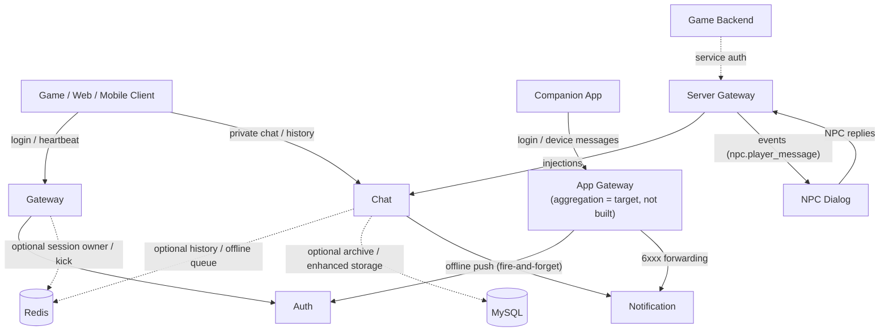

> 🌐 Language: [中文](./CORE.md) | **English** (this page)

# Chirp Core

This page is the condensed source of truth for the current core runtime.

Chirp should currently be understood as a real-time communication backend skeleton for games. The mature path is `gateway + auth + chat`; the rest of the repository is for experimentation, demos, or later productization work.

## Core runtime

| Service | Default port | Status | Responsibility |
| --- | --- | --- | --- |
| Gateway | TCP 5000 / WS 5001 | Supported | Login, logout, heartbeat, session binding; optional Redis backing for cross-instance kick |
| Auth | TCP 6000 | Supported | token verification path; the enhanced auth depends on local libraries and is conditional |
| Chat | TCP 7000 / WS 7001 | Supported | Private chat, groups, history, offline queue; optional Redis/MySQL enhancement paths |
| Server Gateway | TCP 8100 | Experimental | Trusted service-plane hub: the game backend authenticates with `service_id` + secret, injects system/NPC messages, and receives events queued until acked |
| NPC Dialog | no listener | Experimental | server plane client: replies to `npc.player_message` events using keyword rules and injects the replies back into chat (see [server_plane.md](./server_plane.md)) |
| Search | TCP 5007 | Supported | message search: SQLite FTS5 index, 2248/2249 composite cursor pagination; both SDK gateways with `--search_host` (default 5007) forward, degrading without a kick |
| Notification | TCP 5006 / WS 5016 | Experimental | device registry and push face (6xxx); provider delivery logs by default (`--push_transport logging`), `--push_transport http` enables real HTTP(S) provider POST (`HttpPushTransport`, https endpoints verify TLS 1.2+ certificates; the official APNs endpoint requires HTTP/2, so production deployments need a protocol conversion in front) |
| App Gateway | TCP 5200 / WS 5201 | Experimental | companion app edge: login/heartbeat/session binding, plus device message forwarding to Notification (authenticated sessions only). Today it is only the connection skeleton——the goal is the **player aggregation plane**: one player identity associated with multiple games (cross-game channel subscription, aggregated in-game chat, cross-game voice teaming); see "Game-facing plane vs player aggregation plane" in [architecture.md](./architecture.md) |

Minimum viable topology:



## Current contract

- Login, logout, heartbeat, and session-level verification go through `gateway`.
- Private chat and history go directly through `chat`.
- Once the SDK gateway is configured with `--chat_host`, it forwards client 2xxx business packets frame by frame to chat over a per-client `ServiceBridge` pipe (chat re-runs login authentication on its side; if the chat bridge drops, the client is kicked off per the existing semantics). 2248 is intercepted before the 2xxx catch-all: with `--search_host` (default 5007) configured, it forwards to the search service; a failed search bridge degrades back to `SERVER_UNAVAILABLE` without kicking the client, and without `--search_host` configured it falls back to the chat catch-all.
- social (3xxx) / voice (4xxx) are not on the forwarding path; without `--chat_host` configured, 2xxx is not forwarded. Gateway login and chat-side authentication are two independent gates.
- The game plane (game plane) and the app plane (app plane) are two independent systems: each has its own chat (`game_chat` / `app_chat`, the same binary, deployed separately) and its own edge. The game plane is self-contained: the game backend issues tokens and `game_chat` verifies them locally (`--token_secret`), with no dependency on external auth. The app plane has its own auth (`app_auth`). Cross-plane communication is a built-in chat capability: `game_chat` registers into `app_chat` using the native peer registration protocol (with whitelist and version negotiation)——see [architecture.md](./architecture.md).
- Redis and MySQL paths are always treated as optional enhancements unless a deployment explicitly enables them.

## Protocol

TCP streams and WebSocket binary frames carry the same application payload:

```text
[uint32_be payload_size][chirp.gateway.Packet protobuf bytes]
```

`chirp.gateway.Packet` is the business envelope:

```protobuf
message Packet {
  MsgID msg_id = 1;
  int64 sequence = 2;   // request pairing within a connection
  bytes body = 3;
  int64 request_id = 4; // distributed correlation id; 0 = not provided, both ends fall back to a monotonically increasing per-connection value, and the forwarding chain passes it through unchanged
}
```

`sequence` is responsible for request/reply pairing; `request_id` is responsible for log correlation across planes and across services; the two are independent of each other (generation and pass-through rules are in [API overview](./api/overview.md)).

Key mappings:

| Packet `msg_id` | Packet `body` |
| --- | --- |
| `LOGIN_REQ` | `chirp.auth.LoginRequest` (login request) |
| `LOGIN_RESP` | `chirp.auth.LoginResponse` (login response) |
| `HEARTBEAT_PING` | `chirp.gateway.HeartbeatPing` (heartbeat request) |
| `HEARTBEAT_PONG` | `chirp.gateway.HeartbeatPong` (heartbeat response) |
| `SEND_MESSAGE_REQ` | `chirp.chat.SendMessageRequest` (send message request) |
| `SEND_MESSAGE_RESP` | `chirp.chat.SendMessageResponse` (send message response) |
| `GET_HISTORY_REQ` | `chirp.chat.GetHistoryRequest` (fetch history request) |
| `GET_HISTORY_RESP` | `chirp.chat.GetHistoryResponse` (fetch history response) |
| `CHAT_MESSAGE_NOTIFY` | `chirp.chat.ChatMessage` (chat message notification) |
| `MARK_READ_REQ` | `chirp.chat.MarkReadRequest` (mark read request) |
| `MARK_READ_RESP` | `chirp.chat.MarkReadResponse` (mark read response) |
| `GET_READ_RECEIPTS_REQ` | `chirp.chat.GetReadReceiptsRequest` (read receipt query request) |
| `GET_READ_RECEIPTS_RESP` | `chirp.chat.GetReadReceiptsResponse` (read receipt query response) |
| `GET_UNREAD_COUNT_REQ` | `chirp.chat.GetUnreadCountRequest` (unread count query request) |
| `GET_UNREAD_COUNT_RESP` | `chirp.chat.GetUnreadCountResponse` (unread count query response) |
| `MESSAGE_READ_NOTIFY` | `chirp.chat.MessageReadNotify` (read notification) |
| `TYPING_INDICATOR_NOTIFY` | `chirp.chat.TypingIndicator` (typing notification) |
| `GET_TYPING_USERS_REQ` | `chirp.chat.GetTypingUsersRequest` (typing users query request) |
| `GET_TYPING_USERS_RESP` | `chirp.chat.GetTypingUsersResponse` (typing users query response) |
| `ADD_REACTION_REQ` | `chirp.chat.AddReactionRequest` (add reaction request) |
| `ADD_REACTION_RESP` | `chirp.chat.AddReactionResponse` (add reaction response) |
| `REMOVE_REACTION_REQ` | `chirp.chat.RemoveReactionRequest` (remove reaction request) |
| `REMOVE_REACTION_RESP` | `chirp.chat.RemoveReactionResponse` (remove reaction response) |
| `GET_REACTIONS_REQ` | `chirp.chat.GetReactionsRequest` (reaction query request) |
| `GET_REACTIONS_RESP` | `chirp.chat.GetReactionsResponse` (reaction query response) |
| `REACTION_ADDED_NOTIFY` | `chirp.chat.ReactionAddedNotify` (reaction added notification) |
| `REACTION_REMOVED_NOTIFY` | `chirp.chat.ReactionRemovedNotify` (reaction removed notification) |
| `EDIT_MESSAGE_REQ` | `chirp.chat.EditMessageRequest` (edit message request) |
| `EDIT_MESSAGE_RESP` | `chirp.chat.EditMessageResponse` (edit message response) |
| `DELETE_MESSAGE_REQ` | `chirp.chat.DeleteMessageRequest` (delete message request) |
| `DELETE_MESSAGE_RESP` | `chirp.chat.DeleteMessageResponse` (delete message response) |
| `BULK_DELETE_REQ` | `chirp.chat.BulkDeleteRequest` (bulk delete request) |
| `BULK_DELETE_RESP` | `chirp.chat.BulkDeleteResponse` (bulk delete response) |
| `MESSAGE_EDITED_NOTIFY` | `chirp.chat.MessageEditedNotify` (message edited notification) |
| `MESSAGE_DELETED_NOTIFY` | `chirp.chat.MessageDeletedNotify` (message deleted notification) |
| `GET_MENTION_SUGGESTIONS_REQ` | `chirp.chat.GetMentionSuggestionsRequest` (@ mention suggestion query request) |
| `GET_MENTION_SUGGESTIONS_RESP` | `chirp.chat.GetMentionSuggestionsResponse` (@ mention suggestion query response) |

Note: `TYPING_INDICATOR_NOTIFY` has only the one client-inbound usage (the server does not reply on that
connection; it broadcasts to the other members of the channel instead); all server-pushed
typing/reaction/read/edit/delete notifications use sequence `0`. Messages carry a default 15-minute
edit window and soft delete; administrator privileges come from group roles (MODERATOR and above).
@everyone/@here mentions share a per-user, per-channel cooldown and are rejected with
`AUTH_FAILED` during the cooldown.

Direct-entry rate limiting: `chirp_chat` counts login attempts per client IP and verified sends
per user over a 60-second fixed window (30 per minute by default, 120 per minute by default), with
the window data held in Redis. Any Redis failure lets traffic through (fail-open; without
`--redis_host` configured the limiter is not enabled at all); when rejected, the reply is
`RATE_LIMITED` (`common.ErrorCode = 8`). The thresholds are configurable via
`--login_rate_limit_per_min` / `--send_rate_limit_per_min`.

Direct-login token: without `--token_secret` configured, `chirp_chat` (identical in the basic and
distributed builds) keeps the scaffold-style login (the token field is used directly as the user id).
Once the shared secret is configured, the token must be an HS256 JWT signed with that secret, must
carry an `exp` claim, and the logged-in user goes in `sub`; verification happens locally in chat
(the JWT helpers in `libs/common`), and expired / bad-signature / missing-claim tokens are all
rejected with `AUTH_FAILED`. Login semantics were aligned in 2026-09: auth-enhanced enforces the
same HS256 contract for `LOGIN_REQ` under `--jwt_secret`——the deployment convention is to hand auth
and the edge service the same secret, and the client's raw token is passed through the
gateway → chat pipe unchanged (`--smoke-jwt` covers this end to end). The auth scaffold fallback
requires `--allow_scaffold_login 1` (off by default). Revocation is still bounded by TTL——the
(Redis-based revocation) hybrid variant is deferred to P3 (TODO.md); the gateway login path via the
`AuthClient` RPC is unchanged.

### Server plane (Server plane, 5xxx)

`chirp_game_server_gateway` (TCP 8100) speaks the same Packet framing on a different trust face:
peers are the game backend and internal services, authenticated with `service_id` + secret——never
user accounts. The full contract is in [Server Plane](./server_plane.md).

| Packet `msg_id` | Packet `body` |
| --- | --- |
| `SERVER_AUTH_REQ` | `chirp.game_server_gateway.ServerAuthRequest` (service auth request) |
| `SERVER_AUTH_RESP` | `chirp.game_server_gateway.ServerAuthResponse` (service auth response) |
| `SERVER_HEARTBEAT_PING` / `PONG` | `chirp.game_server_gateway.ServerHeartbeatPing` / `Pong` (service heartbeat request/response) |
| `INJECT_MESSAGE_REQ` | `chirp.game_server_gateway.MessageInjectRequest` (message injection request) |
| `INJECT_MESSAGE_RESP` | `chirp.game_server_gateway.MessageInjectResponse` (message injection response) |
| `INJECT_MESSAGE_NOTIFY` | `chirp.game_server_gateway.InjectMessageNotify` (injection notification, hub -> chat) |
| `EVENT_PUBLISH_REQ` | `chirp.game_server_gateway.EventPublishRequest` (event publish request) |
| `EVENT_PUBLISH_RESP` | `chirp.game_server_gateway.EventPublishResponse` (event publish response) |
| `EVENT_DELIVER_NOTIFY` | `chirp.game_server_gateway.EventDeliverNotify` (event delivery notification, hub -> target service) |
| `EVENT_ACK_REQ` / `RESP` | `chirp.game_server_gateway.EventAckRequest` / `Response` (event ack request/response) |

Status: Experimental——the handlers and the chat-side consumption of `INJECT_MESSAGE_NOTIFY` are
covered by unit tests, and the NPC loop additionally has a process-level E2E smoke
(`./test_services.sh --smoke-npc`). Events are at-least-once: they queue while the target is
offline and are re-delivered on reconnect until acked.

### Notification / device face (6xxx)

`chirp_app_notification` (TCP 5006 / WS 5016) owns the device registry and push dispatch.
`chirp_app_sdk_gateway` (TCP 5200 / WS 5201) forwards these messages for authenticated app
sessions, with `user_id` pinned to the session owner.

| Packet `msg_id` | Packet `body` |
| --- | --- |
| `REGISTER_DEVICE_REQ` / `RESP` | `chirp.app_notification.RegisterDeviceRequest` / `RegisterDeviceResponse` (device registration request/response) |
| `UNREGISTER_DEVICE_REQ` / `RESP` | `chirp.app_notification.UnregisterDeviceRequest` / `UnregisterDeviceResponse` (device unregistration request/response) |
| `UPDATE_DEVICE_TOKEN_REQ` / `RESP` | `chirp.app_notification.UpdateDeviceTokenRequest` / `UpdateDeviceTokenResponse` (push token update request/response) |
| `GET_USER_DEVICES_REQ` / `RESP` | `chirp.app_notification.GetUserDevicesRequest` / `GetUserDevicesResponse` (user device list query request/response) |
| `PUSH_NOTIFICATION_REQ` / `RESP` | `chirp.app_notification.PushNotificationRequest` / `PushNotificationResponse` (push request/response) |

IDs 6011+ are reserved (badge / silent / preferences). Provider HTTP delivery (APNs HTTP/2 /
FCM HTTP) sits behind the `PushTransport` seam, with the logging transport by default and
`--push_transport http` switching to real HTTP(S) delivery; all three chat main builds (default /
distributed / MySQL-enhanced) enqueue pushes for offline messages through this face.

## Local verification

```bash
./gen_proto.sh
cmake --preset dev
cmake --build --preset dev
ctest --preset dev
```

Line coverage (rebuilds `build-cov`, runs the full suites, and fails if any package is below 100%
except for registered exemptions):

```bash
scripts/run_coverage.sh
```

Smoke tests:

```bash
./test_services.sh --smoke
./test_services.sh --smoke-chat
./test_services.sh --smoke-sdk
./test_services.sh --smoke-npc
./test_services.sh --smoke-edge
./test_services.sh --smoke-jwt
./test_services.sh --smoke-redis
./test_services.sh --smoke-game
./test_services.sh --smoke-voice
./test_services.sh --smoke-party
```

With Docker Compose:

```bash
docker compose up --build
```

On the first verification pass, watching `redis`, `auth`, `gateway`, and `chat` is enough.

## Non-core areas

The code for these areas is in the repository, but do not present them as stable core capability
until you have checked the current code and tests:

- `services/social` (social)
- `services/voice` (voice)
- `services/app/notification` (notification)
- `services/game/server_gateway` (the protocol is unit-test verified, including chat-side injection consumption; the NPC dialogue loop has a process-level smoke)
- `sdks/core`, `sdks/unity`, `sdks/unreal` (per-end SDKs)
- `apps/android` / `apps/ios` (native mobile protocol core; as of 2026-09-29 these replace the removed Flutter app `apps/mobile_companion`)
- `apps/admin_dashboard` (admin dashboard)
- NPC dialogue system design (the keyword-rule service scope implemented in `services/game/npc_dialog` is narrower; the design note describes the fuller vision)
- The alternative target and scalability examples for distributed chat

The current state is in the [capability matrix](./CAPABILITY_MATRIX.md).

## Detail pages

- [Getting Started guide](./guide/getting-started.md)
- [API overview](./api/overview.md)
- [Overall architecture](./architecture.md)
- [Capability matrix](./CAPABILITY_MATRIX.md)
