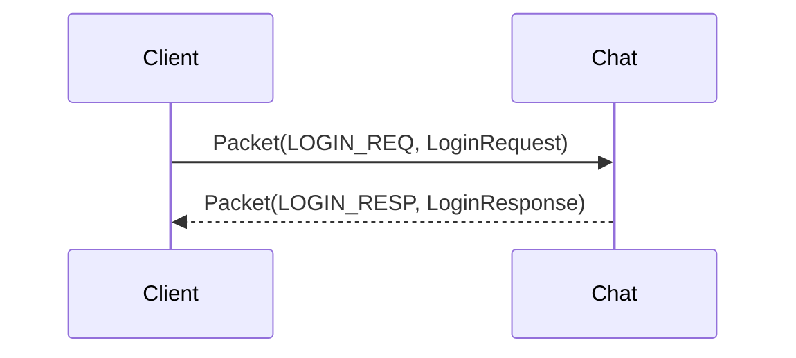
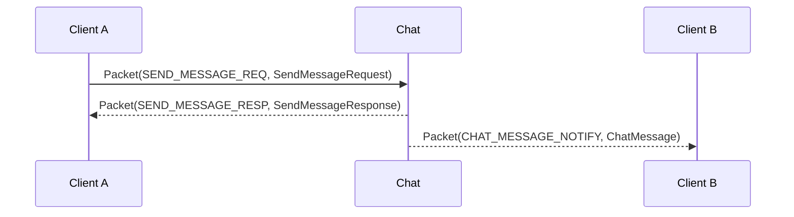

> 🌐 Language: [中文](./overview.md) | **English** (this page)

# API Overview

Chirp runs Protocol Buffers over TCP or WebSocket. The currently supported protocol surface is built around `chirp.gateway.Packet`.

For implementation status see the [capability matrix](../CAPABILITY_MATRIX.en.md). Some proto messages exist for roadmap or experimental services — do not assume they are covered by the default runtime.

Before integrating, read the [integration pitfalls guide](../guide/integration-pitfalls.en.md) — server-side defenses such as send cadence, message length, repeat-mute and sensitive words all reject with dedicated codes, and raw-protocol integrators are most likely to trip on exactly these.

## Packet format

TCP and WebSocket carry the same application payload:

```
TCP stream:
  [uint32_be payload_size][chirp.gateway.Packet protobuf bytes]

WebSocket binary frame payload:
  [uint32_be payload_size][chirp.gateway.Packet protobuf bytes]
```

`payload_size` is the byte length of the serialized `chirp.gateway.Packet`.

`MsgID` is not a standalone network frame header; it lives inside `Packet`:

```protobuf
message Packet {
  MsgID msg_id = 1;
  int64 sequence = 2;
  bytes body = 3;
  int64 request_id = 4;  // distributed correlation id, 0 = not provided (see below)
}
```

`body` carries the serialized protobuf message selected by `msg_id`.

`sequence` and `request_id` have separated semantics (see §4.3 of the [Communication Core design note](../design-notes/communication_core.en.md)):

- `sequence`: a monotonic sequence number within a connection, the local correlation key for request-response pairing. Responses and notifications come back with the same value as the request, and the client uses it to match `RESP`/`NOTIFY` back to the request. **0 = server-initiated (kicks, notifications), pairing not required**.
- `request_id`: a distributed correlation id for cross-plane / cross-service log tracing, unrelated to pairing. **0 = not provided by the caller** — the default generation is filled in across the chain: the gateway's `ServiceBridge` falls back to "generated within the connection" (monotonically increasing) for client outbound 2xxx packets and service-plane outbound packets; the chat direct entry point (bare-protocol clients) falls back to a process-level monotonic value; the peer surface (`ChatPeerHub`/`ChatPeerLink`) generates monotonically within each of its own connections on outbound (both directions, hub→spoke and spoke→hub); the SDK send side (`MakePacket` in `sdks/core`, `rawSend` in `sdks/ts` and `apps/shared/protocol`) generates it automatically. Explicitly supplied values are passed through verbatim along the forwarding chain and never rewritten; the gateway does not rewrite a `request_id` the client already carries, and SDKs / integrators may bring their own correlation key (such as a game-server request ticket).

Mapping example:

| The Packet's `msg_id` | The Packet's `body` protobuf |
| --- | --- |
| `LOGIN_REQ` | `chirp.auth.LoginRequest` (login request) |
| `LOGIN_RESP` | `chirp.auth.LoginResponse` (login response) |
| `HEARTBEAT_PING` | `chirp.gateway.HeartbeatPing` (heartbeat request) |
| `HEARTBEAT_PONG` | `chirp.gateway.HeartbeatPong` (heartbeat response) |
| `SEND_MESSAGE_REQ` | `chirp.chat.SendMessageRequest` (send-message request) |
| `SEND_MESSAGE_RESP` | `chirp.chat.SendMessageResponse` (send-message response) |
| `GET_HISTORY_REQ` | `chirp.chat.GetHistoryRequest` (fetch-history request) |
| `GET_HISTORY_RESP` | `chirp.chat.GetHistoryResponse` (fetch-history response) |
| `CHAT_MESSAGE_NOTIFY` | `chirp.chat.ChatMessage` (chat-message notification) |

## Current endpoints

Services are organized by game plane / App plane, and the binary names carry a plane prefix (see the binary-naming convention section of the [capability matrix](../CAPABILITY_MATRIX.en.md) for the complete mapping).

### Game plane (game clients / game backends integrate here)

| Service | Binary | TCP | WebSocket | Status | Notes |
| --- | --- | --- | --- | --- | --- |
| Game SDK Gateway | `chirp_game_sdk_gateway` | 5000 | 5001 | Supported | Login, heartbeat, kick-out, session claim; 2xxx chat packets are forwarded to game_chat via ServiceBridge |
| Game Chat | `chirp_chat` (built from `services/shared/chat`, the deployment role is distinguished by startup arguments) | 7000 | 7001 | Supported | The chat server; the game backend issues tokens and chat verifies signatures locally with `--token_secret`, a self-contained loop |
| Game Server Gateway | `chirp_game_server_gateway` | 8100 | - | Supported | The game backend's injection hub: message injection + event delivery, `service_id` + secret trust gate |
| Chat Peer port | (game_chat's `--hub_peer_port`) | 8200 | - | Supported | The outbound target for game_chat registering as a spoke to the app_chat hub; see the [peer protocol](./peer_protocol.en.md) |

### App plane (companion App / platform side)

| Service | Binary | TCP | WebSocket | Status | Notes |
| --- | --- | --- | --- | --- | --- |
| App SDK Gateway | `chirp_app_sdk_gateway` | 5200 | 5201 | Supported | Auth/heartbeat + 6xxx device-message forwarding; 2xxx forwarded to app_chat |
| App Chat (hub) | `chirp_chat` (same `services/shared/chat` build, the deployment role is distinguished by startup arguments) | 7000 | 7001 | Supported | The App-plane chat hub: peer registration, identity mapping, channel subscription, cross-plane fan-out/replies, unread ledger |
| App Auth | `chirp_app_auth` | 6000 | - | Supported | App-plane accounts/tokens; the game plane does not depend on it |
| App Notification | `chirp_app_notification` | 5006 | 5016 | Supported | Device registry + push surface (6xxx); `--push_transport http` enables real APNs/FCM HTTP delivery, the default `logging` only writes logs; optional `--service_secret` shared-secret caller handshake |

### Experimental services

| Service | TCP | WebSocket | Status |
| --- | --- | --- | --- |
| Social | 8000 | 8001 | Experimental (friends/presence/blacklist, not on the minimal validation path) |
| Voice | 9000 | 9001 | Experimental (a signaling surface exists but does not yet constitute a complete media backend guarantee) |
| Party | 7500 | 7501 | Experimental (party snapshot surface `chirp_party`, invite-based joining) |
| Search | 5007 | - | Supported (SQLite FTS5 index, per-client pipe via the gateway, 2248/2249, degrades without kicking) |

Per the framing in [Communication Core](../design-notes/communication_core.en.md), social/voice/search are application/plugin surfaces outside Communication and are not on the core validation path.

## Pipe classification

Connections fall into three classes by trust surface, and credential verification, rate limiting and logging all branch on the class (see §4.4 of the [Communication Core design note](../design-notes/communication_core.en.md) for the concept convergence):

| Pipe | Connection | Credential | Carries |
| --- | --- | --- | --- |
| Client Pipe | Client → gateway (the 5000/5200 family) | user token / session | Login, heartbeat, 2xxx forwarding |
| Service Pipe | Game server → server_gateway (8100) | service_id + secret | Injection, events, player-directory RPCs (5013-5030 live on the app_chat main port) |
| Peer Pipe | game_chat ⇄ app_chat, chat ⇄ chat | allowlist + version negotiation | Cross-plane registration/uplink/injection (5050-5053) |

**Gateway = Transport Edge**: the gateway owns connection management, login/logout, heartbeat, kicks, rate limiting, protocol adaptation and forwarding; it does not take on Chat/Social/NPC business routing. "Chat packets go to chat" is a boundary constraint, not a gap waiting to be filled — the gateway will never evolve into a business routing hub.

## Core message IDs

### Gateway and auth (Gateway/Auth, 1xxx)

| MsgID | Name | Direction | Current status |
| --- | --- | --- | --- |
| 1001 | `HEARTBEAT_PING` | client -> Gateway/Chat | Supported |
| 1002 | `HEARTBEAT_PONG` | Gateway/Chat -> client | Supported |
| 1003 | `LOGIN_REQ` | client -> Gateway/Chat | Supported |
| 1004 | `LOGIN_RESP` | Gateway/Chat -> client | Supported |
| 1005 | `KICK_NOTIFY` | Gateway/Chat -> client | Supported (same-platform re-login tops off the previous session) |
| 1006 / 1007 | `LOGOUT_REQ` / `LOGOUT_RESP` | client <-> service | Supported |
| 1008-1019 | Register / password login / refresh token / session management / change password | client <-> Auth | Supported on the App-plane auth surface (requires the enhanced MySQL form `chirp_app_auth_enhanced`; the basic form only has LOGIN/LOGOUT); the game plane does not use this group |
| 1020 | `DEVICES_PRESENCE_NOTIFY` | server -> client | Multi-device presence roster change (body `auth.DevicesPresenceNotify`, aligned with `KICK_NOTIFY` semantics: sequence 0, read-only, no ACK required) |

Both planes accept `LOGIN_REQ`; the game plane's token is issued by the game backend as an HS256 JWT and chat verifies it locally with `--token_secret`.

### Chat (Chat, 2xxx)

The send path passes through a set of server-side defenses in a fixed order on the server (for details and default thresholds see the [integration pitfalls guide](../guide/integration-pitfalls.en.md)): login check → content length (`CONTENT_TOO_LONG`) → world channel level threshold (`LEVEL_REQUIRED`, `--world_channel_min_level` defaults to 0 = off) → fuzzy rate limit (`RATE_LIMITED`) → send cadence (`RATE_LIMITED`) → repeat message mute (`RATE_LIMITED`) → sensitive words (`WORD_FILTERED` or silent replacement) → group channel gate (channels hit by the group ledger: non-members get `AUTH_FAILED`, muted members get `MUTED`; channels outside the ledger do not pass through this gate).

| MsgID | Name | Direction | Notes |
| --- | --- | --- | --- |
| 2001 / 2002 | `SEND_MESSAGE_REQ` / `RESP` | client -> Chat | Send a message; the `RESP` carries the server-side `message_id` and the business code |
| 2003 / 2004 | `GET_HISTORY_REQ` / `RESP` | client -> Chat | Fetch channel history |
| 2005 | `CHAT_MESSAGE_NOTIFY` | Chat -> client | Real-time message push |
| 2101-2116 | The full group set | client <-> Chat | Create/join/leave/invite/kick/query + group event notifies (2117-2121) |
| 2122-2124 | Group nickname alias | client <-> Chat | `SET_MEMBER_ALIAS_REQ/RESP` + `GROUP_MEMBER_ALIAS_UPDATED_NOTIFY`; set another member's alias as yourself or MODERATOR+; the alias ships in `GroupMember.alias` and is consumed in two places: the member list and the message sender name |
| 2250-2252 | Group moderator mute | client <-> Chat | `SET_GROUP_MUTE_REQ/RESP` + `GROUP_MEMBER_MUTED_NOTIFY`; MODERATOR+ mutes/unmutes members of this group (seconds, 0 = unmute, cap 30 days); a muted member's group-channel send is rejected with `MUTED`, and the mute state ships in `GroupMember.muted_until_ts` |
| 2253-2254 | Report | client <-> Chat | `REPORT_MESSAGE_REQ/RESP`; a player reports a message, the in-memory ledger is deduplicated idempotently by (message_id, reporter_id) and accumulates `report_count` after dedup; the reported message must be in this instance's edit ledger (same `USER_NOT_FOUND` semantics as a recall outside the ledger); the reason is optional with a 500 code-point cap, over-cap/empty message_id returns `INVALID_PARAM`, not-logged-in returns `AUTH_FAILED` |
| 2255-2258 | Anti-harassment DM restriction | client <-> Chat | `SET/GET_DM_RESTRICTION_REQ/RESP`; a receiver-side switch (off by default, in-memory state on the io thread, reset on process restart), once on, DMs from strangers are rejected with `DM_RESTRICTED` (the message is not stored anywhere); a stranger = not a friend in the social plane's friend snapshot (`chirp:social:friends:<receiver>`) and no shared group; friends / same-group / yourself / NPC receivers are exempt; a missing Redis tightens to "not a friend" (only the shared-group half still takes effect); not-logged-in returns `AUTH_FAILED`, a corrupt body returns `INVALID_PARAM` |
| 2201 / 2202 | `MARK_READ_REQ` / `RESP` | client -> Chat | Mark as read (server-side cursor) |
| 2203 / 2204 | `GET_READ_RECEIPTS_REQ` / `RESP` | client -> Chat | Query message read receipts |
| 2205 / 2206 | `GET_UNREAD_COUNT_REQ` / `RESP` | client -> Chat | Unread counts |
| 2207 | `MESSAGE_READ_NOTIFY` | Chat -> client | Read-event push |
| 2208 | `TYPING_INDICATOR_NOTIFY` | client <-> Chat | Typing (a bare notify, no response) |
| 2209 / 2210 | `MESSAGE_ACK` / `MESSAGE_NACK` | client <-> Chat | Delivery ack/nack (same family as `TRACK_MESSAGE` 2211/2212) 
| 2213 / 2214 | `GET_HISTORY_V2_REQ` / `GET_HISTORY_V2_RESP` | client -> Chat | Enhanced history v2 |
| 2211 / 2212 | `TRACK_MESSAGE_REQ` / `RESP` | client -> Chat | Delivery tracking |
| 2215-2222 | The full reaction set | client <-> Chat | Add/remove/query + add/remove notifies |
| 2223 / 2224 | `GET_TYPING_USERS_REQ` / `RESP` | client -> Chat | Who is typing |
| 2225-2232 | The full edit/delete set | client <-> Chat | Edit, delete, bulk delete + event notifies; `DELETE` (`is_hard_delete=false`) on one's own message is a **recall** (a soft delete inside the default 120-second window for private chat/guild; out-of-window / non-recall channel / repeat recall returns `INVALID_PARAM`), and a moderator delete is not bound by the window |
| 2233 / 2234 | `GET_MENTION_SUGGESTIONS_REQ` / `RESP` | client -> Chat | @mention candidates |
| 2235-2238 | Channel block (do not disturb) | client <-> Chat | `SET_CHANNEL_MUTE` / `GET_CHANNEL_MUTES`; only WORLD/GUILD/TEAM can be blocked |
| 2239-2244 | Message sender blocklist | client <-> Chat | `BLOCK/UNBLOCK_MESSAGE_SENDER`, `GET_BLOCKED_SENDERS`; acts only on message delivery and is fully independent of the social-plane 3011 blocklist |
| 2245-2247 | Word-list push | client <-> Chat | `WORD_FILTER_FETCH` conditional GET + `WORD_FILTER_UPDATE_NOTIFY` hot update; bodies see chat.proto `WordFilter*` |
| 2248 / 2249 | Server-side message search | client <-> search | `SEARCH_MESSAGE_REQ` / `RESP`; forwarded via the gateway's per-client pipe to `chirp_search` (5007), a SQLite FTS5 index with composite-cursor pagination; the decision record is in [design-notes/message_search](../design-notes/message_search.en.md) |

For clients integrating through `chirp_game_sdk_gateway` / `chirp_app_sdk_gateway`, 2xxx messages are forwarded by ServiceBridge (formerly ChatBridge, renamed when search was wired in) by destination: business packets go to the matching chat instance, 2248 goes to the search instance (accessed via `--search_host`; a search-bridge failure degrades without kicking the client), with semantics identical to a direct connection; the game plane's cross-plane interception (content prefix) and defense thresholds take effect the same way.

### Social / voice / experimental surfaces (3xxx/4xxx)

3001-3029 (social: friends/blacklist/presence/come-online notifications) and 4001+ (voice rooms) are provided by experimental services and are not on a supported path; check the [capability matrix](../CAPABILITY_MATRIX.en.md) before integrating.

| MsgID | Name | Direction | Semantics |
| --- | --- | --- | --- |
| 3025 / 3026 | `SET_NOTIFY_PREFS_REQ` / `RESP` | client <-> Social | Friend come-online notification switch (stored per user, all-on by default); the `prefs` submessage is mandatory, missing returns `INVALID_PARAM` |
| 3027 / 3028 | `GET_NOTIFY_PREFS_REQ` / `RESP` | client <-> Social | Read the switch; returns all-on when there is no record |
| 3029 | `FRIEND_ONLINE_NOTIFY` | Social -> client | An explicit come-online notification when a friend transitions from OFFLINE to a non-OFFLINE state (the body reuses `PresenceNotify`), filtered per recipient by the 3025 switch; the roster `PRESENCE_NOTIFY` (3021) is not affected by the switch and fires on all three paths: login, SET_PRESENCE, and game assertions |

### Service plane (Server plane, 5xxx)

`chirp_game_server_gateway` (TCP 8100) uses the same Packet framing on a different trust surface. Peers are game backends and internal services, authenticated with `service_id` + a shared secret — never a user account.

| MsgID | Name | Direction |
| --- | --- | --- |
| 5001 / 5002 | `SERVER_AUTH_REQ` / `SERVER_AUTH_RESP` | service <-> hub |
| 5003 / 5004 | `SERVER_HEARTBEAT_PING` / `PONG` | service <-> hub |
| 5005 / 5006 / 5007 | `INJECT_MESSAGE_REQ` / `RESP` / `NOTIFY` | service -> hub; the NOTIFY is forwarded to chat |
| 5008 / 5009 | `EVENT_PUBLISH_REQ` / `RESP` | service -> hub |
| 5010 | `EVENT_DELIVER_NOTIFY` | hub -> target service |
| 5011 / 5012 | `EVENT_ACK_REQ` / `RESP` | service <-> hub |
| 5013-5030 | Player identity binding / channel subscription / unread ledger | service <-> the app_chat main port (moved out of server_gateway, so mind the port you dial) |
| 5031-5034 | Game presence switch (`SET_GAME_PRESENCE_ENABLED` / `GET_GAME_PRESENCE`) | service <-> the app_chat main port (same chain as 5013-5030, distributed via the app gateway edge) |
| 5050 / 5051 | `PEER_REGISTER_REQ` / `RESP` | game_chat (spoke) -> app_chat (hub) |
| 5052 | `CHANNEL_MESSAGE_NOTIFY` | spoke -> hub channel-message uplink |
| 5053 | `PEER_INJECT_MESSAGE_NOTIFY` | hub -> spoke cross-plane reply injection |

Status: the 5xxx contract is Supported; the 5013-5030 responses land on the **app_chat main port** (TCP 7000), not on 8100. The full contract (dial-out, at-least-once event delivery, injection validation, peer protocol) is in [Server plane](../server_plane.en.md) and the [peer protocol](./peer_protocol.en.md); the complete msg-id to body mapping is in the [core doc](../CORE.en.md).

### Notification / device plane (6xxx)

Served by `chirp_app_notification` (TCP 5006 / WS 5016), forwarded via `chirp_app_sdk_gateway` (TCP 5200 / WS 5201). Bodies are `chirp.app_notification.*` messages.

| MsgID | Name | Body |
| --- | --- | --- |
| 6001 / 6002 | `REGISTER_DEVICE_REQ` / `RESP` | `RegisterDeviceRequest` / `RegisterDeviceResponse` (device registration request/response) |
| 6003 / 6004 | `UNREGISTER_DEVICE_REQ` / `RESP` | `UnregisterDeviceRequest` / `UnregisterDeviceResponse` (device deregistration request/response) |
| 6005 / 6006 | `UPDATE_DEVICE_TOKEN_REQ` / `RESP` | `UpdateDeviceTokenRequest` / `UpdateDeviceTokenResponse` (push token update request/response) |
| 6007 / 6008 | `GET_USER_DEVICES_REQ` / `RESP` | `GetUserDevicesRequest` / `GetUserDevicesResponse` (user device list query request/response) |
| 6009 / 6010 | `PUSH_NOTIFICATION_REQ` / `RESP` | `PushNotificationRequest` / `PushNotificationResponse` (push request/response) |

The IDs from 6011 onward are reserved (badges / silent mode / preferences) and are not yet implemented.

Authentication rules:

- On `app_sdk_gateway`, 6xxx device messages require an authenticated session (otherwise `AUTH_FAILED`), and `user_id` is always rewritten to the authenticated user — a client cannot register or query devices on someone else's behalf. `UPDATE_DEVICE_TOKEN_REQ` addresses the device by `device_id` and has no `user_id` field, but likewise requires authentication.
- A direct connection to `app_notification` has no session concept; it faces internal services on trusted networks (such as chat's push bridge). With `--service_secret` configured, direct callers must also complete the `SERVER_AUTH_REQ`/`SERVER_AUTH_RESP` shared-secret handshake first — a mismatched secret gets `AUTH_FAILED` and the connection closed; with none set the plane stays open.
- Real provider delivery: `--push_transport http` delivers to FCM/APNs over HTTP(S) (endpoints `--fcm-endpoint` / `--apns-endpoint` / `--apns-sandbox`, private CA `--push_ca_file`, debug exemption `--push_verify_tls off`); a device with no token explicitly records a failure and is no longer silently recorded as a success. The default `--push_transport logging` only writes logs. The official APNs endpoint requires HTTP/2, so either front it with protocol conversion or use the provider's HTTP/1.1-compatible API.

### Party (7xxx)

`chirp_party` (7500/7501, Experimental) provides the party snapshot surface: 7001-7027 covers create/join/leave/kick plus PARTY_JOINED/LEFT/KICKED notifies (bodies are `chirp.party.*`), invite-based joining with no join codes; current status in the [capability matrix](../CAPABILITY_MATRIX.md).

## Login flows

### Gateway login (game plane)

```mermaid
sequenceDiagram
    participant C as Client
    participant G as game_sdk_gateway
    participant S as game_chat

    C->>G: Packet(LOGIN_REQ, LoginRequest)
    G-->>C: Packet(LOGIN_RESP, LoginResponse)
    G->>S: ServiceBridge replays LOGIN_REQ (chat verifies the signature locally with token_secret)
    Note over C,G: After login, 2xxx messages are forwarded by ServiceBridge to game_chat; if chat-side signature verification rejects, a KICK follows (chat session rejected)
```

A repeat login with the same `(user_id, platform)` tops off the old session: the old connection receives `KICK_NOTIFY`, and the new connection's `LOGIN_RESP.kick_previous = true`; across platforms, multiple devices coexist and exchange come-online/offline events.

### Direct Chat login



Gateway login and direct Chat login are **two independent session concepts**: the SDK (`sdks/core`) connects to the gateway by default (`gateway_port` default 5000) and uses gateway login, so one login completes both connection and authentication; connecting directly to the chat main port (7000) requires explicitly configuring the port and is an optional path. A self-developed client picks one path — do not stack them.

## Chat message flow



When the receiver is offline, Chat stores the message in the offline queue (an in-memory fallback of 200 per bucket, Redis optional) and returns `TARGET_OFFLINE` in `SEND_MESSAGE_RESP`; the copy is redelivered after the receiver's next login. When chat is started with `--notification_host`, offline messages also trigger one device push through app_notification (fire-and-forget; see the 6xxx section above).

The offline queue is bucketed per device (slot = the normalized login `platform`, a device with an empty platform falls into the shared `default` bucket, and the key shape matches the pre-split user-level queue): at send time, when the receiver has no online client at all, the copy lands in the `default` bucket and whichever client logs in first wins; login-time redelivery pops this device's bucket ∪ the `default` bucket (this slot first); a copy requeued after an ack timeout lands in the device bucket that originally claimed the redelivery, so a redelivery is not intercepted by another device's login. This is purely a server-side routing semantic; the protocol and the client feel nothing.

## Delivery Semantics

The send response code answers only "accepted", not "delivered". The message lifecycle:

```text
Message ──send──► Accepted ──► Persisted ──► (Queued | Delivered) ──► Acknowledged
```

| Semantic | Meaning | Current counterpart |
| --- | --- | --- |
| BEST_EFFORT | Best effort, no delivery guarantee | The offline device push bridge (fire-and-forget); after `TARGET_OFFLINE` is enqueued the only redelivery is at the next login, with no delivery guarantee for the push itself |
| AT_LEAST_ONCE | At least once, redeliver until acknowledged | Service-plane injection: hub ack + Redis Streams PEL replay (NPC/system messages, see [Server plane](../server_plane.en.md)) |
| DURABLE | Persisted, survives a restart | Chat messages are archived to MySQL history (the `messages` table); redelivery and history share the same source |

What the response codes mean: `OK` = accepted by the service plane (possibly already persisted, not necessarily delivered); `TARGET_OFFLINE` = accepted and entered the offline queue; `KICK`/`RATE_LIMITED` and the like = not accepted. Whether the player side really reached Delivered/Acknowledged is answered by offline redelivery and read receipts (`read_receipts`) — two chains independent of the send response code.

Delivery dedup (P1-5): `ChatMessage.delivery_id` is the subject of a single delivery — empty = the first online delivery (identical in meaning to `message_id`); offline-redelivery copies get an independently minted server value; an ack-timeout requeue redelivery **preserves the original value** (redeliveries of the same delivery share one id). Division of labor on the consumer side: the UI dedupes idempotently by `message_id`, the transport layer dedupes by `delivery_id`; read receipts are message-level (subjected to `message_id`) and do not change with the delivery count. **Delivery acks explicitly carry the delivery subject**: `MessageAck.delivery_id` (and `MessageNack.delivery_id`) — when non-empty the server matches the in-flight delivery exactly by delivery subject (several deliveries of the same `message_id` do not interfere with each other); empty = old clients / first-delivery scenario, matching the first delivery by `message_id` for compatibility. The conceptual model's origin: the [Communication Core design note](../design-notes/communication_core.en.md).

Sender kind (the ActorKind convergence): `ChatMessage.sender_kind` (field 12) distinguishes `SENDER_USER` (0, an ordinary player) / `SENDER_SYSTEM` (1) / `SENDER_NPC` (2) / `SENDER_SERVICE` (3), with the value domain aligned to `game_server_gateway.SenderKind`. **Clients cannot forge it**: `SendMessageRequest` has no such field, so a player's send is always USER; non-player identities can only go through service-plane injection (see [Server plane](../server_plane.en.md)), and injection validation rejects UNKNOWN and passes the value through per the contract. The value is faithful across the whole chain: storage (a `messages.sender_kind` column + the Redis mirror), offline redelivery, history dispatch and cross-plane fan-out copies all carry the original value. The BOT and GM identities are not implemented (no producer, and no reserved enum value on the protocol surface).

## WebSocket usage

Use binary frames, do not send JSON.

Pseudocode:

```ts
const loginBody = LoginRequest.encode({
  token: 'player_1',
  deviceId: 'dev_1',
  platform: 'web'
}).finish()

const packet = Packet.encode({
  msgId: MsgID.LOGIN_REQ,
  sequence: 1n,
  body: loginBody
}).finish()

ws.send(concat(uint32be(packet.length), packet))
```

Server responses are WebSocket binary frames too, with the payload prefixed by a 4-byte big-endian length.

## Error codes

The common response-code enum is defined in `proto/common.proto`.

| Code | Name | Meaning |
| --- | --- | --- |
| 0 | `OK` | Success |
| 1 | `INTERNAL_ERROR` | Server error |
| 2 | `INVALID_PARAM` | Invalid request (missing field, illegal channel code, non-blockable channel, etc.) |
| 3 | `AUTH_FAILED` | Authentication failed (not logged in, invalid token) |
| 4 | `SESSION_EXPIRED` | The session has expired |
| 5 | `USER_NOT_FOUND` | The user does not exist |
| 6 | `TARGET_OFFLINE` | The receiver is not online right now (the message has entered the offline queue) |
| 7 | `SERVER_UNAVAILABLE` | The service-plane target service is not connected, or its event queue is full; the same code is used when a cross-plane reply has no online spoke |
| 8 | `RATE_LIMITED` | A rate limit was triggered: login/send fuzzy gate, channel send cadence, repeat-message mute |
| 9 | `VERSION_MISMATCH` | The peer registration protocol version is below the hub's `min_peer_version` |
| 10 | `WORD_FILTERED` | Rejected when the sensitive-word strategy is reject (the replace strategy silently substitutes and then lets it through) |
| 11 | `CONTENT_TOO_LONG` | The content exceeds the channel's code-point cap (private chat 200 / world 100 / system announcement 500) |
| 12 | `MUTED` | The sender is muted in the target group by MODERATOR+ (the group-channel send is rejected; other channels are unaffected) |
| 13 | `LEVEL_REQUIRED` | The declared level (`LoginRequest.level`) is below `--world_channel_min_level`, so the world-channel send is rejected (0 = the threshold is off; other channels are unaffected) |
| 14 | `DM_RESTRICTED` | The receiver has anti-harassment DM restrictions on, so a stranger's direct message is rejected (nothing is stored; the switch is 2255-2258) |

The SDK transport-layer errors (`NotConnected`/`Timeout`/`Closed`/`Kicked`/`BadResponse`) are independent of the table above: `ec == OK` does not mean business success — you must read `resp.code()` as well.

## Related documents

- [Integration pitfalls guide](../guide/integration-pitfalls.en.md) — the thresholds, trigger conditions and client-side responses for the server-side defenses
- [Overall architecture](../architecture.en.md)
- [Capability matrix](../CAPABILITY_MATRIX.en.md)
- [Core doc](../CORE.en.md)
- [Peer registration protocol](./peer_protocol.en.md)