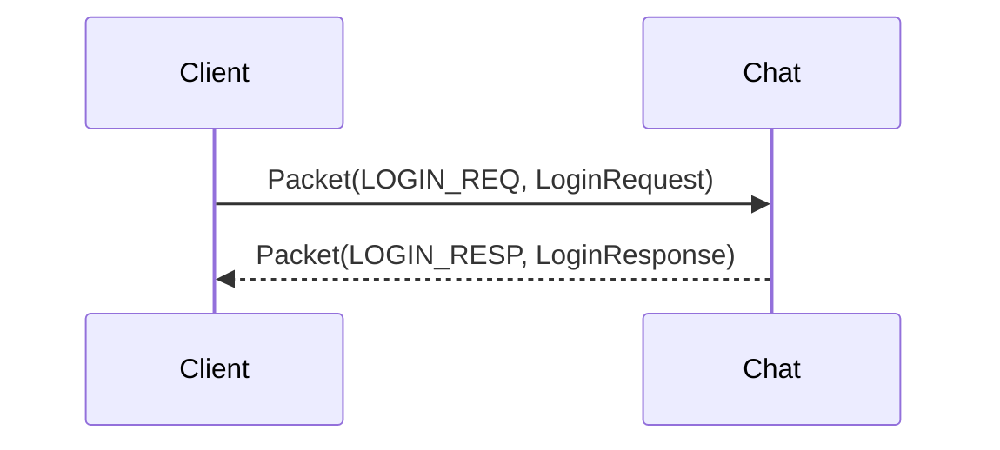
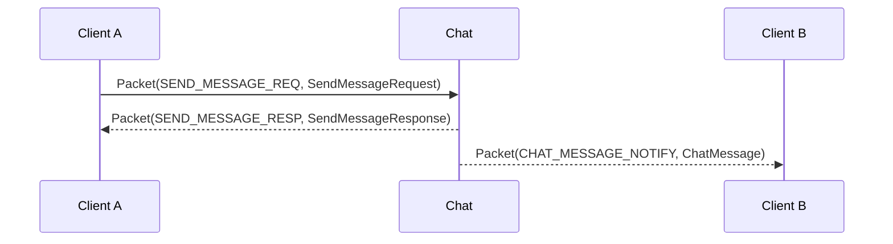

> 🌐 Language: [中文](./overview.md) | **English** (this page)

# API Overview

Chirp runs Protocol Buffers over TCP or WebSocket. The currently supported protocol surface revolves around `chirp.gateway.Packet`.

For implementation status see the [Capability Matrix](../CAPABILITY_MATRIX.en.md). Some proto messages exist for roadmap or experimental services; do not assume they are supported by the default runtime.

Before integrating, read the [Integration Pitfall Guide](../guide/integration-pitfalls.en.md) first — server-side defenses such as send pacing, message length, repeat-mute and banned words reject with dedicated codes, and these are exactly where raw-protocol integrators stumble.

## Packet format

TCP and WebSocket carry the same application payload:

```
TCP stream:
  [uint32_be payload_size][chirp.gateway.Packet protobuf bytes]

WebSocket binary frame payload:
  [uint32_be payload_size][chirp.gateway.Packet protobuf bytes]
```

`payload_size` is the byte count of the serialized `chirp.gateway.Packet`.

`MsgID` is not a separate network frame header; it lives inside the `Packet`:

```protobuf
message Packet {
  MsgID msg_id = 1;
  int64 sequence = 2;
  bytes body = 3;
  int64 request_id = 4;  // 分布式关联 id,0 = 未提供(见下)
}
```

`body` holds the serialized protobuf message corresponding to the chosen `msg_id`.

`sequence` and `request_id` have separate semantics (see [Communication Core design notes](../design-notes/communication_core.en.md) 4.3):

- `sequence`: a connection-scoped monotonic number, the local correlation key for request-response pairing. Responses and notifications return the request's value, and clients use it to pair `RESP`/`NOTIFY` back to requests. **0 = server-initiated (kicks, notifications), no pairing required**.
- `request_id`: a distributed correlation id for cross-plane/cross-service log tracing, unrelated to pairing. **0 = the caller did not provide one** — when absent, generation is backfilled along the whole chain: the gateway's `ServiceBridge` backfills client-outbound 2xxx packets and server-plane outbound packets "generated per connection" (monotonic increase); the chat direct entry (raw-protocol clients) backfills with a process-level monotonic counter; the peer plane (`ChatPeerHub`/`ChatPeerLink`) generates its own per-connection monotonic values on outbound (hub→spoke and spoke→hub, both directions); SDK send sides (`sdks/core` `MakePacket`, `sdks/ts` and `apps/shared/protocol` `rawSend`) generate automatically. Explicitly provided values are passed through unchanged along the forwarding chain — the gateway never rewrites a client-supplied `request_id`, and SDKs/integrators can carry their own correlation key directly (e.g. a game-server request number).

Mapping examples:

| Packet's `msg_id` | Packet's `body` protobuf |
| --- | --- |
| `LOGIN_REQ` | `chirp.auth.LoginRequest` (login request) |
| `LOGIN_RESP` | `chirp.auth.LoginResponse` (login response) |
| `HEARTBEAT_PING` | `chirp.gateway.HeartbeatPing` (heartbeat request) |
| `HEARTBEAT_PONG` | `chirp.gateway.HeartbeatPong` (heartbeat response) |
| `SEND_MESSAGE_REQ` | `chirp.chat.SendMessageRequest` (send message request) |
| `SEND_MESSAGE_RESP` | `chirp.chat.SendMessageResponse` (send message response) |
| `GET_HISTORY_REQ` | `chirp.chat.GetHistoryRequest` (fetch history request) |
| `GET_HISTORY_RESP` | `chirp.chat.GetHistoryResponse` (fetch history response) |
| `CHAT_MESSAGE_NOTIFY` | `chirp.chat.ChatMessage` (chat message notification) |

## Current endpoints

Services are organized by game plane / app plane, and binary names carry the plane prefix (the full mapping is in the binary naming convention section of the [Capability Matrix](../CAPABILITY_MATRIX.en.md)).

### Game plane (game clients / game backends connect here)

| Service | Binary | TCP | WebSocket | Status | Notes |
| --- | --- | --- | --- | --- | --- |
| Game SDK Gateway | `chirp_game_sdk_gateway` | 5000 | 5001 | Supported | Login, heartbeat, kick, session claim; 2xxx chat packets are forwarded to game_chat via ServiceBridge |
| Game Chat | `chirp_chat` (built from `services/shared/chat`, deployment role chosen by startup arguments) | 7000 | 7001 | Supported | The chat server; the game backend issues HS256 tokens + `--token_secret` local verification, a self-contained loop |
| Game Server Gateway | `chirp_game_server_gateway` | 8100 | - | Supported | Game backend injection hub: message injection + event delivery, a `service_id` + secret trust gate |
| Chat Peer port | (game_chat's `--hub_peer_port`) | 8200 | - | Supported | The outbound target where game_chat registers as a spoke to the app_chat hub; see the [peer protocol](./peer_protocol.en.md) |

### App plane (companion app / platform side)

| Service | Binary | TCP | WebSocket | Status | Notes |
| --- | --- | --- | --- | --- | --- |
| App SDK Gateway | `chirp_app_sdk_gateway` | 5200 | 5201 | Supported | Auth/heartbeat + 6xxx device message forwarding; 2xxx is forwarded to app_chat |
| App Chat (hub) | `chirp_chat` (same `services/shared/chat` build, deployment role chosen by startup arguments) | 7000 | 7001 | Supported | App-plane chat hub: peer registration, identity mapping, channel subscription, cross-plane fan-out/replies, unread ledger |
| App Auth | `chirp_app_auth` | 6000 | - | Supported | App-plane accounts/tokens; the game plane does not depend on it |
| App Notification | `chirp_app_notification` | 5006 | 5016 | Supported | Device registry + push plane (6xxx); `--push_transport http` enables real APNs/FCM HTTP delivery, the default `logging` only logs |

### Experimental services

| Service | TCP | WebSocket | Status |
| --- | --- | --- | --- |
| Social | 8000 | 8001 | Experimental (friends/presence/blacklist, not on the minimal verification path) |
| Voice | 9000 | 9001 | Experimental (signaling plane exists, does not yet constitute a complete media backend guarantee) |
| Search | 5007 | - | Supported (SQLite FTS5 index, per-client pipe via gateway, 2248/2249, degrades without kicking) |

Per the [Communication Core](../design-notes/communication_core.en.md) framing, social/voice/search are application/plugin planes outside Communication, not on the core verification path.

## Pipe classification

Connections fall into three trust classes; credential checks, rate limiting and logging are separated by class (for the concept convergence see [Communication Core design notes](../design-notes/communication_core.en.md) §4.4):

| Pipe | Connection | Credentials | Carries |
| --- | --- | --- | --- |
| Client Pipe | client → gateway (5000/5200 series) | user token/session | login, heartbeat, 2xxx forwarding |
| Service Pipe | game server → server_gateway (8100) | service_id + secret | injection, events, player directory RPCs (5013-5030 on the app_chat main port) |
| Peer Pipe | game_chat ⇄ app_chat, chat ⇄ chat | whitelist + version negotiation | cross-plane registration/uplink/injection (5050-5053) |

**Gateway = Transport Edge**: the gateway handles connection management, login/logout, heartbeat, kicks, rate limiting, protocol adaptation and forwarding, and does not carry Chat/Social/NPC business routing; "chat packets go to chat" is a boundary constraint, not a gap to fill — the gateway will not evolve into a business routing hub.

## Core message IDs

### Gateway and auth (1xxx)

| MsgID | Name | Direction | Current status |
| --- | --- | --- | --- |
| 1001 | `HEARTBEAT_PING` | client -> Gateway/Chat | Supported |
| 1002 | `HEARTBEAT_PONG` | Gateway/Chat -> client | Supported |
| 1003 | `LOGIN_REQ` | client -> Gateway/Chat | Supported |
| 1004 | `LOGIN_RESP` | Gateway/Chat -> client | Supported |
| 1005 | `KICK_NOTIFY` | Gateway/Chat -> client | Supported (same-platform relogin kick) |
| 1006 / 1007 | `LOGOUT_REQ` / `LOGOUT_RESP` | client <-> server | Supported |
| 1008-1019 | register/password login/refresh token/session management/change password | client <-> Auth | App-plane auth surface Supported (needs the MySQL-enhanced form `chirp_app_auth_enhanced`; the basic form has LOGIN/LOGOUT only); the game plane does not use this group |

Both planes accept `LOGIN_REQ`; on the game plane the token is an HS256 JWT issued by the game backend, verified locally by chat with `--token_secret`.

### Chat (2xxx)

The send chain passes through a fixed sequence of server-side defenses (details and default thresholds in the [Integration Pitfall Guide](../guide/integration-pitfalls.en.md)): login check → content length (`CONTENT_TOO_LONG`) → world channel level gate (`LEVEL_REQUIRED`, `--world_channel_min_level` defaults to 0 = off) → coarse rate limit (`RATE_LIMITED`) → send pacing (`RATE_LIMITED`) → repeat-mute (`RATE_LIMITED`) → banned words (`WORD_FILTERED` or silent replacement) → group channel gate (channels in the group ledger: non-members `AUTH_FAILED`, muted members `MUTED`; channels outside the ledger bypass this gate).

| MsgID | Name | Direction | Notes |
| --- | --- | --- | --- |
| 2001 / 2002 | `SEND_MESSAGE_REQ` / `RESP` | client -> Chat | Send a message; the `RESP` carries the server-side `message_id` and business code |
| 2003 / 2004 | `GET_HISTORY_REQ` / `RESP` | client -> Chat | Fetch channel history |
| 2005 | `CHAT_MESSAGE_NOTIFY` | Chat -> client | Real-time message push |
| 2101-2116 | Full group set | client <-> Chat | Create/join/leave/invite/kick/query + group event notifies (2117-2121) |
| 2122-2124 | Group alias | client <-> Chat | `SET_MEMBER_ALIAS_REQ/RESP` + `GROUP_MEMBER_ALIAS_UPDATED_NOTIFY`; self or MODERATOR+ sets others; the alias ships with `GroupMember.alias`, consumed in two places — member lists and message sender names |
| 2250-2252 | Group moderator mute | client <-> Chat | `SET_GROUP_MUTE_REQ/RESP` + `GROUP_MEMBER_MUTED_NOTIFY`; MODERATOR+ mutes/unmutes group members (seconds, 0 = unmute, cap 30 days); a muted member's group-channel sends are rejected `MUTED`, and the mute state ships with `GroupMember.muted_until_ts` |
| 2253-2254 | Report | client <-> Chat | `REPORT_MESSAGE_REQ/RESP`; players report messages, the in-memory ledger dedupes idempotently by (message_id, reporter_id) and accumulates `report_count` after dedup; the reported message must be in this instance's edit ledger (same out-of-ledger semantics as recall, `USER_NOT_FOUND`); the optional reason caps at 500 code points, over-limit/empty message_id returns `INVALID_PARAM`, not logged in returns `AUTH_FAILED` |
| 2255-2258 | Anti-spam DM restriction | client <-> Chat | `SET/GET_DM_RESTRICTION_REQ/RESP`; a recipient-side switch (default off, io-thread in-memory state, reset on process restart); when on, strangers' private messages are rejected `DM_RESTRICTED` (the message lands in no storage); stranger = not a social-plane friend snapshot (`chirp:social:friends:<receiver>`) and no shared group; friends/shared-group/self/NPC recipients are exempt; without Redis it tightens to non-friend (only the shared-group half applies); not logged in returns `AUTH_FAILED`, a broken body returns `INVALID_PARAM` |
| 2201 / 2202 | `MARK_READ_REQ` / `RESP` | client -> Chat | Mark read (server-side cursor) |
| 2203 / 2204 | `GET_READ_RECEIPTS_REQ` / `RESP` | client -> Chat | Message read-receipt query |
| 2205 / 2206 | `GET_UNREAD_COUNT_REQ` / `RESP` | client -> Chat | Unread count |
| 2207 | `MESSAGE_READ_NOTIFY` | Chat -> client | Read-event push |
| 2208 | `TYPING_INDICATOR_NOTIFY` | client <-> Chat | Typing indicator (bare notify, no response) |
| 2211 / 2212 | `TRACK_MESSAGE_REQ` / `RESP` | client -> Chat | Delivery tracking |
| 2215-2222 | Full emoji reaction set | client <-> Chat | Add/remove/query + add/remove notifies |
| 2223 / 2224 | `GET_TYPING_USERS_REQ` / `RESP` | client -> Chat | Who is typing |
| 2225-2232 | Full edit/delete set | client <-> Chat | Edit, delete, bulk delete + event notifies; `DELETE` (`is_hard_delete=false`) is **recall** for the sender themselves (a soft delete of private/guild messages within the default 120-second window; past-window/non-recallable-channel/repeat-recall returns `INVALID_PARAM`); moderator deletion is not bound by the window |
| 2233 / 2234 | `GET_MENTION_SUGGESTIONS_REQ` / `RESP` | client -> Chat | @mention suggestions |
| 2235-2238 | Channel muting (do not disturb) | client <-> Chat | `SET_CHANNEL_MUTE` / `GET_CHANNEL_MUTES`; only WORLD/GUILD/TEAM can be muted |
| 2239-2244 | Message blacklist | client <-> Chat | `BLOCK/UNBLOCK_MESSAGE_SENDER`, `GET_BLOCKED_SENDERS`; only affects message delivery, independent of the social-plane 3011 blacklist |
| 2245-2247 | Lexicon distribution | client <-> Chat | `WORD_FILTER_FETCH` conditional GET + `WORD_FILTER_UPDATE_NOTIFY` hot update; body see chat.proto `WordFilter*` |
| 2248 / 2249 | Server-side message search | client <-> search | `SEARCH_MESSAGE_REQ` / `RESP`; forwarded via the gateway per-client pipe to `chirp_search` (5007), SQLite FTS5 index, composite-cursor pagination; decision record in [design-notes/message_search](../design-notes/message_search.en.md) |

For clients connected via `chirp_game_sdk_gateway` / `chirp_app_sdk_gateway`, 2xxx messages are forwarded by ServiceBridge (formerly ChatBridge, renamed when search was wired) by destination: business packets to the corresponding chat instance, 2248 to the search instance (--search_host wiring; a failed search bridge degrades without kicking the client), with the same semantics as a direct connection; the game plane's cross-plane interception (content prefixes) and defense thresholds apply equally.

### Social/voice/experimental surfaces (3xxx/4xxx)

3001-3029 (social: friends/blacklist/presence/online notifies) and 4001+ (voice rooms) are provided by experimental services and are not on the supported path; check the [Capability Matrix](../CAPABILITY_MATRIX.en.md) before integrating.

| MsgID | Name | Direction | Semantics |
| --- | --- | --- | --- |
| 3025 / 3026 | `SET_NOTIFY_PREFS_REQ` / `RESP` | client <-> Social | Friend-online notify switch (stored per user, default all on); the `prefs` submessage is mandatory, missing returns `INVALID_PARAM` |
| 3027 / 3028 | `GET_NOTIFY_PREFS_REQ` / `RESP` | client <-> Social | Read the switch; with no record, all-on is returned |
| 3029 | `FRIEND_ONLINE_NOTIFY` | Social -> client | The explicit online notify on a friend's valid-state OFFLINE→non-OFFLINE transition (body reuses `PresenceNotify`), gated per recipient by the 3025 switch; the roster's `PRESENCE_NOTIFY` (3021) is unaffected by the switch and fires on all three chains — login/SET_PRESENCE/game assertion |

### Server plane (5xxx)

`chirp_game_server_gateway` (TCP 8100) uses the same Packet frame on a separate trust plane. Peers are game backends and internal services, authenticated with `service_id` + shared secret — never user accounts.

| MsgID | Name | Direction |
| --- | --- | --- |
| 5001 / 5002 | `SERVER_AUTH_REQ` / `SERVER_AUTH_RESP` | service <-> hub |
| 5003 / 5004 | `SERVER_HEARTBEAT_PING` / `PONG` | service <-> hub |
| 5005 / 5006 / 5007 | `INJECT_MESSAGE_REQ` / `RESP` / `NOTIFY` | service -> hub; NOTIFY is forwarded to chat |
| 5008 / 5009 | `EVENT_PUBLISH_REQ` / `RESP` | service -> hub |
| 5010 | `EVENT_DELIVER_NOTIFY` | hub -> target service |
| 5011 / 5012 | `EVENT_ACK_REQ` / `RESP` | service <-> hub |
| 5013-5030 | player identity binding / channel subscription / unread ledger | service <-> app_chat main port (migrated out of server_gateway, mind which port you dial) |
| 5031-5034 | game presence switches (`SET_GAME_PRESENCE_ENABLED` / `GET_GAME_PRESENCE`) | service <-> app_chat main port (same chain as 5013-5030, dispatched via the app gateway edge) |
| 5050 / 5051 | `PEER_REGISTER_REQ` / `RESP` | game_chat (spoke) -> app_chat (hub) |
| 5052 | `CHANNEL_MESSAGE_NOTIFY` | spoke -> hub channel-message uplink |
| 5053 | `PEER_INJECT_MESSAGE_NOTIFY` | hub -> spoke cross-plane reply injection |

Status: the 5xxx contract is Supported; 5013-5030 responses are on the **app_chat main port** (TCP 7000), not 8100. The full contract (dialing, at-least-once event delivery, injection validation, peer protocol) is in [Server Plane](../server_plane.en.md) and the [peer protocol](./peer_protocol.en.md); the full msg-id to body mapping is in [Core Document](../CORE.en.md).

### Notification / device plane (6xxx)

Provided by `chirp_app_notification` (TCP 5006 / WS 5016), forwarded via `chirp_app_sdk_gateway` (TCP 5200 / WS 5201). Bodies are `chirp.app_notification.*` messages.

| MsgID | Name | Body |
| --- | --- | --- |
| 6001 / 6002 | `REGISTER_DEVICE_REQ` / `RESP` | `RegisterDeviceRequest` / `RegisterDeviceResponse` (device registration request/response) |
| 6003 / 6004 | `UNREGISTER_DEVICE_REQ` / `RESP` | `UnregisterDeviceRequest` / `UnregisterDeviceResponse` (device unregistration request/response) |
| 6005 / 6006 | `UPDATE_DEVICE_TOKEN_REQ` / `RESP` | `UpdateDeviceTokenRequest` / `UpdateDeviceTokenResponse` (push token update request/response) |
| 6007 / 6008 | `GET_USER_DEVICES_REQ` / `RESP` | `GetUserDevicesRequest` / `GetUserDevicesResponse` (user device list query request/response) |
| 6009 / 6010 | `PUSH_NOTIFICATION_REQ` / `RESP` | `PushNotificationRequest` / `PushNotificationResponse` (push request/response) |

Ids 6011+ are reserved (badge / silent / preferences), not yet implemented.

Authentication rules:

- On `app_sdk_gateway`, 6xxx device messages require an authenticated session (otherwise `AUTH_FAILED`), and `user_id` is always rewritten to the authenticated user — a client cannot register or query devices for someone else. `UPDATE_DEVICE_TOKEN_REQ` addresses the device by `device_id` and has no `user_id` field, but still requires authentication.
- Directly connected `app_notification` has no session concept; it serves internal services on a trusted network (e.g. chat's push bridge).
- Real provider delivery: `--push_transport http` delivers FCM/APNs over HTTP(S) (endpoints `--fcm-endpoint` / `--apns-endpoint` / `--apns-sandbox`, private CA `--push_ca_file`, debug exemption `--push_verify_tls off`); devices without a token explicitly record a failure instead of silently recording success. The default `--push_transport logging` only logs. The official APNs endpoint requires HTTP/2 — front it with a protocol converter or use the provider's HTTP/1.1-compatible API.

## Login flow

### Gateway login (game plane)

```mermaid
sequenceDiagram
    participant C as 客户端
    participant G as game_sdk_gateway
    participant S as game_chat

    C->>G: Packet(LOGIN_REQ, LoginRequest)
    G-->>C: Packet(LOGIN_RESP, LoginResponse)
    G->>S: ServiceBridge 重放 LOGIN_REQ(chat 侧 token_secret 本地验签)
    Note over C,G: 登录后 2xxx 消息经 ServiceBridge 转发到 game_chat;chat 侧验签拒绝则随后 KICK(chat session rejected)
```

A repeat login with the same `(user_id, platform)` kicks the old session: the old connection receives `KICK_NOTIFY`, and the new connection's `LOGIN_RESP.kick_previous = true`; across platforms, multiple devices coexist and exchange online/offline events.

### Direct chat login



Gateway login and direct chat login are **two independent session concepts**: the SDK (`sdks/core`) connects to the gateway by default (`gateway_port` default 5000) for gateway login, completing connection and authentication in one shot; connecting directly to the chat main port (7000) requires explicitly configuring the port and is an optional path. Self-developed clients pick one path; do not stack them.

## Chat message flow



When the recipient is offline, Chat puts the message into the offline queue (in-memory fallback 200 per bucket, optional Redis) and returns `TARGET_OFFLINE` in `SEND_MESSAGE_RESP`; the message is delivered on the recipient's next login. When chat is started with `--notification_host`, offline messages additionally trigger one device push via app_notification (fire-and-forget; see the 6xxx section above).

The offline queue is bucketed per device (slot = the normalized login `platform`, empty device goes to the shared `default` bucket, key shape unchanged from the pre-split user-level queue): at send time, if the recipient has no online device, the copy lands in the `default` bucket and whichever device logs in first claims it; login backfill pops this device's bucket ∪ the `default` bucket (own slot first); a copy requeued after an ack timeout lands in the device bucket that claimed the backfill, so a redelivery cannot be intercepted by another device's login. Pure server-side routing semantics, invisible to the protocol and clients.

## Delivery semantics

The send response code only answers "accepted", not "delivered". Message lifecycle:

```text
Message ──发送──► Accepted ──► Persisted ──► (Queued | Delivered) ──► Acknowledged
```

| Semantics | Meaning | Current mapping |
| --- | --- | --- |
| BEST_EFFORT | Best effort, no delivery guarantee | The offline device-push bridge (fire-and-forget); after `TARGET_OFFLINE` enqueues, only the next login backfills, push delivery is not guaranteed |
| AT_LEAST_ONCE | At least once, redelivered until acknowledged | Server-plane injection: hub ack + Redis Streams PEL replay (NPC/system messages, see [Server Plane](../server_plane.en.md)) |
| DURABLE | Persisted, survives restarts | Chat messages land in MySQL history (`messages` table); backfill and history share the source |

Response code meanings: `OK` = accepted by the server plane (possibly persisted, not necessarily delivered); `TARGET_OFFLINE` = accepted and enqueued into the offline queue; `KICK`/`RATE_LIMITED` etc. = not accepted. Whether the player side is truly Delivered/Acknowledged is answered by offline backfill and read receipts (`read_receipts`), a separate chain from the send response code.

Delivery dedup (P1-5): `ChatMessage.delivery_id` is the subject of a single delivery — empty = first online delivery (synonymous with `message_id`); an offline-backfill copy is minted an independent value by the server; a requeue-after-ack-timeout redelivery **keeps the original value** (redeliveries of the same delivery share the id). Consumer-side division: UI idempotency keys on `message_id`, transport-layer dedup keys on `delivery_id`; read receipts are message-level (subject `message_id`) and do not change per delivery. **The delivery ack explicitly carries the delivery subject**: `MessageAck.delivery_id` (and `MessageNack.delivery_id`) — when non-empty, the server precisely matches in-flight deliveries by the delivery subject (multiple deliveries of the same `message_id` do not interfere); empty = legacy-client/first-delivery scenario, matched compatibly by `message_id` to the first delivery. Concept model origin: [Communication Core design notes](../design-notes/communication_core.en.md).

Sender kinds (ActorKind convergence): `ChatMessage.sender_kind` (field 12) distinguishes `SENDER_USER` (0, a regular player) / `SENDER_SYSTEM` (1) / `SENDER_NPC` (2) / `SENDER_SERVICE` (3), aligned with the `game_server_gateway.SenderKind` value range. **Not client-forgeable**: `SendMessageRequest` has no such field, and player sends are always USER; non-player identities can only come through server-plane injection (see [Server Plane](../server_plane.en.md)), where injection validation rejects UNKNOWN and passes through per the contract. The value is preserved across the whole chain: storage (`messages.sender_kind` column + Redis mirror), offline backfill, history distribution, and cross-plane fan-out copies all carry the original. BOT/GM identities are not implemented (no producers, no enum values reserved in the protocol surface).

## WebSocket usage

Use binary frames; do not send JSON.

Pseudocode:

```ts
const loginBody = LoginRequest.encode({
  token: 'player_1',
  deviceId: 'dev_1',
  platform: 'web'
}).finish()

const packet = Packet.encode({
  msgId: MsgID.LOGIN_REQ,
  sequence: 1n,
  body: loginBody
}).finish()

ws.send(concat(uint32be(packet.length), packet))
```

Server responses are likewise WebSocket binary frames whose payload begins with the 4-byte big-endian length prefix.

## Error codes

The common response code enum is defined in `proto/common.proto`.

| Code | Name | Meaning |
| --- | --- | --- |
| 0 | `OK` | Success |
| 1 | `INTERNAL_ERROR` | Server error |
| 2 | `INVALID_PARAM` | Invalid request (missing fields, invalid channel code, non-mutable channel, etc.) |
| 3 | `AUTH_FAILED` | Authentication failed (not logged in, invalid token) |
| 4 | `SESSION_EXPIRED` | Session has expired |
| 5 | `USER_NOT_FOUND` | User does not exist |
| 6 | `TARGET_OFFLINE` | Recipient currently offline (message already enqueued into the offline queue) |
| 7 | `SERVER_UNAVAILABLE` | The target server-plane service is not connected, or its event queue is full; also this code when a cross-plane reply has no online spoke |
| 8 | `RATE_LIMITED` | Rate limit hit: login/send coarse gate, channel send pacing, repeat-message mute |
| 9 | `VERSION_MISMATCH` | The peer registration protocol version is below the hub's `min_peer_version` |
| 10 | `WORD_FILTERED` | Rejected when the banned-word policy is reject (the replace policy silently replaces and lets through) |
| 11 | `CONTENT_TOO_LONG` | Content exceeds the channel's code-point cap (private 200 / world 100 / system announcement 500) |
| 12 | `MUTED` | The sender is muted by MODERATOR+ in the target group (group-channel sends rejected, other channels unaffected) |
| 13 | `LEVEL_REQUIRED` | The declared level (`LoginRequest.level`) is below `--world_channel_min_level`, world-channel sends rejected (0 = gate off, other channels unaffected) |

SDK transport-layer errors (`NotConnected`/`Timeout`/`Closed`/`Kicked`/`BadResponse`) are independent of the table above: `ec == OK` does not mean business success; you must also read `resp.code()`.

## Related documents

- [Integration Pitfall Guide](../guide/integration-pitfalls.en.md) — thresholds, trigger conditions and client handling for the server-side defenses
- [Overall Architecture](../architecture.en.md)
- [Capability Matrix](../CAPABILITY_MATRIX.en.md)
- [Core Document](../CORE.en.md)
- [Peer registration protocol](./peer_protocol.en.md)
