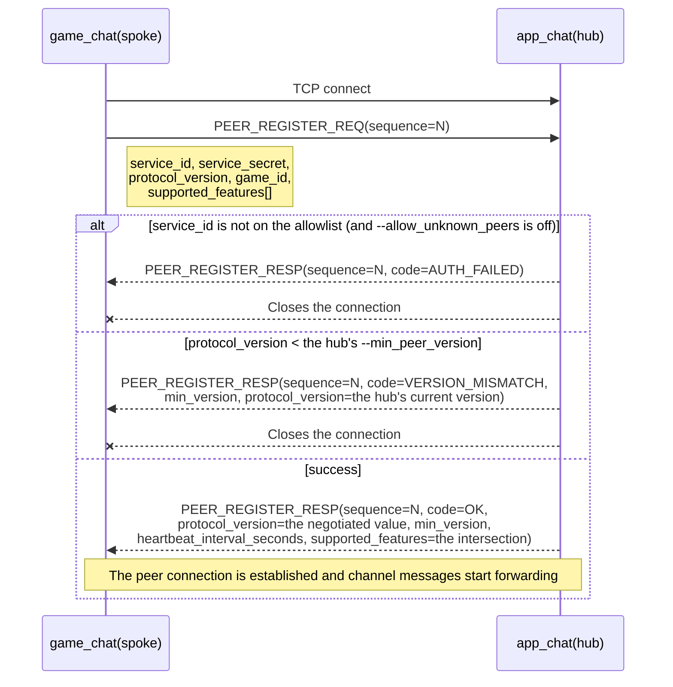

> 🌐 Language: [中文](../zh/api/peer_protocol.md)) | **English** (this page)

# Chat Peer registration protocol (5050-5053)

Last reconciled: 2026-09-22, aligned with `proto/gateway.proto` and `libs/network/chat_peer_{hub,link}.{h,cc}` (wired in both the basic and the enhanced form of chat).

`game_chat` (spoke) and `app_chat` (hub) are the same `chirp_chat` binary, with the role chosen by startup arguments. The spoke joins the hub through the built-in peer registration protocol — registration, the allowlist and version negotiation are all native chat capabilities, with no external bridging process. This page is the protocol-level source of truth for that chain; for the overall architecture see [Overall architecture](../architecture.md)).

## Frames and envelope

The peer link uses the same binary framing as the client link:

```text
TCP stream: [uint32_be payload_size][chirp.gateway.Packet protobuf bytes]
```

`Packet{msg_id, sequence, request_id, body}`, with `body` parsed per the table below (a peer outbound packet's default `request_id` is filled in by a per-connection monotonic generator — one for the hub and one for the spoke each; explicit values pass through without rewriting, see [Communication Core 4.3](../design-notes/communication_core.md))):

| msg_id | Value | Direction | body |
| --- | --- | --- | --- |
| `PEER_REGISTER_REQ` | 5050 | spoke -> hub | `chirp.gateway.PeerRegisterReq` |
| `PEER_REGISTER_RESP` | 5051 | hub -> spoke | `chirp.gateway.PeerRegisterResp` |
| `CHANNEL_MESSAGE_NOTIFY` | 5052 | spoke -> hub | `chirp.gateway.ChannelMessageNotify` |
| `PEER_INJECT_MESSAGE_NOTIFY` | 5053 | hub -> spoke | `chirp.gateway.PeerInjectMessageNotify` |

All 4 ids live inside the server-plane (5xxx) block, are open only to trusted peers, and are never sent by a client.

## Handshake



Rules:

- Registration is valid for the lifetime of the connection. If the connection drops, the spoke must redo the full handshake — the hub does not restore old registration state.
- A second registration with the same `service_id` displaces the first (`ChatPeerHub` overwrites the old entry). This keeps reconnect semantics simple: if the spoke crashes it just reconnects immediately, and the old connection is displaced by the new registration.
- `PEER_REGISTER_RESP.sequence` echoes `PEER_REGISTER_REQ.sequence`, so the spoke can correlate request/response by it.

## Message fields

### PeerRegisterReq (spoke -> hub, 5050)

| Field | Type | Meaning |
| --- | --- | --- |
| `service_id` | string | The game identifier, e.g. `game_42`; a second registration with the same id displaces the first |
| `service_secret` | string | The shared secret, matching the value configured in the hub's `--allowed_peers` |
| `protocol_version` | int32 | The spoke's current protocol version; the negotiation result is `min(hub_version, spoke_version)` |
| `game_id` | string | The channel namespace; the hub automatically prefixes all of that peer's channels with `<game_id>:`. **Must not contain `:`** |
| `supported_features` | repeated `PeerCapability` | The capability bits the spoke supports; the session's final capabilities are the intersection of both sides |

### PeerRegisterResp (hub -> spoke, 5051)

| Field | Type | Meaning |
| --- | --- | --- |
| `code` | `chirp.common.ErrorCode` | `OK` / `AUTH_FAILED` / `VERSION_MISMATCH`, see the error codes below |
| `protocol_version` | int32 | The negotiated value on `OK`; the hub's current version on `VERSION_MISMATCH` (so the spoke can reference it for an upgrade) |
| `min_version` | int32 | The hub's current `--min_peer_version` |
| `heartbeat_interval_seconds` | int32 | The heartbeat cadence the hub assigns; if the spoke stays silent for about 2× this period the hub drops it |
| `supported_features` | repeated `PeerCapability` | The post-negotiation intersection; the spoke must use only capabilities inside the intersection |

### ChannelMessageNotify (spoke -> hub, 5052)

| Field | Type | Meaning |
| --- | --- | --- |
| `game_id` | string | A redundant field the hub uses to cross-check against the registration info |
| `channel_id` | string | The **bare channel id** (the spoke adds no prefix); the hub adds `<game_id>:` automatically on receipt |
| `message` | `chirp.chat.ChatMessage` | The original game-side message, forwarded as-is; the hub fans out from it |

### PeerInjectMessageNotify (hub -> spoke, 5053)

| Field | Type | Meaning |
| --- | --- | --- |
| `channel_id` | string | The bare channel id (the `<game_id>:` prefix has been stripped) |
| `sender_id` | string | The game-side user id after the hub resolved `player_id → game_user_id`; the spoke never sees a `player_id` |
| `content` | bytes | The message content |
| `client_msg_id` | string | The App client's idempotency key (optional); the spoke may use it for dedup |

Naming note: `PEER_INJECT_MESSAGE_NOTIFY` (5053) and the server-gateway chain's `INJECT_MESSAGE_NOTIFY` (5007) have different semantics — the former is cross-plane, the latter same-plane; the `PEER_` prefix exists specifically to tell them apart.

## Capability bits

```protobuf
enum PeerCapability {
  RELAY_READ_RECEIPTS = 0;     // the hub forwards read-receipt changes to the spoke
  RELAY_TYPING = 1;            // the hub forwards typing indicators to the spoke
  RELAY_PRESENCE = 2;          // the hub forwards online/offline state to the spoke
  RELAY_OFFLINE_MESSAGES = 3;  // when a spoke player logs in, the hub pulls the offline history up
}
```

- Both sides of the handshake exchange the capability sets they support, and the session uses the **intersection**.
- A new capability bumps `protocol_version` and adds a bit; an old peer that does not know a bit will neither send it nor receive it — no breaking change.
- Currently `protocol_version = 1`; the capability bits are all defined but **not yet activated in the code** (see "Implementation status" below).

## Error codes

| code | Value | Trigger condition | Spoke behavior |
| --- | --- | --- | --- |
| `OK` | 0 | Handshake succeeded | Enter the registered state and start forwarding |
| `AUTH_FAILED` | 3 | `service_id` is not in `--allowed_peers` and `--allow_unknown_peers 0`; or `service_secret` does not match | Do not retry blindly — check the configuration first |
| `VERSION_MISMATCH` | 9 | `protocol_version < hub --min_peer_version` | Read `min_version` + `protocol_version` (the hub's current version), upgrade the spoke and reconnect |

## Heartbeat and timeouts

- `PEER_REGISTER_RESP.heartbeat_interval_seconds` is assigned by the hub; the spoke sends `HEARTBEAT_PING` at that period and the hub replies `HEARTBEAT_PONG`.
- After about 2× the period of silence the hub drops that peer (`ChatPeerHub`'s idle timer).
- When the hub crashes or the network breaks, the spoke reconnects after a fixed delay and re-registers; the reconnect loop built into `ChatPeerLink` is responsible.

## Allowlist and access control (hub-side CLI)

| flag | Default | Meaning |
| --- | --- | --- |
| `--hub_mode` | `0` | `1` enables the hub role and accepts peer registrations on the peer port; with `0` the hub is fully off |
| `--hub_peer_port` | `8200` | The dedicated listen port for the peer link. The main client port (`--port`) **no longer** accepts `PEER_REGISTER_REQ`; a 5050 sent to the main port is silently dropped |
| `--allowed_peers` | empty | A comma-separated list of `service_id:secret` pairs, e.g. `game_42:s3cr3t,game_99:hunter2`. **Empty = reject everyone** |
| `--min_peer_version` | `1` | The lowest accepted `protocol_version`; a lower value returns `VERSION_MISMATCH` |
| `--allow_unknown_peers` | `0` | With `1`, peers outside the allowlist may also register (open registration mode, for intranet debugging only) |

## Spoke-side CLI

| flag | Default | Meaning |
| --- | --- | --- |
| `--app_chat_host` | empty | The hub address; empty = the spoke role is not enabled |
| `--app_chat_port` | `8200` | The hub's **peer port** (`--hub_peer_port`), not the main client port |
| `--game_service_id` | empty | This peer's `service_id`; empty = the spoke is not enabled |
| `--game_service_secret` | empty | The shared secret, which must match the value for this id in the hub's `--allowed_peers` |
| `--game_id` | empty | The channel namespace; empty = the spoke is not enabled |

The spoke role requires `app_chat_host`, `game_service_id` and `game_id` to be all non-empty simultaneously; missing any one leaves it fully off.

## Deployment example

Hub side (`app_chat`):

```bash
./chirp_chat \
  --port 7000 --ws_port 7001 \
  --hub_mode 1 --hub_peer_port 8200 \
  --allowed_peers "game_42:s3cr3t_42,game_99:s3cr3t_99" \
  --min_peer_version 1
```

Spoke (the `game_chat` serving game 42):

```bash
./chirp_chat \
  --port 7100 --ws_port 7101 \
  --token_secret <game_jwt_secret> \
  --app_chat_host app-chat.internal --app_chat_port 8200 \
  --game_service_id game_42 --game_service_secret s3cr3t_42 \
  --game_id game_42
```

Key points:

- The hub and the spoke are the **same binary**, only the flags differ.
- `--game_service_secret` must not appear in any client binary or log; inject it through the environment / a secret manager.
- Deploy only one spoke per `game_id`; multiple instances registering with the same `service_id` displace each other.

## Cross-plane message flow (protocol view)

### spoke -> hub: channel-message uplink

```text
Game client --SEND_MESSAGE_REQ--> game_sdk_gateway --pipe--> game_chat
game_chat persists + broadcasts locally
game_chat(spoke) --CHANNEL_MESSAGE_NOTIFY--> app_chat(hub)
The hub queries the subscribers and injects a private-copy message to <game_id>:<channel_id> for each App player
```

### hub -> spoke: player-reply downlink

```text
App player --SEND_MESSAGE_REQ(<game_id>:<channel_id>)--> app_chat(hub)
The hub detects the prefix → resolves player_id → game_user_id
The hub --PEER_INJECT_MESSAGE_NOTIFY--> game_chat(spoke)
The spoke persists it as an ordinary injected message + broadcasts to the game-side members
```

The spoke side never sees a `player_id`; the hub side never sees a plaintext `game_user_id` (except the mapping the game backend proactively binds at registration time via `BIND_PLAYER_IDENTITY`). The two identity spaces do not leak into each other.

## Implementation status

Reconciled with `todo.md` and `CAPABILITY_MATRIX.md` (2026-09-22):

| Module | Status |
| --- | --- |
| proto definitions (5050-5053, capability bits, error codes) | Landed |
| Hub-side registration / allowlist / version negotiation / displacement | `libs/network/chat_peer_hub.cc`, covered by unit tests (`chat_peer_tests`) |
| Spoke-side connect / register / heartbeat / reconnect | `libs/network/chat_peer_link.cc` (strand-ified), covered by unit tests (`chat_peer_tests`) |
| Chat wiring (both the basic and enhanced forms) | Landed: both `main.cc` and `main_enhanced.cc` wire `ChatPeerHub`/`ChatPeerLink`; the old half-finished `services/shared/chat/src/peer_{hub,spoke}.{h,cc}` (single read, no heartbeat, no reconnect, and it never even compiled) has been deleted |
| Hub CLI such as `--hub_mode` / `--hub_peer_port` / `--allowed_peers` | Landed (both forms) |
| Spoke CLI such as `--app_chat_host` | Landed (both forms) |
| Capability-bit negotiation (the intersection takes effect) | Already exchanged in the handshake, but the **actual capabilities are not yet activated in the code** — registration still succeeds when the intersection is empty, and the bit definitions await use |
| `CHANNEL_MESSAGE_NOTIFY` uplink + hub fan-out | Landed (2026-09-22): the spoke uplink is unchanged (non-PRIVATE channels, best-effort after registration); the hub side's "fan out to App players by subscription" is carried by `PlayerDirectory::FanoutChannelMessage` (`services/shared/chat/src/player_directory.cc`), handing over one private-copy message per subscriber plus an auto-incrementing unread badge, bounded by `--max_fanout_per_message` (over the limit the whole message is dropped with a warning), and an empty subscriber set is a semantic no-op |
| WP-8 RPC block (5013-5030) | Landed: the three registries (identity binding / channel subscription / unread counts) plus 9 RPCs moved from `chirp_game_server_gateway` into `app_chat` (`PlayerDirectory`; for the authorization details see the WP-8 section of `docs/server_plane.md`); `DispatchPlayerDirectoryPacket` responds on chat's main client port and must pass the `SERVER_AUTH_REQ` trust gate (untrusted returns `AUTH_FAILED`); the App edge's self-service path uses an empty id and lets the server mint the id |
| `PEER_INJECT_MESSAGE_NOTIFY` downlink | Consumed on the spoke side; the injection goes through the same store/deliver tail as a player-sent message (including the offline queue) |
| `heartbeat_interval_seconds` heartbeat eviction | Implemented: the hub evicts on 2× period of idleness (`ChatPeerHub` idle timer), the spoke sends `HEARTBEAT_PING` at the negotiated period |
| Real-chain E2E (hub + spoke genuinely connected in one process) | `EndToEndAgainstRealHub` in `chat_peer_tests`: a real `ChatPeerLink` registers into a real `ChatPeerHub` with uplink/downlink round-trip assertions; process-level smoke orchestration is still not in the scripts |

The not-yet-implemented capability bits (`RELAY_READ_RECEIPTS` / `RELAY_TYPING` / `RELAY_PRESENCE` / `RELAY_OFFLINE_MESSAGES`) are already reserved in the protocol, and integrating them does **not** require bumping `protocol_version` — an old peer seeing an empty intersection simply disables the corresponding feature automatically.

## Change constraints

Protocol evolution obeys these rules:

1. New message ids may only be appended at the end of the 5xxx block (the next one is currently 5054), and deleted ids are never reused.
2. A new capability = a new `PeerCapability` enum value + bumping the hub's `protocol_version`; a spoke may choose not to implement it.
3. Existing field numbers are not reused and their types do not change; deprecated fields are marked with `reserved`.
4. `service_id` and `game_id` must not contain `:`; `game_id` additionally must not be an empty string.
5. A breaking change must go through the `VERSION_MISMATCH` rejection path; silent degradation is not allowed.