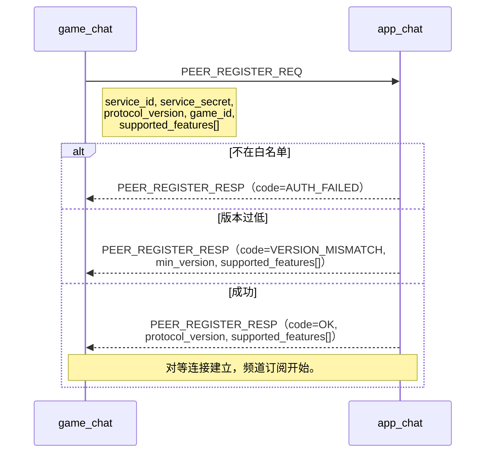
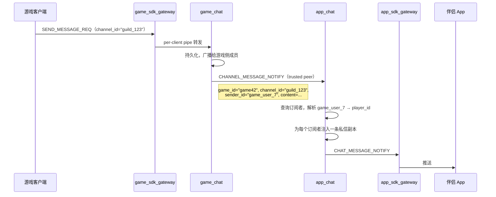
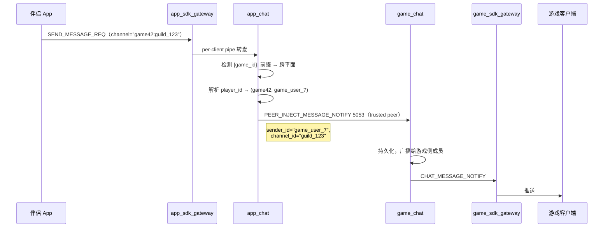
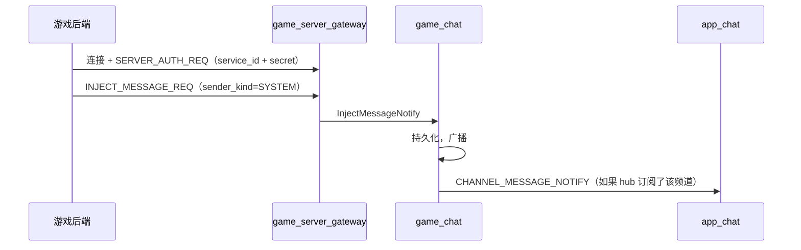

> 🌐 Language: [中文](./architecture.md) | **English** (this page)

# Chirp Overall Architecture

Last reviewed: 2026-10-08

Chirp is a real-time communication backend for games. The game plane and the App plane are two independent systems, each with its own edge and its own chat service. Cross-plane communication is a native capability of chat — two `chirp_chat` instances connect directly and complete attachment through a built-in registration protocol, version negotiation, and access control.

## Overview

- Two planes, two chat instances. `game_chat` serves game clients; `app_chat` serves the companion app. Same binary, different deployments.
- `app_chat` is the hub. `game_chat` instances attach via the built-in peer registration protocol, which supports a whitelist and version negotiation.
- `game_server_gateway` is the lightweight game backend injection hub.
- Search is a separate service `chirp_search` (TCP 5007, SQLite FTS5): both gateways forward 2248 queries to it via a second ServiceBridge (`--search_host`), reusing chat's service_id/secret credentials; if the search bridge fails, it degrades to `SERVER_UNAVAILABLE` without kicking the client; when `--search_host` is not configured, 2248 falls back to the chat catch-all.
- The edges (`game_sdk_gateway`, `app_sdk_gateway`) are stateless connection managers.
- The game plane is self-sufficient and depends on no component of the App plane. A deployment that "does game chat only" is a first-class citizen.
- Authentication in the two planes is isolated from each other: the game plane's tokens are issued by the game backend and verified locally by `game_chat`; the App plane's platform user tokens are issued and verified by `app_auth`.

## Design Principles

1. Two planes, not one shared core. The game plane faces games, high frequency, low latency; the App plane faces players, low frequency, heavy aggregation.
2. Same protocol, same binary. `game_chat` and `app_chat` are the same `chirp_chat` binary. Cross-plane communication uses chat's native trusted-peer protocol — there is no translation layer and no external bridging process.
3. Hub-spoke attachment model. `app_chat` is the hub; each `game_chat` attaches to it, and the hub controls who may connect through a whitelist and credential verification.
4. Thin edges. Only connection management, protocol adaptation, authentication forwarding, and heartbeats — no business state.
5. No mutual dependency between planes. The game plane depends on no component of the App plane (authentication included). The direction of cross-plane attachment is the game plane connecting to the App plane over the registration protocol: `game_chat` registers into hub `app_chat`; the reverse does not hold.
6. Trusted planes use service credentials; untrusted edges use user tokens; the two are never mixed.

## Topology

```mermaid
flowchart TB
    subgraph game_plane["游戏平面（独立部署单元）"]
      GC1["游戏客户端 A"] -->|TCP/WS| GG1["game_sdk_gateway #1"]
      GC2["游戏客户端 B"] -->|TCP/WS| GG2["game_sdk_gateway #2"]
      GG1 -->|per-client pipe| GCHAT["game_chat"]
      GG2 -->|per-client pipe| GCHAT
      GB["游戏后端"] -->|出站连接，服务凭证| SG["game_server_gateway"]
      SG -->|注入| GCHAT
      GCHAT -->|事件| SG
      GG1 & GG2 -->|LOGIN_REQ| GCHAT
      Note right of GCHAT: 本地验证 token（--token_secret）<br/>不依赖外部认证服务
    end

    subgraph app_plane["App 平面（可选附加）"]
      APP1["伴侣 App"] -->|WS/TLS| AG1["app_sdk_gateway #1"]
      APP2["伴侣 App"] -->|WS/TLS| AG2["app_sdk_gateway #2"]
      AG1 -->|per-client pipe| ACHAT["app_chat（hub）"]
      AG2 -->|per-client pipe| ACHAT
      AG1 & AG2 -->|LOGIN_REQ| APPAUTH["app_auth"]
      AG1 & AG2 -->|会话 claim| R1[("Redis")]
      ACHAT -->|推送触发| NT["app_notification"]
      APPAUTH --> R1
    end

    GCHAT -->|"PEER_REGISTER_REQ + 白名单"| ACHAT
    GCHAT -->|"频道消息"| ACHAT
    ACHAT -->|"玩家回复"| GCHAT
```

Reading the diagram:

- The game plane is self-sufficient. `game_sdk_gateway + game_chat` is a complete game chat deployment; the game backend issues tokens, `game_chat` verifies them locally, and nothing depends on `app_auth` or any App plane component.
- The App plane is an optional add-on, deployed only when a companion app exists; `app_auth` serves only the App plane.
- Cross-plane is a native capability of chat. Two `chirp_chat` instances connect directly using the same trusted-peer protocol — registration, version negotiation, and the whitelist are all built into the chat service.

## Game Plane

| Responsibility | Owner | Notes |
| --- | --- | --- |
| Edge | `game_sdk_gateway` | TCP + WS listener; login/logout/heartbeat and kicks. Stateless. |
| Chat | `game_chat` | Deployed as the game plane's `chirp_chat`. Holds in-game channels, history, and the offline queue. Verifies tokens locally. Registers to `app_chat` as a spoke. |
| Authentication | game_chat locally | The game backend issues an HS256 JWT (`--token_secret`), and `game_chat` verifies it locally. No external authentication service is needed. |
| Session claim | Redis | `chirp:sess:<user>\x1F<device>` per edge instance. |
| Backend injection | `game_server_gateway` | Trusted hub; the game backend makes an outbound connection with `service_id` + secret. Responsible for message injection plus event delivery only. Optional. |

Deployment shapes: `game_sdk_gateway + game_chat` is a complete deployment on its own. Add `game_server_gateway` when game backend injection is needed. When chat itself needs to scale, switch to the distributed chat build.

## App Plane

| Responsibility | Owner | Notes |
| --- | --- | --- |
| Edge | `app_sdk_gateway` | WS-first, optional TLS, heartbeats tuned for mobile networks. Stateless. |
| Chat | `app_chat` | Deployed as the hub's `chirp_chat`. Accepts `game_chat` registrations, aggregates cross-game channels, and delivers to the companion app. Holds identity bindings, channel subscriptions, and unread counts. |
| Authentication | `app_auth` | Issues and verifies platform user tokens (`player_id`). Serves only the App plane; unrelated to the game plane. |
| Push | `app_notification` | Pushes to the phone (APNs/FCM) when the player is offline. A separate service, because push has vendor-specific constraints, collapsing, rate limiting, and other runtime characteristics of its own. |

Deployment shapes: `app_sdk_gateway + app_chat + app_auth + app_notification`. Any number of `app_sdk_gateway` instances, one `app_chat`.

## Peer Registration Protocol

When `game_chat` starts, it attaches to `app_chat` through the built-in peer registration handshake. Registration, access control, and version negotiation are all native capabilities of chat. Protocol-level fields, error codes, CLI, and implementation status are in [Chat Peer Registration Protocol](api/peer_protocol.md).

### Handshake



### Registration Fields

| Field | Direction | Meaning |
| --- | --- | --- |
| `service_id` | game → app | Game identifier (e.g. `game_42`) |
| `service_secret` | game → app | The shared secret under which that game attaches |
| `protocol_version` | both ways | Integer version number; the two sides negotiate the highest mutually supported version |
| `game_id` | game → app | Game namespace; every channel of that peer is automatically prefixed with `{game_id}:` in the hub |
| `supported_features` | both ways | Optional capability bitmask (read-receipt relay, typing relay, presence synchronization, etc.) |

### Whitelist and Access Control

`app_chat` maintains a whitelist of peers that are allowed to attach:

| Setting | Default | Meaning |
| --- | --- | --- |
| `--allowed_peers` | (none) | Comma-separated `service_id:secret` pairs. Empty = reject everything. |
| `--min_peer_version` | 1 | Lowest accepted `protocol_version`. |
| `--allow_unknown_peers` | 0 | Whether to accept peers that are not in the whitelist (open registration mode). |

Rules:
- A peer that is not in `--allowed_peers` (and with `--allow_unknown_peers` off) is rejected with `AUTH_FAILED`.
- A peer whose `protocol_version` is below `--min_peer_version` is rejected with `VERSION_MISMATCH`; the response carries the hub's minimum version.
- Once registration succeeds, the peer connection is valid for the life of the connection. Re-registration is required after a disconnect and reconnect.
- A second registration with the same `service_id` displaces the first.

### Version Negotiation

The two sides exchange `protocol_version` and `supported_features` during the handshake. The negotiated version is `min(hub_version, spoke_version)`. Capabilities outside the intersection are disabled for that session.

| Capability bit | Meaning |
| --- | --- |
| `RELAY_READ_RECEIPTS` | hub relays read-receipt changes to the spoke |
| `RELAY_TYPING` | hub relays typing indicators to the spoke |
| `RELAY_PRESENCE` | hub relays online/offline status to the spoke |
| `RELAY_OFFLINE_MESSAGES` | spoke pushes offline message history to the hub when the player logs in |

When a new capability is added, bump `protocol_version` and add the capability bit. Older peers that do not understand the bit simply do not use it — no breaking change.

## Cross-Plane Message Flow

### game_chat → app_chat: channel message bridging



`game_chat` sends every channel message to its registered hub peer. The hub (`app_chat`) owns the fan-out:

1. Query which players are subscribed to `(game_id, channel_id)`.
2. Resolve the sender's `game_user_id → player_id`.
3. Inject a private-message copy into the app chat for each subscriber, with the channel automatically prefixed `{game_id}:{channel_id}`.

The game side knows nothing about subscribers, fan-out, or player identity. It only sends the channel message to the hub.

### app_chat → game_chat: player replies



When a player sends a message to a channel carrying the `{game_id}:` prefix, `app_chat`:

1. Detects the cross-plane prefix.
2. Resolves `player_id → game_user_id`.
3. Injects the message into the registered `game_chat` peer for that `game_id`.

What the game side receives is an ordinary injection — it does not know the message came from an App player. (Landed 2026-09-22: `PlayerDirectory::RelayGameReply` + `ChatPeerHub::service_id_for_game` + `IdentityRegistry::ResolveGameUser`, with reply codes OK / SERVER_UNAVAILABLE / INVALID_PARAM; see server_plane.md, "Cross-plane replies".)

### Game backend injecting system messages



## Identity and Namespaces

Two identity spaces, one mapping point:

- The **game plane** uses `game_user_id`. The game backend issues short-lived, game-scoped user tokens, which `game_chat` verifies locally. The game plane is unaware that `player_id` exists.
- The **App plane** uses `player_id`. `app_auth` issues the platform user tokens.
- The mapping lives **inside `app_chat`.** After a player has authenticated through the game's own login server, the game backend calls `app_chat`'s `BIND_PLAYER_IDENTITY` RPC to assert `player_id ↔ (game_id, game_user_id)`. The mapping is stored inside `app_chat` (Redis backend).

Channel namespaces:

- Inside `game_chat`, channels are bare: `guild_123`, `world`, `team_42`.
- Inside `app_chat`, cross-plane channels carry a prefix: `<game_id>:guild_123`. App-local channels (player-to-player private chat, App-side groups) carry no prefix.
- `app_chat` adds the prefix automatically when it receives a message from a registered `game_chat` peer (using the `game_id` from the registration handshake). The spoke never sees the prefix.

## Credential Model

Two kinds of credential, not interchangeable:

| Kind | Identifier | Lifetime | Where it is used |
| --- | --- | --- | --- |
| Service credential (`service_id` + secret) | backend component | long-lived | `game_server_gateway` peer, `game_chat → app_chat` registration, gateway → chat trusted pipes, gateway → search pipes (reusing chat's service_id/secret) |
| User token (HS256 JWT) | single user session | short-lived | game client → `game_sdk_gateway` (issued by the game backend, verified locally by `game_chat`), App → `app_sdk_gateway` (issued by `app_auth`) |

Rules:

- Service credentials never enter client binaries.
- User tokens never enter trusted planes.
- The user tokens of the two planes are isolated from each other: the game plane's tokens are issued by the game backend, the App plane's by `app_auth`, and the two secrets are unrelated.
- `game_chat` verifies game user tokens locally with `--token_secret` and depends on no external service.
- `--auth_host` is optional and serves only the App edge. `--auth_host` on `game_sdk_gateway` / `app_sdk_gateway` creates an `AuthClient` only when it is non-empty (`services/game/sdk_gateway/src/main.cc`, `services/app/sdk_gateway/src/main.cc`). When it is not configured, `HandleLogin` goes through the scaffold path: the token is used directly as the user_id, and after `BindAuthenticatedSession` it is forwarded to chat over ServiceBridge — the game plane is self-sufficient with no `app_auth` dependency. chat's relationship with `app_auth` works the same way: with `--token_secret` configured, chat does local HS256 signature verification and calls back no authentication service; `app_auth`'s scaffold fallback additionally requires `--allow_scaffold_login 1` (off by default). The pure game plane end-to-end path is covered by `test_services.sh --smoke-game` (gateway without `--auth_host` plus chat without `--token_secret`, i.e. the scaffold path), and the production-isomorphic `--token_secret` local verification path is covered by `--smoke-jwt`.

## Failure and Degradation

| Component failure | Blast radius |
| --- | --- |
| one `game_sdk_gateway` instance | its current connections drop; clients reconnect to another instance. |
| `game_chat` | game-plane messages stop. The App plane keeps running (cross-game messages stop, but App-local messages work). |
| `game_server_gateway` | the game backend can no longer inject messages. Player chat is unaffected. |
| one `app_sdk_gateway` instance | its current connections drop; clients reconnect to another instance. |
| `app_chat` | App-plane messages stop. The game plane is unaffected. The `game_chat` peer detects the disconnect and retries registration with backoff. |
| `app_auth` | new App-plane logins are blocked. Existing sessions are unaffected (local JWT verification). The game plane is unaffected. |
| `app_notification` | offline push stops. Online messages are unaffected. |
| `chirp_search` | 2248 queries degrade immediately: the gateway returns `SERVER_UNAVAILABLE`, without kicking the client or touching the connection, and the next query dials again automatically. Chat is unaffected. |
| Redis (game plane) | session claim degrades to single-instance (no cross-instance kicks). |
| Redis (App plane) | `app_chat`'s identity bindings / subscriptions / unread data become unavailable. Session claim degrades. |

Any failure in the game plane leaves the App plane untouched, and vice versa (an `app_chat` failure only affects cross-plane messages, not the game plane's local operation).

## Horizontal Scaling

- Edges (`game_sdk_gateway`, `app_sdk_gateway`): stateless; scale behind a load balancer. Cross-instance kicks go through Redis claims.
- `app_auth`: stateless; scale behind a load balancer.
- `game_server_gateway`: one per game backend integration.
- Chat: single-writer design. When chat itself needs to scale, switch to the distributed chat build.
- `game_chat` to `app_chat` connections: each `game_chat` instance maintains one persistent connection to `app_chat`. Multiple `game_chat` instances each register with their own `service_id`; the hub accepts all connections concurrently.

## Repository Layering

| Layer | Path | Role |
| --- | --- | --- |
| Protocol | `proto/*.proto` | Shared envelope and msg-id blocks |
| Common library | `libs/common` | logging, JWT, base64, metrics |
| Network library | `libs/network` | ASIO TCP/WS sessions, framing protocol, Redis client, trusted-peer helpers |
| Shared service | `services/shared/chat/` | chat service: the same `chirp_chat` binary deployed as `game_chat` / `app_chat` / the distributed form, distinguished by startup flags |
| Search service | `services/search/` | server-side message search (`chirp_search`, SQLite FTS5, 2248/2249) |
| Game plane | `services/game/` | |
| | `services/game/sdk_gateway/` | game client edge (`game_sdk_gateway`) |
| | `services/game/server_gateway/` | game backend injection hub (`game_server_gateway`, optional) |
| App plane | `services/app/` | |
| | `services/app/sdk_gateway/` | App client edge (`app_sdk_gateway`) |
| | `services/app/auth/` | App plane authentication (`app_auth`) |
| | `services/app/notification/` | backend push (`app_notification`) |
| SDK | `sdks/*` | client integration |
| Apps / tooling | `apps/*`, `tools/*` | demos, smoke clients, benchmarks |
| Delivery | `docker-compose.yml`, `deploy/`, `scripts/` | orchestration and verification |

## Protocol Baseline

All edges and trusted peers use the same framing:

```
TCP 流:    [uint32_be payload_size][chirp.gateway.Packet protobuf bytes]
WebSocket: binary frame payload = [uint32_be payload_size][chirp.gateway.Packet protobuf bytes]
```

`chirp.gateway.Packet` carries `msg_id`, `sequence`, `body`, and `request_id` (distributed correlation id; 0 = not provided, in which case both ends fall back to a per-connection monotonic value, and forwarding chains pass it through unchanged — see [API Overview](api/overview.md)). Message ID blocks:

| Block | Plane | Purpose |
| --- | --- | --- |
| 1xxx | both | authentication / session / heartbeat |
| 2xxx | both | chat/search (client ↔ chat/search business messages; 2248/2249 belong to search, the rest to chat) |
| 3xxx | game | social |
| 4xxx | game | voice |
| 5xxx | trusted | service plane (`game_server_gateway`, chat peer registration) |
| 6xxx | App | device / notification |

### Peer registration msg-ids

| ID | Message | Direction |
| --- | --- | --- |
| 5050 | `PEER_REGISTER_REQ` | spoke → hub (the spoke initiates registration) |
| 5051 | `PEER_REGISTER_RESP` | hub → spoke (carries the hub-assigned heartbeat interval `heartbeat_interval_seconds`; a spoke that stays silent for roughly 2× that interval is evicted) |
| 5052 | `CHANNEL_MESSAGE_NOTIFY` | spoke → hub (channel message uplink, hub fans out) |
| 5053 | `PEER_INJECT_MESSAGE_NOTIFY` | hub → spoke (player reply injection; the name carries the `PEER_` prefix to distinguish it from the server_gateway chain's 5007 `INJECT_MESSAGE_NOTIFY`) |

Field tables, error code tables, capability negotiation, and the CLI are in [Chat Peer Registration Protocol](api/peer_protocol.md).

## Architectural Commitments

- The game plane and the App plane are independent deployment units. The game plane can run on its own, depending on no component of the App plane.
- Cross-plane communication is a native capability of chat, not an external bridging process.
- The hub (`app_chat`) controls attachment through a whitelist and version negotiation.
- Authentication in the two planes is isolated from each other: the game plane's is the game backend's responsibility, the App plane's is `app_auth`'s.
- Player identity and game identity are never mixed. The mapping lives inside `app_chat`.
- The edge holds no business state. Chat holds no cross-plane state.
