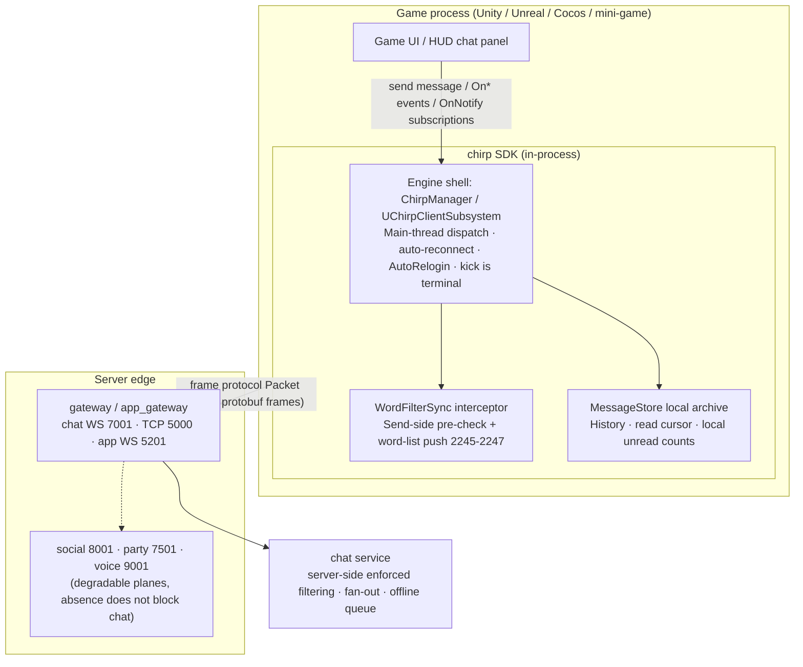
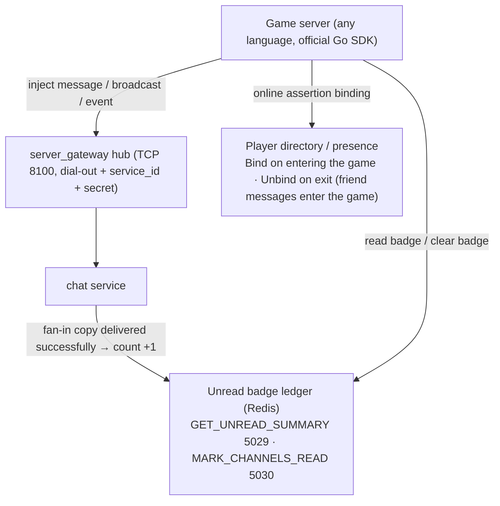
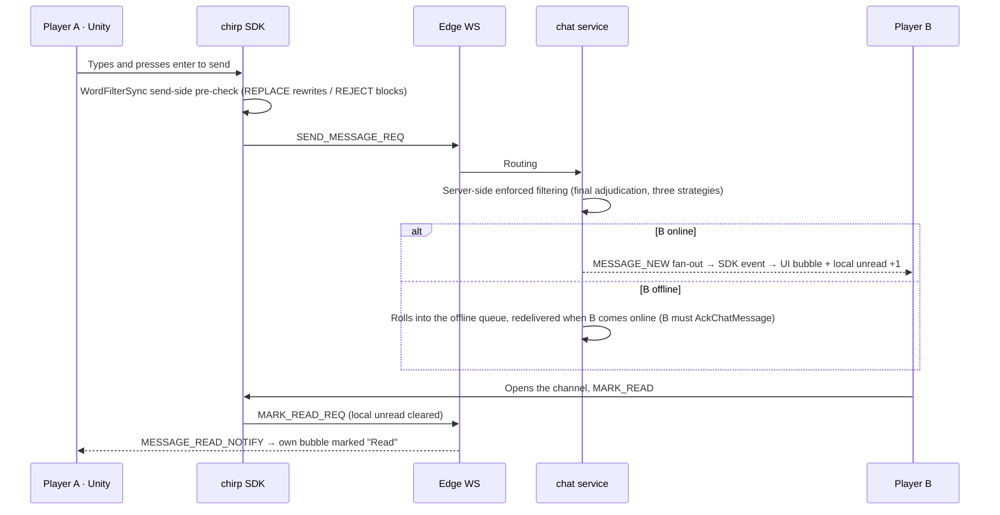
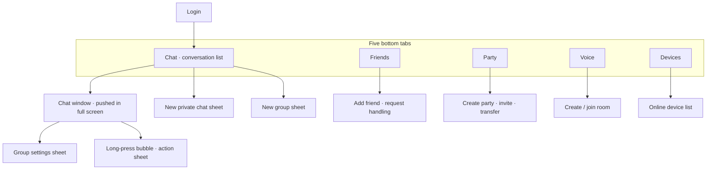

> 🌐 Language: [中文](./app_chat_prototype.md) | **English** (this page)

# App chat prototype and in-game integration

This page has two diagrams: the **app chat prototype wireframes** (matching the chat UI as delivered today) and the **in-game integration diagrams** (the two access paths — the in-process SDK in the client and the game backend). The prototype is not the target state — every block annotates which component of the current implementation it comes from; change the UI only after reconciling it against the diagram.

Prototype baseline and scope:

| Client | Current state | Prototype baseline |
| --- | --- | --- |
| web companion (`apps/web_companion`, "Chirp Companion") | Delivered, most complete feature surface | **Reference implementation**; the wireframes use it as the baseline |
| Desktop (`apps/desktop`, Tauri v2 + React/MUI) | Delivered, same feature surface as web | Same diagram; the only difference is the navigation form (a vertical Rail tab strip replaces the 260px left column, `src/ui/Rail.tsx`) |
| Android / iOS (`apps/android`, `apps/ios`) | Protocol library only (`protocol/`, `Sources/ChirpProtocol/`), **no UI** | **Target-state prototype**, see section 3; must not be cited as delivered before implementation |

## 1. The app chat prototype

### Login page

```text
┌────────────────────────────────────┐
│                                    │
│            Log in to Chirp           │
│   Dev mode: a user ID is enough      │
│                                    │
│      User ID  [ al__________ ]      │
│                                    │
│            [ Log in ]              │
│                                    │
└────────────────────────────────────┘
```

Source `LoginPage.tsx`: dev mode has no password, the user ID is the credential; token login belongs to the SDK surface (the mobile shell).

### Main interface (two-column shell)

```text
┌───────────────────────┬────────────────────────────────────────────┐
│ Chirp Companion alice │  [ConnectionBanner:reconnecting/kicked,    │
├───────────────────────┼────────────────────────────────────────────┤
│ [New private chat]    │  Channel title                           [⚙] │
│ [New group]           │────────────────────────────────────────────│
│───────────────────────│                                            │
│ Private chats         │        [ Load earlier messages ]           │
│  bob    (2) OK, got it│                                            │
│  carol       Around?  │     ┌──────────────────────────┐           │
│ Group chats           │     │ bob: Meet at eight        │           │
│  Squad A  (5) Gather! │     │ [👍 2] [👏] +             │           │
│───────────────────────│     └──────────────────────────┘           │
│ [Friends] [Party] [Voice]     ┌──────────────────────────┐           │
│ [Devices]             │     │ Me: Got it, I'll be there  20:14│        │
│                       │     └────────────[Read]────────┘           │
│ Notification permission│  ┌──────────────────────────────────────┐  │
│ (tap to enable)       │  │ Type a message, Enter to send  [Send]│  │
│ Log out               │  └──────────────────────────────────────┘  │
└───────────────────────┴──┴──────────────────────────────────────┴──┘
     260px · ConversationList               ChatWindow
     (right column shows an empty state when no conversation is selected)
```

Block sources:

| Block | Content | Component |
| --- | --- | --- |
| Left column header | App name + current user ID | `ChatPage.tsx` |
| Conversation list | Private/group grouping, unread badges, last-message preview; "New private chat" / "New group" buttons at the top | `ConversationList.tsx` |
| Plane entries | Friends (add friend/requests/online green dot), party (create/invite/transfer/disband), voice rooms (create/join/mute), multi-device online (list of other online clients) | `FriendsDialog` / `PartyDialog` / `VoiceDialog` / `DevicesDialog` / `OnlineDevicesDialog` |
| Left column footer | Desktop notification permission entry (never requested automatically), log out | `ChatPage.tsx` |
| Right column header | Channel title; typing indicator ("alice, bob are typing…"); the group-only ⚙ opens group settings | `ChatWindow.tsx` |
| Message list | "Load earlier messages" pages upward; bubbles dissected below | `ChatWindow.tsx` + `MessageBubble.tsx` |
| Input area | Enter to send | `MessageInput.tsx` |

### Message bubble anatomy

```text
   Peer message                            Own message
┌────────────────────────┐        ┌────────────────────────────┐
│ bob                    │        │                         Me │
│ Meet at eight          │        │     Got it, I'll be there    │
│ [👍 2] [👏] +          │        │     20:14 · Read          │
└────────────────────────┘        └────────────────────────────┘
 Below the bubble: reaction chips     Status line (appears level by level,
 (one-tap quick reactions)              on one line):
 (own messages also have edit/recall)  · Sending… → Read (after the peer MARK_READ)
                                       · Send failed
                                       · Peer offline, queued (redelivered
                                         automatically when they come online)
```

States and special forms (all from current behavior in `MessageBubble.tsx`):

- **Read**: own messages append `· Read` once "the peer's read cursor ≥ this message";
- **(Edited)**: a message edited by the peer shows the marker; your own edit updates in place;
- **Recall**: the whole message collapses to "message recalled" (identical on both sides);
- **Sensitive words**: content that hits the word list is already rewritten text (the REPLACE strategy displays `**`), the convention is in [Word filter](word_filter.md);
- Group chats additionally have the owner marker and the member count (inside group settings).

### Group settings (group-chat ⚙)

```text
┌─ Group settings: Squad A ─────────────┐
│  Members 4/10                         │
│  ────────────────────────────────     │
│  ★ alice (owner)              [Remove]│
│    bob                       [Remove]│
│  ────────────────────────────────     │
│  [Add member: enter user ID]           │
│  [Leave group]                        │
└────────────────────────────────────────┘
```

Source `GroupDialogs.tsx`: create group, invite/kick, owner marker, leave-group confirmation. The desktop build has the same feature surface in `desktop/src/ui/Dialogs.tsx`.

### Global states and degradation behavior

| State | Behavior | Basis |
| --- | --- | --- |
| Disconnected | Top banner "Connection lost, reconnecting automatically…", self-heals after recovery | `ConnectionBanner.tsx` |
| Kicked (topped by another login) | Banner "This account has been logged in on another device…" + a back-to-login button — a kick is a terminal state, no automatic reconnect | same |
| Plane absent | The social/party/voice/devices planes all log in on a best-effort basis: if any is down the chat main line still works and that feature's entry is hidden | the four useEffect contracts in `ChatPage.tsx` |
| Desktop notifications | A system notification only pops when the page is hidden and the message is not in the current channel; permission is never requested automatically | `ChatPage.tsx` + `desktop_notify.ts` |
| Unread counts | Accounted for locally by the client (incoming message +1, MARK_READ clears), reconciled once with the server after login via `GET_UNREAD_COUNT` (2205); currently there is **no** unread-change push | `ConversationList.tsx` / `message_handlers.cc` |

## 2. In-game integration

Game access has two orthogonal paths: the **SDK embedded in the game client** (the player chat main line) and the **game backend server plane** (system messages / data interop). Both can exist at the same time.

### Diagram A: in-process client SDK



Key points (for the access semantics see [SDK overview](../sdk/index.md) and [SDK hooks](sdk_hooks.md)):

- **The game side only deals with events and Tasks**: callbacks such as `OnChatMessage` are already dispatched back to the main thread by the engine shell; request-response goes through the spec table (`RequestAsync`, correlated by sequence number, throws on timeout);
- **The send-side pre-check happens inside the SDK**: after registering `WordFilterSync` as an interceptor, the whole `SendMessageAsync` pipeline passes the word list first; the word list is pushed by the server, the client adjudicates a prediction of the server's adjudication;
- **Offline is not failure**: a send returning `TargetOffline` means it has rolled into the peer's offline queue; an incoming message must be `AckChatMessage`, otherwise the server redelivers;
- **Being kicked is terminal**: after being topped by another login the SDK stops reconnecting and the game pops a re-login prompt (the banner from the prototype).

### Diagram B: game backend (server plane dial-out)



Key points:

- **dial-out is a direct connection**: the game backend dials out to the hub itself and opens no listening port; authentication uses service_id + secret;
- **The badge ledger and chat unread do not feed each other**: the ledger only counts fan-in copies whose "subscribe notification was successfully delivered to chat"; `MarkChannelsRead` is the only decrement path (stated explicitly in the protocol comment);
- **A presence binding means online**: the game backend binds/unbinds when the player enters/leaves the game, the friend "in game" status derives from this, and no extra heartbeat signal is needed.

### Diagram C: the life of one message in the game



Three gates and two pieces of accounting are all in this diagram: pre-check (SDK, bypassable so the server must adjudicate) → enforced filtering (chat service) → fan-out/offline; unread (receiver-local), read cursor (drives the 2207 notification).

## 3. Mobile prototype (target state, not yet implemented)

> ⚠ This section is a **design prototype** — the mobile UI is not implemented yet, and all that exists in the repo is the protocol layer
> (Android `apps/android/src/main/kotlin/chirp/mobile/protocol/`, iOS
> `apps/ios/Sources/ChirpProtocol/`). The feature surface in this section is
> fully isomorphic to web/desktop and adds no protocol capability; do not cite
> this section as delivered in the capability matrix or the README before the
> implementation lands.
>
> Since 2026-10-05 the five screens in this section (conversation list / chat window /
> friends and game friends / notifications / me) have visual HTML drafts:
> `design/prototypes/mobile/` (375×812, near-black background + indigo,
> neutral placeholders; `index.html` is the navigator, README.md carries the per-page
> design notes) — also a design draft, not an implementation. The review has passed:
> pages 01/02/04/05 passed user first review (2026-10-07), and the revised page 03
> (friends) with game-source tags and a source filter was approved by proxy decision
> (FW1016D 2026-10-16, the user can overturn it); the remaining screens still follow the
> ASCII wireframes in this section.

### Layout mapping: Rail → bottom tab strip

The phone's single-column form has no room for a 260px left column, so the navigation mapping reuses the desktop Rail's five items (`desktop/src/ui/Rail.tsx`) compressed into a bottom tab strip; dialogs (friends/party/voice/devices/group settings) are all full-screen sheets.

### Conversation list (home)

```text
┌────────────────────────────┐
│ Chirp Companion alice  [🔔]│
├────────────────────────────┤
│ [New private chat] [New group]│
│────────────────────────────│
│ Private chats               │
│  bob     (2)  OK, got it    │
│  carol          Around?     │
│ Group chats                 │
│  Squad A   (5)  Gather!     │
│────────────────────────────│
│  💬Chat   👥Friends   🧩Party│
│  🎙Voice  📱Devices         │
└────────────────────────────┘
  Top bar: app name + current user ID + notification toggle
  List: same as the web conversation list (unread badge + last-message preview)
  Bottom: five tabs = the same feature entries as the desktop Rail
```

### Chat window (pushed in full screen)

```text
┌────────────────────────────┐
│ ←   Squad A             ⚙   │
│     bob is typing…           │
├────────────────────────────┤
│      [ Load earlier messages ]│
│  ┌──────────────────────┐    │
│  │ bob: Meet at eight   │    │
│  │ [👍 2] [👏] +         │    │
│  └──────────────────────┘    │
│        ┌──────────────────┐  │
│        │ Me: Got it   20:14│  │
│        └──────[Read]──────┘  │
├────────────────────────────┤
│ [ Type a message…      ][Send]│
└────────────────────────────┘
  Header: back + title + typing subtitle + ⚙ (group chats)
  Bubbles: same as "Message bubble anatomy", same status line/reactions/recall
```

### Group settings (full-screen sheet)

```text
┌────────────────────────────┐
│ ✕  Group settings: Squad A  │
│────────────────────────────│
│  Members 4/10               │
│  ★ alice (owner)    [Remove]│
│    bob              [Remove]│
│────────────────────────────│
│  [ Add member: enter user ID ]│
│  [ Leave group ]            │
└────────────────────────────┘
  Content is isomorphic to the web group-settings dialog (GroupDialogs)
```

### Where mobile differs from web/desktop

| Dimension | web / desktop (delivered) | Mobile (target state) | Basis |
| --- | --- | --- | --- |
| Navigation | 260px left column / vertical Rail tabs | Five bottom tabs + full-screen sheets | Isomorphic mapping from the desktop `Rail.tsx` |
| Notifications | Desktop notifications (only when hidden and not the current channel) | System push, registered via the devices plane (`RegisterDevice`, app_gateway WS 5201); iOS APNs credentials and the HarmonyOS ArkTS toolchain are registered external prerequisites, so the push arm is unavailable before they land | `DeviceRegistrar.kt` / the `apps/ios` protocol library |
| Sending | Direct send while online, retryable on failure | The protocol library ships its own offline send queue: enqueue on a weak network and replay after recovery | `OfflineSendQueue.kt` |
| Being topped | Banner + back to login | Also a terminal kick: the SDK stops reconnecting and pops a re-login prompt | The kick-is-terminal contract in the protocol library |
| Word list | The `WordFilterSync` interceptor ships with the SDK | The same component with the same contract on all three platforms (the Kotlin/Swift protocol libraries are ready), wired straight into the native shells | `WordFilterSync.kt` / `WordFilterSync.swift` |

### Screen navigation (five bottom tabs = the desktop Rail)



### Friends page

```text
┌────────────────────────────┐
│ Friends             [Add]  │
├────────────────────────────┤
│ Friend requests (1)         │
│  dave wants to add you      │
│              [Accept] [Decline]│
│────────────────────────────│
│ ● bob           [Message]  │
│ ● carol         [Message]  │
│ ○ erin          [Message]  │
│────────────────────────────│
│ Waiting for their approval: frank│
│────────────────────────────│
│  💬Chat  👥Friends  🧩Party ...│
└────────────────────────────┘
  ● online green dot / ○ offline; "Message" jumps to
  the private chat and switches back to the chat tab
  (same action set as FriendsDialog)
```

### Party page

```text
┌────────────────────────────┐
│ Party                       │
├────────────────────────────┤
│ (no party)                  │
│  [ Create party · default cap 5 ]│
│────────────────────────────│
│ Invitations received (1)    │
│  alice invited you          │
│              [Accept] [Decline]│
│────────────────────────────│
│ (after joining)             │
│  Party 2/5                  │
│  ★ alice  ·  bob            │
│  [Invite] [Transfer leader] [Leave party]│
│────────────────────────────│
│  💬Chat  👥Friends  🧩Party ...│
└────────────────────────────┘
  Invite-and-accept model, snapshot sync (member changes
  are broadcast to the whole party)
  — isomorphic to the web PartyDialog / the desktop party page
```

### Voice page

```text
┌────────────────────────────┐
│ Voice                       │
├────────────────────────────┤
│ (not in a room)             │
│  [ Create room ]  [ Join room ]│
│────────────────────────────│
│ (after entering)            │
│  Room room-1                │
│  🎙 alice   🎙 bob           │
│  [Mute / Unmute]  [Leave room]│
│────────────────────────────│
│ ⚠ Signaling closed loop; the media plane (audio stream) is unverified│
│────────────────────────────│
│  💬Chat  👥Friends  🧩Party ...│
└────────────────────────────┘
  ⚠ Not an oversight in drawing: this is the same state
  of affairs as on desktop —
  voice only goes as far as signaling, and no call UI is
  promised until the media plane is verified
```

### Devices page

```text
┌────────────────────────────┐
│ Devices                     │
├────────────────────────────┤
│ Online devices for this account (2)│
│  📱 alice-phone (this device) │
│  💻 alice-desktop           │
│────────────────────────────│
│ Logging in on another device│
│ with the same account tops off the current session│
│ — a kick is terminal, so pop back to the login page│
│────────────────────────────│
│  💬Chat  👥Friends  🧩Party ...│
└────────────────────────────┘
  Same as OnlineDevicesDialog: the list of online clients
  plus the same "topped by another login" notice; push
  registration is managed on this page
```

### Long-press bubble (action sheet)

```text
┌────────────────────────────┐
│  ┌──────────────────────┐  │
│  │ Meet at eight     bob │  │ ← long-press this one
│  └──────────────────────┘  │
│ ┌────────────────────────┐ │
│ │  👍   👏   🔥   ❤️      │ │ ← quick reactions (QUICK_REACTIONS)
│ │ ────────────────────── │ │
│ │  Edit    (own messages)│ │
│ │  Recall  (own messages)│ │
│ └────────────────────────┘ │
└────────────────────────────┘
  The web hover action set (react/edit/recall) is
  translated one-to-one into a long-press sheet,
  nothing added and nothing removed
```

### Login page

```text
┌────────────────────────────┐
│                            │
│        Log in to Chirp     │
│ Dev mode: a user ID is enough│
│                            │
│   User ID [ ____________ ] │
│                            │
│          [ Log in ]        │
└────────────────────────────┘
  Same as the web LoginPage: dev mode has no password,
  the user ID is the credential; token login is left to
  the production shell
```

### Interaction translation table

| web / desktop (delivered) | Mobile (target state) | Semantics |
| --- | --- | --- |
| Hover bubble → react/edit/recall | Long-press bubble → action sheet | The action set is translated one-to-one, nothing added and nothing removed |
| Enter to send | Send button / IME send action | The same `MessageInput` semantics |
| "Load earlier messages" button | The same button at the top of the list | The pagination semantics are unchanged |
| Desktop notifications (only pop when hidden and not the current channel) | System push + in-app banner, tapping jumps to the matching channel | The notification-suppression rules are isomorphic (`shouldNotifyFor`) |
| Top ConnectionBanner | The same top banner; a kick pops back to the login page | The kick-is-terminal behavior is consistent |
| Group/friends/party/voice/devices dialogs | Full-screen sheets / bottom tabs | The content is isomorphic |

**Deliberately un-designed surfaces**: the voice media-plane UI (unverified beyond signaling, see the ⚠ on the voice page), and push-channel credentials (APNs needs Apple developer credentials, HarmonyOS needs the ArkTS toolchain — the external prerequisites are registered, so the push arm is unavailable before they land). Apart from these two external prerequisites, the prototype in this section depends on no capability that does not yet exist.