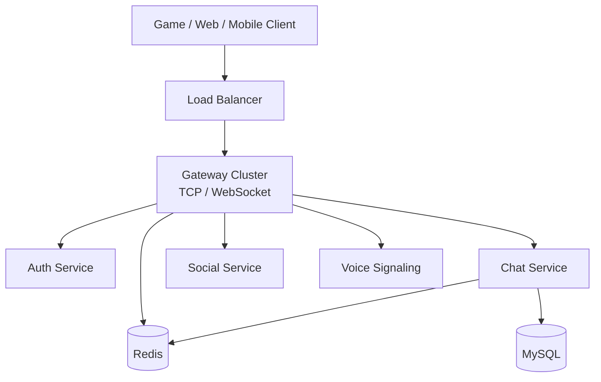

> 🌐 Language: [中文](../zh/design-notes/game_chat_architecture.md)) | **English** (this page)

# Game chat architecture notes

This page is kept as a design note (design-notes) for the game chat scenario. For the current prototype wireframes of the app chat UI and the in-game integration diagrams, see [App chat prototype](app_chat_prototype.md).

For the current repository architecture, service boundaries, protocol baseline, and the architecture soundness review, read [Overall Architecture](../architecture.md)) first.

## Current position

The currently supported backend path is `gateway + auth + chat`.

- `gateway` is the login/session edge; it currently handles login, logout, heartbeat, and optional Redis backing for cross-instance kicks.
- `chat` is currently a standalone TCP/WebSocket service and the actual entry point for the current chat smoke tests.
- Social, voice, notification, search, the SDK wrapper layer, the mobile apps, and the admin dashboard are experimental or demo surfaces unless [Capability Matrix](../CAPABILITY_MATRIX.md)) says otherwise.

## Design intent

The long-term direction is still a unified real-time communication platform for games and companion apps:

- Game clients can do predictable binary protocol integration over TCP.
- Web and mobile companion clients can use WebSocket.
- A future gateway can become the single public edge, routing business packets to internal services.
- Redis can continue as the fast shared coordination layer for session ownership, Pub/Sub, recent/offline buffering, and distributed routing.
- MySQL can continue as the persistent history and account/session storage when the enhanced build is enabled.

## A reasonable target shape



This target is reasonable, but it is not today's implemented runtime. The missing architectural pieces are gateway-to-business-service routing and a unified session/auth contract.

## Protocol choice

The current code uses the same binary protocol over TCP and WebSocket:

```
[uint32_be payload_size][chirp.gateway.Packet protobuf bytes]
```

`Packet.msg_id` identifies the business message, and `Packet.body` carries the serialized protobuf request or response.

For game clients this is a good choice: compact, stable across languages, and covering both TCP and WebSocket. KCP/QUIC and a full WebRTC media path should be left as separate future decisions rather than implicitly promised by the current core.

## Practical advice

- For local verification, use the current direct `chat` path described in [Overall Architecture](../architecture.md)).
- For product architecture, once gateway routing is implemented, converge on a single public edge first.
- Do not write social, voice, search, push, or advanced chat features up as "supported" until they have matching tests and a clear runtime topology.
