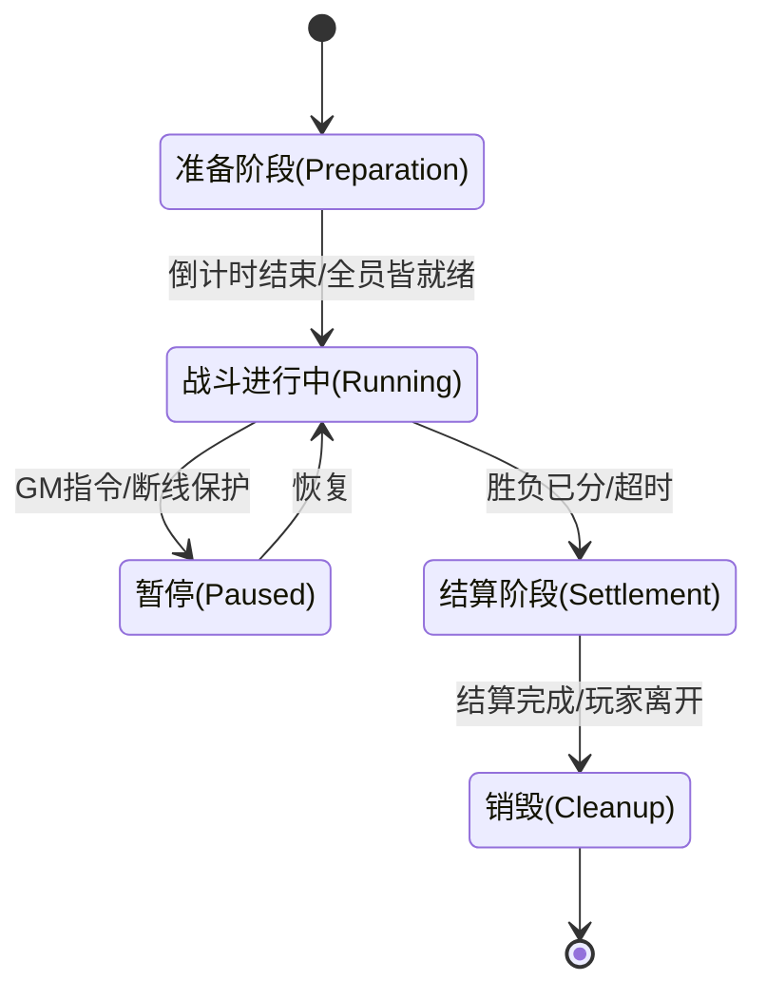

> 🌐 Language: [中文](../zh/design-notes/game_combat_best_practices.md)) | **English** (this page)

# Game Combat System Best Practices

> Status note: this page is generic game combat design notes, not a statement of Chirp's current backend capabilities. It is better used as a reference for gameplay systems or client implementation.

For tower defense (Tower Defense) and MMORPG games, the design focus of the combat system differs, yet the architectural patterns share quite a lot.

## 1. Core architectural pattern: Entity-Component-System (ECS) vs object-oriented (OOP)

For a modern game combat system, **prefer ECS or composition over inheritance**.

- **Problems with traditional OOP**:
  - hierarchies grow too deep (`Unit` -> `Movable` -> `CombatUnit` -> `Hero`), hard to maintain.
  - cache-unfriendly (data scattered across memory).
- **Advantages of ECS**:
  - **Composability**: a tower in tower defense and a player in an MMORPG can both just be a combination of `Position` + `Health` + `Skill` components.
  - **Performance**: data stored contiguously (data locality), which is critical for a game like tower defense where a single screen may hold thousands of units.

---

## 2. Tower Defense best practices

The core challenges of tower defense combat are **pathfinding and collision computation for massive unit counts** and **determinism**.

### A. Spatial partitioning

- **Pain point**: hundreds of towers each second must find the thousands of monsters within attack range. $O(N^2)$ complexity is unacceptable.
- **Solution**: use a **QuadTree** or **spatial hashing** (Grid).
  - Each Grid stores the monster IDs inside it.
  - A tower only queries the Grids its attack radius covers.

### B. Object pooling

- **Pain point**: bullets, effects, and monsters are created and destroyed constantly, causing GC pressure (in GC languages) or memory fragmentation.
- **Solution**: all combat entities (especially bullets) must be pre-allocated and reused.

### C. Determinism

- **Scenarios**: anti-cheat verification, and even online modes (such as the Warcraft 3 model).
- **Solution**:
  - Separate logic from rendering.
  - Use fixed-point math instead of floating point to guarantee identical results across platforms.
  - All random numbers use a unified seed sequence.

---

## 3. MMORPG best practices

The core challenges of an MMORPG are **masking network latency**, **state synchronization**, and **skill system complexity**.

### A. Skill system (GAS - Gameplay Ability System)

This is the current industry standard (e.g. Unreal Engine); even if you do not use Unreal, its architecture is worth referencing:

- **Ability (skill)**: not just "deal damage" but a logic flow (wind-up -> hit check -> settlement -> backswing).
- **Effect (buff)**: every state change (HP loss, poison, haste) is abstracted as a GameplayEffect.
- **Tag**: use tags to control logic. For example, the "stunned" state carries the `State.Stunned` tag, while casting a skill requires `!State.Stunned`.
- **Attribute**: base attributes (strength) derive computed attributes (attack power), recalculated automatically.

### B. Network synchronization model

- **State synchronization**:
  - The client sends operation commands ("Cast Skill A at Target B").
  - The server validates CD, distance, and cost, then broadcasts the result ("User A cast Skill A, User B took 100 dmg").
  - **Never trust the client's computation** (do not send "I dealt 100 dmg" directly).
- **Client prediction**:
  - **Movement**: the client moves first, the server rolls back and corrects (rubber banding).
  - **Presentation**: skill effects play immediately; damage numbers wait for the server reply.

### C. Area of Interest (AOI)

- An MMO must implement AOI: only synchronize entity state around each player's view, to save bandwidth.
- Common approaches: the 9-grid or the cross linked list.

---

## 4. Combat core system design

For **timers, lifecycle, and the update loop**, the standard design patterns are as follows:

### A. Drive model: fixed time step

Never update combat logic directly from the system clock's `delta`, because network jitter and machine performance lead to unpredictable results.

**Best practice: the accumulator pattern**

```cpp
// pseudocode: main loop
const double MS_PER_UPDATE = 16.666; // 60Hz logic frame (or the MMO-typical 100ms/10Hz)
double accumulated_time = 0.0;

void GameLoop() {
    double current_time = GetHighResTime();
    double delta = current_time - last_time;
    last_time = current_time;

    accumulated_time += delta;

    // catch-up logic: if too much time has piled up, run Update several times in a row
    while (accumulated_time >= MS_PER_UPDATE) {
        BattleInstance->Update(MS_PER_UPDATE); // pass the fixed dt
        accumulated_time -= MS_PER_UPDATE;
    }

    // Render uses interpolation to smooth presentation (Client Side)
}
```

- **Advantage**: guarantees the same number of logic iterations for every player on every machine, keeping physics and CD computations stable.

### B. Timer management

Combat is full of timing needs: buff durations, skill CDs, delayed damage settlement.

- **Do not**:

  - Do not use `std::thread` or `sleep`.
  - Do not store a separate `float timer` in every subordinate object (e.g. every buff) and `-= dt` it each frame (with tens of thousands of objects, the traversal cost is huge).

- **Recommended approach 1: priority queue (min-heap)**

  - Fits: the number of simultaneous timers is < 1000.
  - Principle: put all timed tasks into a min-heap keyed by their **absolute trigger timestamp**.
  - Tick: each frame only check `Queue.top()`; if `now >= top.executeTime`, pop and execute, repeating until the heap top's time has not yet arrived.
  - Complexity: insert $O(\log N)$, peek $O(1)$.

- **Recommended approach 2: timing wheel** (used by the Linux kernel / Netty)
  - Fits: massive timer counts (e.g. an MMO server with tens of thousands of buffs).
  - Principle: like clock ticks — a pointer advances one slot per frame, and tasks hang on the slot's linked list.
  - Complexity: insert $O(1)$, execute $O(1)$.

```cpp
// simple timer manager interface
class BattleTimer {
public:
    using TimerID = uint64_t;
    using Callback = std::function<void()>;

    // register a timer to execute after delayMs
    TimerID AddTimer(uint32_t delayMs, Callback cb);

    // cancel a timer (e.g. a buff gets dispelled)
    void CancelTimer(TimerID id);

    // call this inside the main-loop Update
    void Tick(uint64_t currentServerTimeMs);
};
```

### C. Combat lifecycle (FSM)

A single battle must be an explicit **finite state machine**.



**Code structure example**:

```cpp
class BattleInstance {
    enum class State { PREPARE, RUNNING, SETTLEMENT, FINISHED };
    State currentState;

    // core components
    BattleMap map;
    EntityManager entityMgr;
    BattleTimer timerMgr;

public:
    void Update(double dt) {
        // 1. drive the timers
        timerMgr.Tick(GetLogicTime());

        // 2. dispatch logic by state
        switch (currentState) {
            case State::Running:
                entityMgr.Update(dt); // movement, attacks, AI
                CheckWinCondition();  // win-condition check
                break;
            // ...
        }
    }

    void StartBattle() {
        currentState = State::Running;
        OnBattleStart(); // fire the various "on battle start" passive skills
    }
};
```

---

## 5. Server-side combat architecture in detail

The biggest differences of server-side combat design from the client are **stability, concurrency handling**, and **anti-cheat**.

### A. Concurrency models

How do you use a multi-core CPU to handle thousands of concurrent battle instances?

#### 1. Actor model (recommended)

- **Concept**: each battle room (Room/Zone) is an independent Actor.
- **Threading model**:
  - **Logic Thread**: all combat logic for one Actor executes serially inside it (lock-free).
  - **Worker Pool**: a fixed-size thread pool (e.g. CPU core count) schedules the thousands of Actors.
- **Advantages**:
  - **Lock-free programming**: no `mutex` is needed, hence no lock contention and no deadlocks.
  - **High throughput**: the thread pool spreads across cores, using them fully.
- **Implementations**: C++ can use `CAF (C++ Actor Framework)`; Go supports it natively (Goroutine + Channel); Java can use `Akka`.

#### 2. Thread-per-Zone (the traditional model)

- **Concept**: dedicate one thread to running one map or battle.
- **Drawbacks**: heavy thread-switching overhead, and once the number of battles exceeds the CPU core count, performance drops sharply. Only fits a small number of extremely heavy battles (e.g. a single-server, ten-thousand-players-on-screen nation war).

#### 3. Parallelizing ECS systems

- **Concept**: under ECS, `MovementSystem` handles movement for all entities and `DamageSystem` handles all damage. These systems can run in parallel.
- **Note**: extremely hard to implement, requiring careful data-dependency analysis. Usually seen only in single-player AAA titles or a rare few high-performance engines.

### B. State management and persistence

**Golden rule: never block on database reads or writes during combat.**

#### 1. In-memory is king

- At battle start: load all player data from DB/Redis into memory (Player Objects).
- During the battle: **all** reads and writes stay in memory.
- At battle end / periodically: write back asynchronously to the database.

#### 2. Asynchronous persistence design

Never call `db.Update()` inside `OnDamage()`.

```cpp
// wrong example (a source of stalls)
void OnDamage(Player* p, int dmg) {
    p->hp -= dmg;
    db.Execute("UPDATE players SET hp = ? WHERE id = ?", p->hp, p->id); // blocking IO!
}

// right example (async queue)
void OnDamage(Player* p, int dmg) {
    p->hp -= dmg;
    p->SetDirty(true); // mark the data dirty
}

// a separate Persistence Thread runs every few seconds or at battle end
void PersistenceLoop() {
    while (true) {
        auto dirtyPlayers = CollectDirtyPlayers();
        BulkUpdateDB(dirtyPlayers); // bulk writes, greatly improving throughput
        Sleep(5000);
    }
}
```

### C. Network and tick synchronization (server authoritative)

#### 1. Authoritative server

- Server data is always authoritative. A client's `Move(x, y)` is only a **request**; the server computes and returns `NewPos(x', y')`.
- **Anti-teleport / anti-speedhack**: every frame the server validates `dist(last_pos, new_pos) <= max_speed * dt`.

#### 2. Buffering and interpolation

- The server usually sends snapshots at a fixed rate, e.g. every 50ms (20Hz).
- On receiving a snapshot, the client does not render immediately but puts it into a buffer queue.
- The client's render time usually **lags** the server by 1-2 packets (render delay) and linearly interpolates between two snapshots, so the movement of other players looks smooth.

#### 3. You may not even need TCP

- Extremely demanding real-time (FPS/MOBA): **UDP (KCP/QUIC)** is a must. Retransmitting lost packets causes "stutter"; it is better to drop stale packets outright and process only the newest state packets.
- MMORPG/card/turn-based games: TCP/WebSocket is enough.

---

## 6. Summary

| Feature          | Tower Defense                    | MMORPG                         |
| :----------- | :------------------------------------- | :----------------------------- |
| **Bottleneck**     | CPU / memory bandwidth (massive unit counts)              | network bandwidth / latency / database consistency |
| **Sync model** | the key here is usually deterministic lockstep (online play) | state synchronization (state sync)          |
| **Core algorithms** | A\* pathfinding, spatial hashing, collision detection            | skill logic (GAS), AOI, persistence     |
| **Recommended architecture** | ECS (purely data-driven)                       | ECS or the Actor model (RPC-friendly)  |

If you are extending within the existing `chirp` project (which looks like a C++ network service), the suggestion is to start by building the **AOI service** and the **basic attribute components**.
