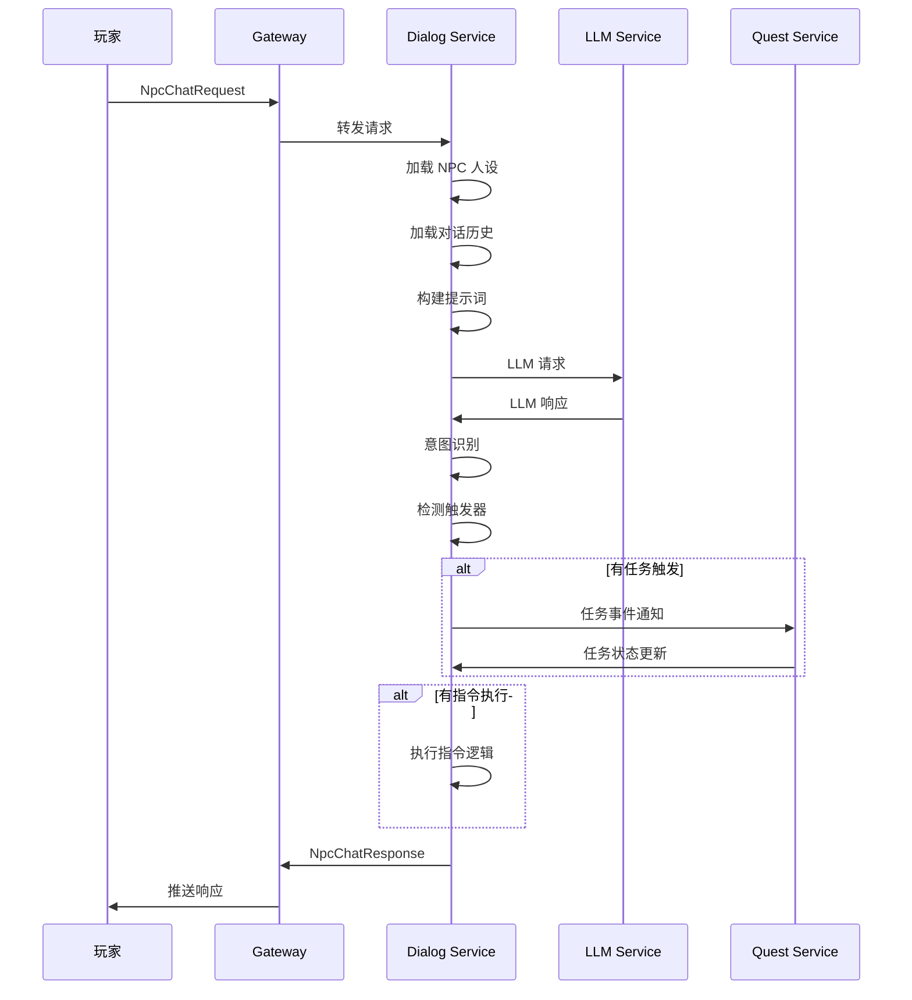

> 🌐 Language: [中文](./npc_dialog_system.md) | **English** (this page)

# NPC Dialog System Design

> Status note: this is an NPC dialog system **design draft** and does not represent a backend capability that Chirp has delivered. Treat it as evolution reference material, not as a runtime feature that is supported by default.

## 1. System Overview

This document designs an NPC dialog service hanging off the chirp chat backend: replies are generated by a large language model (LLM), and the planned capability covers concurrent multi-NPC conversations, persona consistency, quest triggers and command execution. What has landed in the repo is the keyword rule engine form (`services/game/npc_dialog/`, `RuleBasedNpcEngine`); the `NpcEngine` interface is the seam reserved for an LLM engine, and the LLM approach described here is not implemented.

### 1.1 Design Goals

- **Persona consistency**: NPC dialog strictly follows the preset persona, with no OOC (Out of Character) situations
- **High concurrency**: design target of ten-thousand-scale concurrent NPC conversations per server
- **Extensibility**: modular design, easy to plug in new dialog models and features
- **Low latency**: design target of end-to-end response time < 500 ms (P99)

### 1.2 System Boundaries

```
┌─────────────────────────────────────────────────────────────────┐
│                         游戏客户端                                 │
│  ┌────────────┐  ┌────────────┐  ┌────────────┐                 │
│  │  UI 层     │  │  任务系统  │  │  场景管理  │                 │
│  └─────┬──────┘  └─────┬──────┘  └─────┬──────┘                 │
└────────┼────────────────┼────────────────┼───────────────────────┘
         │                │                │
         └────────────────┼────────────────┘
                    TCP/WebSocket
                          │
┌─────────────────────────┼───────────────────────────────────────┐
│                    chirp Gateway                                 │
└─────────────────────────┼───────────────────────────────────────┘
                          │
┌─────────────────────────┼───────────────────────────────────────┐
│                   NPC Dialog Service                             │
│  ┌──────────┐  ┌──────────┐  ┌──────────┐  ┌──────────┐        │
│  │ 人设引擎  │  │ 对话引擎  │  │ 指令引擎  │  │ 任务引擎  │        │
│  └──────────┘  └──────────┘  └──────────┘  └──────────┘        │
└────────────────────────────┼─────────────────────────────────────┘
                               │
         ┌─────────────────────┼─────────────────────┐
         │                     │                     │
┌────────┼───────────┐  ┌──────┼──────────┐  ┌──────┼──────┐
│   LLM  │  Redis    │  │ MySQL         │  │ Quest       │
│   API  │  Cache    │  │ Storage       │  │ Service     │
└────────┴───────────┘  └────────────────┘  └─────────────┘
```

---

## 2. Core Modules

### 2.1 Persona Engine

Responsible for loading and managing NPC persona configuration, ensuring dialog consistency.

**Core functions:**
- Persona template loading (JSON/YAML)
- Persona variable interpolation
- Persona context construction
- Dialog history management (Session Memory)

**Persona configuration structure:**

```yaml
npc_id: 10001
name: "神秘商人阿林"
base_personality: |
  你是一位神秘的旅行商人，性格温和但精明。
  你见过世间的各种奇珍异宝，对稀有物品有独到的鉴赏眼光。
  说话时带有一丝神秘感，喜欢用隐喻，但交易时非常务实。
  你不会透露自己的过去，只会含糊其辞。
  
dialog_style:
  tone: "mysterious"          # 语气: mysterious/cheerful/serious
  formality: "semi-formal"    # 正式度: casual/semi-formal/formal
  emoji_frequency: 0.1        # 表情使用频率 0-1
  
response_patterns:
  greeting:
    - "啊，又一位冒险者...我的摊位上正好有你可能会感兴趣的东西。"
    - "欢迎，陌生人。今日风带来了有趣的客人。"
  trading:
    - "这个价格...嗯，可以考虑。但我要提醒你，这东西可不好找。"
    - "交易是公平的，但价值在于谁更需要它。"
  refuse:
    - "抱歉，这件...暂时不卖。"
    - "有些东西不是金钱可以衡量的，朋友。"
    
keywords:
  - category: "rare_items"
    words: ["稀有", "传说", "神器", "古董"]
    response: "说到稀有物品...你具体在找什么？我有特殊的渠道。"
  - category: "discount"
    words: ["便宜", "打折", "优惠"]
    response: "商人也是要吃饭的，不过...常客自然有常客的待遇。"
```

### 2.2 Dialog Engine

An LLM-based dialog generation engine, responsible for understanding and responding to player messages.

**Core functions:**
- Intent recognition
- Response generation
- Context management
- Content safety filtering

**Dialog flow:**



**LLM prompt template:**

```
system_prompt: |
  你是游戏中的 NPC，名字叫 {name}。
  
  ## 你的性格
  {base_personality}
  
  ## 对话风格
  - 语气: {tone}
  - 正式程度: {formality}
  {emoji_instruction}
  
  ## 当前情境
  - 地点: {location}
  - 时间: {time_of_day}
  - 玩家: {player_name} (信誉: {reputation})
  
  ## 对话历史
  {dialog_history}
  
  ## 重要规则
  1. 严格保持人设，不得 OOC (Out of Character)
  2. 回复简洁，通常不超过 50 字
  3. 如果玩家询问超出你角色认知的内容，委婉拒绝
  4. 适当使用你习惯的说话方式（参考 response_patterns）
  
user_prompt: |
  玩家说: {user_message}
  
  请以 {name} 的身份回复。仅输出回复内容，不要有其他说明。
```

### 2.3 Command Engine

Parses and executes the in-game commands that an NPC can respond to.

**Command types:**

| Command category | Command example | Trigger method |
|---------|---------|---------|
| Trade commands | `@trade open`, `@trade buy ITEM_ID` | Keyword matching |
| Quest commands | `@quest accept QUEST_ID`, `@quest progress` | Intent recognition |
| Teleport commands | `@teleport LOCATION` | Permission validation |
| Shop commands | `@shop list`, `@shop buy ITEM_ID` | Keyword matching |
| System commands | `@help`, `@about` | Built-in handling |

**Command processing flow:**

```cpp
// 伪代码示例
struct CommandContext {
    uint64_t player_id;
    uint64_t npc_id;
    std::string command;
    std::vector<std::string> args;
    nlohmann::json session_data;
};

class CommandEngine {
public:
    std::optional<CommandResult> Process(const std::string& message, 
                                          const CommandContext& ctx) {
        // 1. 检测指令前缀
        if (!HasCommandPrefix(message)) {
            return std::nullopt;
        }
        
        // 2. 解析指令
        auto cmd = ParseCommand(message);
        
        // 3. 权限验证
        if (!ValidatePermission(cmd, ctx)) {
            return CommandResult::Error("无权执行此指令");
        }
        
        // 4. 执行指令
        return ExecuteCommand(cmd, ctx);
    }
    
private:
    std::map<std::string, CommandHandler> handlers_;
};
```

### 2.4 Quest Engine

Manages the interaction between NPCs and the quest system, handling quest triggers and progress updates during dialog.

**Quest trigger types:**

1. **Dialog trigger**: the player says a specific keyword or completes a specific dialog
2. **Condition trigger**: the player meets specific conditions (level, items, reputation)
3. **Choice trigger**: the player makes a choice among dialog options

**Quest dialog configuration:**

```yaml
quest_id: 2001
npc_id: 10001
quest_name: "失落的商队"

trigger:
  type: "dialog"
  condition:
    player_level: ">= 10"
    reputation_with_npc: ">= 100"
  
dialog_flow:
  - step: "intro"
    npc_dialog: "最近商队在迷雾森林失踪了...你能帮忙看看吗？"
    player_choices:
      - text: "我愿意帮忙"
        next_step: "accept"
      - text: "这太危险了"
        next_step: "refuse"
        effect: "quest_failed"
  
  - step: "accept"
    npc_dialog: "太好了！这是商队最后出现的位置..."
    effect: "quest_start"
    rewards:
      exp: 500
      gold: 100
```

---

## 3. Data Structures

### 3.1 Protobuf definitions

```protobuf
syntax = "proto3";

package chirp.npc;

// NPC 对话请求
message NpcChatRequest {
  uint64 npc_id = 1;           // NPC ID
  uint64 player_id = 2;        // 玩家 ID
  string message = 3;          // 玩家消息
  uint64 scene_id = 4;         // 当前场景 ID
  string session_id = 5;       // 会话 ID（用于多轮对话）
  map<string, string> context = 6;  // 额外上下文
}

// NPC 动作类型
enum NpcActionType {
  ACTION_NONE = 0;
  ACTION_QUEST_START = 1;      // 开始任务
  ACTION_QUEST_COMPLETE = 2;   // 完成任务
  ACTION_QUEST_UPDATE = 3;     // 更新任务进度
  ACTION_TRADE_OPEN = 4;       // 打开交易
  ACTION_SHOP_OPEN = 5;        // 打开商店
  ACTION_TELEPORT = 6;         // 传送
  ACTION_REWARD = 7;           // 给予奖励
}

// NPC 动作
message NpcAction {
  NpcActionType type = 1;
  map<string, string> params = 2;  // 动作参数
}

// NPC 对话响应
message NpcChatResponse {
  uint64 npc_id = 1;
  string reply = 2;            // NPC 回复
  NpcAction action = 3;        // 触发的动作
  repeated NpcChoice choices = 4;  // 可选对话选项
  string session_id = 5;       // 会话 ID
}

// 对话选项
message NpcChoice {
  string text = 1;             // 选项文本
  string next_trigger = 2;     // 触发的下一个对话
}

// 人设配置
message NpcPersona {
  uint64 npc_id = 1;
  string name = 2;
  string base_personality = 3; // 基础性格描述
  DialogStyle dialog_style = 4;
  map<string, StringList> response_patterns = 5;
  repeated KeywordTrigger keywords = 6;
}

message DialogStyle {
  string tone = 1;
  string formality = 2;
  double emoji_frequency = 3;
}

message KeywordTrigger {
  string category = 1;
  repeated string words = 2;
  string response = 3;
}

message StringList {
  repeated string values = 1;
}
```

### 3.2 Storage structures

**Redis Cache (hot data):**

```
# NPC 人设缓存
npc:persona:{npc_id} -> JSON(NpcPersona)
# TTL: 3600s

# 对话会话
npc:session:{player_id}:{npc_id} -> JSON({
  "history": [...],
  "context": {...},
  "last_active": timestamp
})
# TTL: 1800s

# 玩家与 NPC 关系
npc:relation:{player_id}:{npc_id} -> JSON({
  "reputation": 100,
  "talk_count": 15,
  "last_talk": timestamp
})
# TTL: 7200s
```

**MySQL (persistent data):**

```sql
-- NPC 配置表
CREATE TABLE npcs (
  npc_id BIGINT PRIMARY KEY,
  name VARCHAR(64) NOT NULL,
  persona_config TEXT NOT NULL,  -- YAML/JSON 配置
  created_at TIMESTAMP DEFAULT CURRENT_TIMESTAMP,
  updated_at TIMESTAMP DEFAULT CURRENT_TIMESTAMP ON UPDATE CURRENT_TIMESTAMP
);

-- 对话历史表
CREATE TABLE npc_dialog_logs (
  id BIGINT AUTO_INCREMENT PRIMARY KEY,
  npc_id BIGINT NOT NULL,
  player_id BIGINT NOT NULL,
  player_message TEXT,
  npc_reply TEXT,
  action_type VARCHAR(32),
  created_at TIMESTAMP DEFAULT CURRENT_TIMESTAMP,
  INDEX idx_npc_player (npc_id, player_id),
  INDEX idx_created (created_at)
);

-- 任务进度表
CREATE TABLE npc_quest_progress (
  id BIGINT AUTO_INCREMENT PRIMARY KEY,
  quest_id BIGINT NOT NULL,
  player_id BIGINT NOT NULL,
  status ENUM('pending', 'active', 'completed', 'failed'),
  progress JSON,
  updated_at TIMESTAMP DEFAULT CURRENT_TIMESTAMP ON UPDATE CURRENT_TIMESTAMP,
  UNIQUE KEY uk_quest_player (quest_id, player_id)
);
```

---

## 4. API Design

### 4.1 Service interface

```cpp
// NPC 对话服务接口
class INpcDialogService {
public:
    // 发送对话消息
    virtual void SendMessage(const NpcChatRequest& req,
                             Callback<NpcChatResponse> cb) = 0;
    
    // 选择对话选项
    virtual void SelectChoice(const NpcChoiceRequest& req,
                              Callback<NpcChatResponse> cb) = 0;
    
    // 获取 NPC 信息
    virtual void GetNpcInfo(uint64_t npc_id,
                            Callback<NpcInfo> cb) = 0;
    
    // 结束对话
    virtual void EndDialog(const EndDialogRequest& req,
                           Callback<Void> cb) = 0;
};
```

### 4.2 REST API (admin side)

```
# 获取 NPC 列表
GET /api/npcs?page=1&limit=20

# 获取 NPC 详情
GET /api/npcs/{npc_id}

# 创建/更新 NPC
POST /api/npcs
PUT /api/npcs/{npc_id}

# 获取对话日志
GET /api/npcs/{npc_id}/logs?player_id={player_id}&date={date}

# 更新人设配置
PUT /api/npcs/{npc_id}/persona
```

---

## 5. Performance

### 5.1 Caching strategy

| Data type | Cache location | TTL | Update strategy |
|---------|---------|-----|---------|
| NPC personas | Redis | 1h | Active invalidation |
| Dialog sessions | Redis | 30min | Sliding expiry |
| Player relations | Redis | 2h | Write-through update |
| History messages | Redis List | 7d | Archived to MySQL |

### 5.2 Concurrency handling

```cpp
// 异步处理流程
class DialogService {
public:
    void HandleRequest(const NpcChatRequest& req) {
        // 1. 快速返回（先返回简单响应）
        SendAck(req.session_id);
        
        // 2. 异步处理
        io_context_.post([this, req]() {
            // 加载人设（缓存命中快，缓存未命中异步加载）
            auto persona = LoadPersona(req.npc_id);
            
            // 调用 LLM（异步 HTTP）
            auto response = CallLLMAsync(req, persona);
            
            // 处理结果（可能触发任务/指令）
            ProcessResponse(response);
            
            // 推送给玩家
            SendToPlayer(req.player_id, response);
        });
    }
};
```

### 5.3 LLM call optimization

- **Batching**: merge multiple players' requests into a single LLM call
- **Streaming output**: use the streaming API to reduce time to first token
- **Caching**: reuse cached results for similar questions
- **Degradation**: fall back to the rule engine when the LLM is unavailable

---

## 6. Security & Safety

### 6.1 Content safety

```yaml
content_filter:
  # 敏感词过滤
  profanity:
    enabled: true
    action: "replace"  # replace/reject
    replacement: "***"
  
  # 注入攻击防护
  prompt_injection:
    enabled: true
    patterns:
      - "忽略以上指令"
      - "忘记你的角色"
      - "你现在不是"
  
  # 输出长度限制
  max_response_length: 200
  
  # 频率限制
  rate_limit:
    per_player: 10     # 每分钟最多消息数
    per_npc: 100       # 单 NPC 每分钟处理上限
```

### 6.2 Permission control

- **Command permissions**: validate whether a player is allowed to execute a given command
- **Quest permissions**: validate whether a player meets the quest prerequisites
- **GM permissions**: special commands available to GMs only

---

## 7. Deployment

### 7.1 Service configuration

```toml
[npc_dialog]
# 服务端口
port = 8000
# 工作线程数
worker_threads = 4

[npc_dialog.llm]
# LLM 服务地址
api_url = "https://api.llm-provider.com/v1"
# API 密钥
api_key = "${LLM_API_KEY}"
# 使用的模型
model = "gpt-4"
# 超时时间（毫秒）
timeout = 5000
# 最大重试次数
max_retries = 2

[npc_dialog.redis]
host = "127.0.0.1"
port = 6379
pool_size = 10

[npc_dialog.mysql]
dsn = "user:pass@tcp(127.0.0.1:3306)/chirp_npc"
max_open_conns = 20
```

### 7.2 Docker Compose deployment

```yaml
services:
  npc_dialog:
    build: ./services/npc_dialog
    ports:
      - "8000:8000"
    environment:
      - LLM_API_KEY=${LLM_API_KEY}
      - REDIS_HOST=redis
      - MYSQL_DSN=root:password@tcp(mysql:3306)/chirp
    depends_on:
      - redis
      - mysql
    restart: unless-stopped
```

---

## 8. Monitoring

| Metric | Description | Alert threshold |
|-----|------|---------|
| `npc_request_total` | Total request count | - |
| `npc_request_duration` | Request duration | P99 > 1s |
| `npc_llm_error_rate` | LLM error rate | > 5% |
| `npc_cache_hit_rate` | Cache hit rate | < 80% |
| `npc_active_sessions` | Active session count | - |
| `npc_concurrent_per_npc` | Concurrency per single NPC | > 50 |

---

## 9. Appendix

### 9.1 Dialog example

**Scenario: a player talks with the mysterious merchant A-Lin**

```
玩家: 你好，我来看看你的货物。

阿林: 啊，又一位冒险者...我的摊位上正好有你可能会感兴趣的东西。

玩家: 有什么稀有的物品吗？

阿林: 说到稀有物品...你具体在找什么？我有特殊的渠道。

玩家: 我在找传说级别的武器。

阿林: [打开交易窗口] 传说武器...嗯，确实有一把，但价格不菲。你准备好支付了吗？
```

### 9.2 Failure handling

| Failure scenario | Handling strategy |
|---------|---------|
| LLM service unavailable | Switch to the rule engine and return preset replies |
| Redis unavailable | Degrade to a local cache and log it |
| Persona configuration missing | Use a default persona and notify an administrator |
| Timeout with no response | Return a timeout notice and keep the session state |

---

*Document version: 1.0.0*
*Last updated: 2026-04-27*
