> 🌐 Language: [中文](../zh/guide/config-effects.md) | **English** (this page)

# Config switch effects

Before/after evidence for the switches that change what the app does when
toggled. Each switch shows the off/on pair of the control itself plus a GIF
alternating between the two states. Everything on this page is regenerated by
one script — do not hand-edit the images.

## Regenerate

```bash
# prerequisites: apps/desktop/dev/stack-up.sh stack online
node apps/desktop/dev/capture-switch-effects.mjs        # desktop app toggles
node apps/web_companion/scripts/capture-switch-effects.mjs   # web app toggles
python3 scripts/capture_cli_switch_effects.py          # server CLI flags
python3 scripts/build_config_switch_inventory.py --write   # refresh the switch inventory table
```

Outputs land in `docs/screenshots/switches/`. Every script asserts that the
switch actually changed state (desktop: button variant flips contained ↔
outlined; web: the switch input's `checked` property flips; CLI: the port goes
from refusing connections to answering `/health`; the auth scaffold probe's
`LOGIN_RESP` code flips from `AUTH_FAILED` to `OK` with a `user_id` echo; and
the password-login probe's second login flips from `SESSION_EXPIRED`-refused
to `OK` with `kick_previous=true`) and fails loudly otherwise.

Note on the CLI frames: this machine has no `xterm` or `asciinema`, so there is
no live terminal recording. The frames are the two real runs' captured output
rendered in a terminal style and stitched with ffmpeg — every line in them is
text that actually came back (`curl`'s error string included).

## Desktop app switches (covered)

### Desktop notifications (`通知`)

Asks the OS/browser for notification permission on first enable; afterwards
messages that arrive off-screen fire a system notification.

| Off | On |
| --- | --- |
|  |  |


Capture note: headless Chromium hard-denies the Notification permission, so
the capture rig stubs it (same practice as the unit-test environment). The GIF
documents the control's UI state flip; in the real desktop shell the permission
ask goes through the Tauri notification plugin.

### Friend-online notifications (`上线通知`)

Toast when a friend comes online (social plane).

| Off | On |
| --- | --- |
|  |  |


### Direct-message restriction (`私聊限制`)

When on, only friends and same-group members can DM you (server-enforced).

| Off | On |
| --- | --- |
|  |  |


## Web companion switches (covered)

The web app runs against the same dev stack; its own capture pipeline starts a
vite server on 3001 and retargets the `/ws/*` proxy at the stack's ports (the
`vite.config.ts` values such as 7001 are product defaults, not dev-stack ports).

### Desktop notifications (`开启桌面通知`)

Not a switch control: clicking the left-rail link asks the browser for the
permission, after which the link is replaced by `桌面通知已开启`. Off/on is
that label change.

| Off | On |
| --- | --- |
|  |  |


### Friend-online notifications (`好友` dialog)

Toast when a friend comes online.

| Off | On |
| --- | --- |
|  |  |


### Direct-message restriction (`好友` dialog)

Only friends / same-group members can DM you.

| Off | On |
| --- | --- |
|  |  |


### Game presence (`在线设备` dialog)

Friends can see what you are playing; private messages also get delivered into
the game. Off/on flips this switch.

| Off | On |
| --- | --- |
|  |  |


## Server CLI flags (covered)

### `--metrics_port <port>` (`chirp_chat` and the other long-lived services)

Default `0` means no listener at all; with a port, `libs/common`'s
`MetricsHttpServer` comes up on it. Off = connections to that port are refused,
on = `GET /health` answers `OK` and `GET /metrics` answers `200`.

| Off | On |
| --- | --- |
|  |  |


**Real behavior worth knowing**: the `/metrics` body comes back **empty**. No
service in the repo calls `SetMetricsHandler` (only
`tests/unit/common_metrics_test.cc` does), so the counters that are collected
into `SimpleMetrics` (e.g. `CHIRP_GAUGE_INC("chirp_chat_sessions")` in
`services/shared/chat/src/enhanced_dispatch.cc`) are never exported. Collected,
not published.

### `--allow_scaffold_login <0|1>` (`chirp_app_auth`)

Default `0`. With `1`, a `LOGIN_REQ` whose token is neither a valid access
token nor a live session falls back to *token == user_id* — the development
scaffold login the desktop dev stack relies on. With `0` (default) that login is
refused outright instead of trusting an arbitrary token as a user id.

| Off | On |
| --- | --- |
|  | 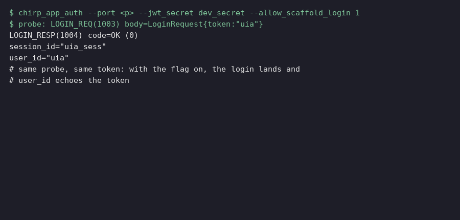 |

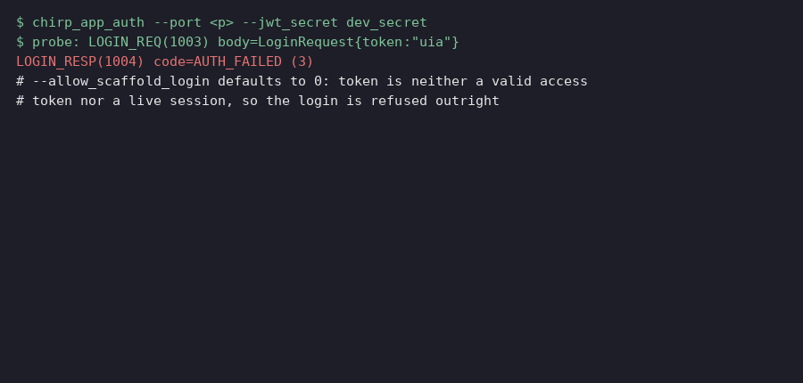

Evidence method: two `chirp_app_auth` instances on fresh ports — one default,
one with the flag on — probed over raw TCP with a `LOGIN_REQ` carrying
`LoginRequest{token:"uia"}`, same framing as `scripts/demo_account.py`
(`u32be` length prefix per `libs/network/protobuf_framing.h`). Off answers
`code=AUTH_FAILED (3)` with no `session_id`/`user_id`; on answers `code=OK (0)`
with `session_id="uia_sess"` and `user_id="uia"`.

### `--kick_previous <0|1>` (`chirp_app_auth`)

Default `1`. Consumed only on the password-login path, and only when the account
has hit its session cap (`--max_sessions`, default 5): with `1` the old sessions
are revoked and the new login succeeds, answering `kick_previous=true`; with
`0` the login is refused with `SESSION_EXPIRED`.

| Off | On |
| --- | --- |
| 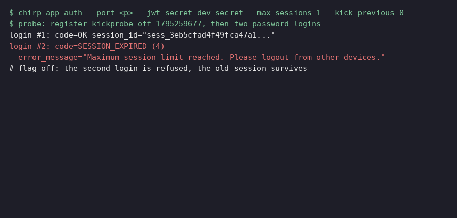 | 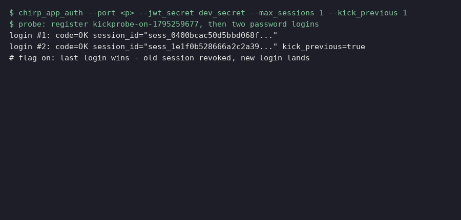 |


Evidence method: a throwaway account registered against the local `chirp` MySQL
database (no external credentials) with `--max_sessions 1`, so the second login
of that account hits the cap. Off answers `code=SESSION_EXPIRED (4)` with
`error_message="Maximum session limit reached..."` and no kick flag; on answers
`code=OK (0)` with a different `session_id` and `kick_previous=true`. The probe
accounts are deleted from the user / session / refresh-token tables after the
run.

Note: the legacy `LOGIN_REQ` scaffold path always answers
`kick_previous=true` regardless of this flag
(`services/app/auth/src/main_enhanced.cc`), so this switch only changes
behavior for password logins.

### `--word_filter_policy <replace|reject|record>` (`chirp_chat`)

Default `replace`. The source of truth is `WordFilterPolicyFromString`
(`services/shared/chat/src/word_filter.cc`), which accepts **only these three
strings**; any other value falls back to `replace`. It controls what happens to
a message that hits the sensitive-word lexicon:

- `replace` (default): every hit is masked in place (the default replacement
  is `**`) and the masked text is stored.
- `reject`: the whole message is refused before it reaches the store,
  answering `code=WORD_FILTERED (10)`; nothing is persisted.
- `record`: the content is stored **unchanged**; the hit only shows up in a
  server Warn log (`word filter recorded a hit from <sender> (N term hit(s))`)
  for later review.

| replace | reject | record |
| --- | --- | --- |
| 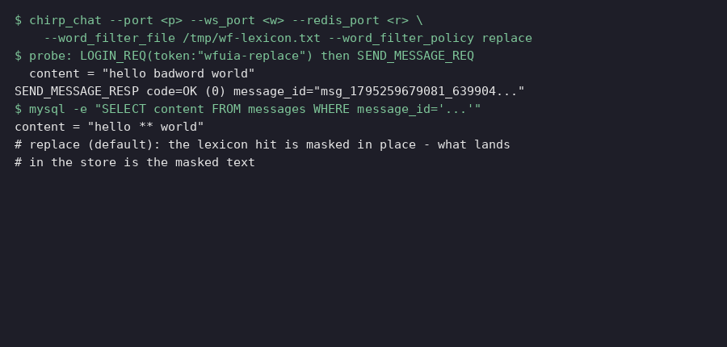 | 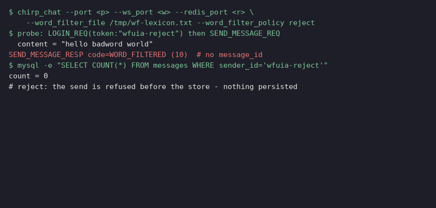 | 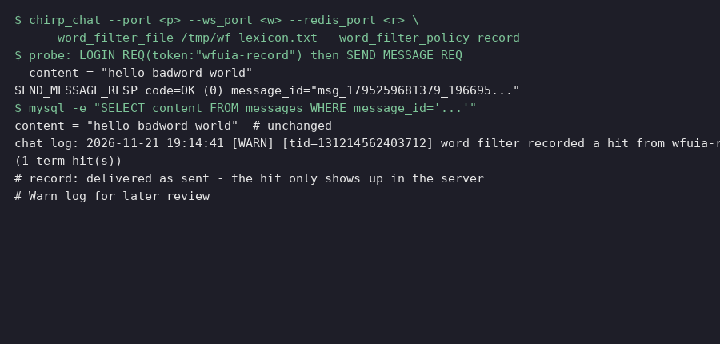 |


Evidence method: a lexicon file containing only `badword`; for each policy a
separate `chirp_chat` with `--word_filter_file <lexicon>
--word_filter_policy <policy>` on fresh ports (plus a probe-owned redis, so the
shared dev-stack redis is untouched), a scaffold login (`--token_secret` empty
means token == user id), then one private message `content="hello badword
world"`. The `SEND_MESSAGE_RESP` code and the `messages`-table content are
compared across the three: `hello ** world` (replace), zero rows (reject), and
`hello badword world` unchanged (record). The `wfuia-*` probe users and the
probe redis are cleaned up afterwards.

### `--enable_migration <0|1>` (`chirp_chat` enhanced)

Default `1`. Controls the background migration worker that moves the redis
hot tier into the MySQL cold tier: with `1` a `MessageMigrationWorker` starts
and scans the `chirp:chat:history:*` and `chirp:chat:offline:*` key patterns
every `--migration_interval` seconds (default 30), parsing each entry and
INSERT-ing it into the `messages` table; with `0` the worker never starts
(startup log: `MessageMigrationWorker disabled by configuration`) and whatever
lives only in redis stays there.

| Off | On |
| --- | --- |
|  |  |


Evidence method: no legacy data-bearing database is needed — the worker's
input state is simply "a ChatMessage that exists only in the redis hot tier",
so the probe hand-crafts one. Each variant gets its own redis and its own
`chirp_chat` (`--migration_interval 3` to make the worker tick fast); the
probe RPUSHes a serialized `ChatMessage` (same field layout the store writes,
`PrivateChannelId`'s sorted `a|b` key included) into
`chirp:chat:history:<channel>` — a message that never went through
`SendMessage`, so nothing but the migration worker could persist it. Off:
after more than two intervals the `messages` row count for that message_id is
still 0 and the log says the worker is disabled. On: within one interval the
row count is 1 and the log says the worker started. The `miguia-*` probe rows
and both probe redis instances are cleaned up afterwards.

### `--hub_mode <0|1>` (`chirp_chat`)

Default `0`. With `1` the chat opens the game-chat peer acceptor on
`--hub_peer_port` (default 8200) and logs `hub mode enabled: peer_port=<port>`.
With `0` (default) no such listener exists — the chat serves only the client
protocol on its main port. This is the "hub" half of the hub+spoke topology.

| Off | On |
| --- | --- |
|  | 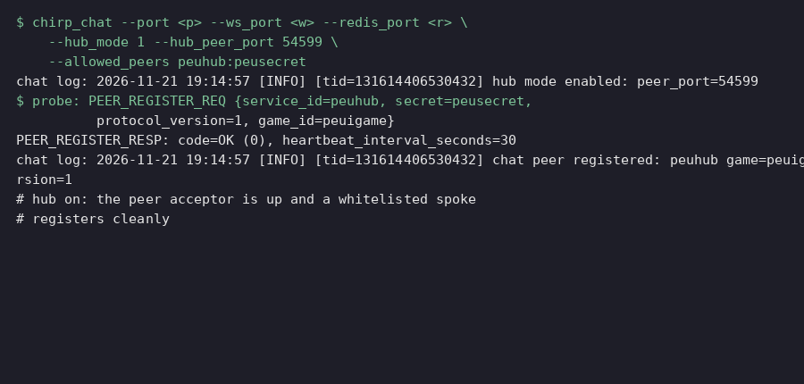 |

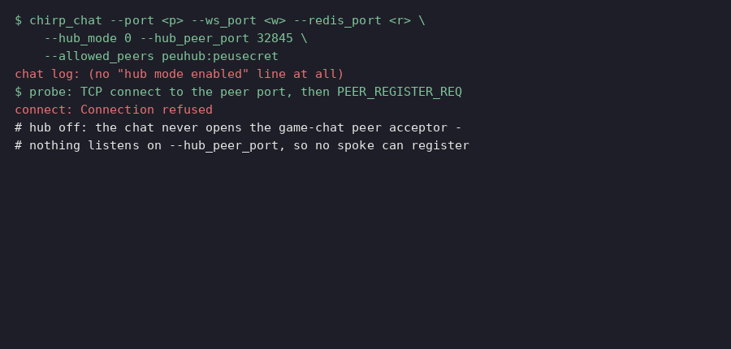

Evidence method: no real spoke is needed — the probe speaks the peer
registration protocol itself. Two `chirp_chat` instances (each with its own
probe redis): one without `--hub_mode`, one with
`--hub_mode 1 --hub_peer_port <port> --allowed_peers peuhub:peusecret`. The
probe connects to the peer port and sends `PEER_REGISTER_REQ`
(`gateway.proto`, msg 5050, same u32be+Packet framing) with
`service_id=peuhub, service_secret=peusecret, protocol_version=1,
game_id=peuigame`. Off: the connect is refused (the port was never bound) and
there is no `hub mode enabled` log line. On: the register answers
`code=OK (0)` with a `heartbeat_interval_seconds` and the log shows
`chat peer registered: peuhub game=peuigame version=1`
(`libs/network/chat_peer_hub.cc`). Registration is in-memory only, so nothing
persists to clean up.

### `--allow_unknown_peers <0|1>` (`chirp_chat`)

Default `0`. Consumed only when `--hub_mode 1`. Controls the peer
registration gate: with `0` (default) a peer whose `service_id` is not in
`--allowed_peers` is refused (`code=AUTH_FAILED (3)`, connection closed, Warn
log `chat peer registration rejected (not whitelisted): <id>`); with `1` the
same peer is accepted in open-registration mode (`code=OK (0)`).

| Off | On |
| --- | --- |
|  | 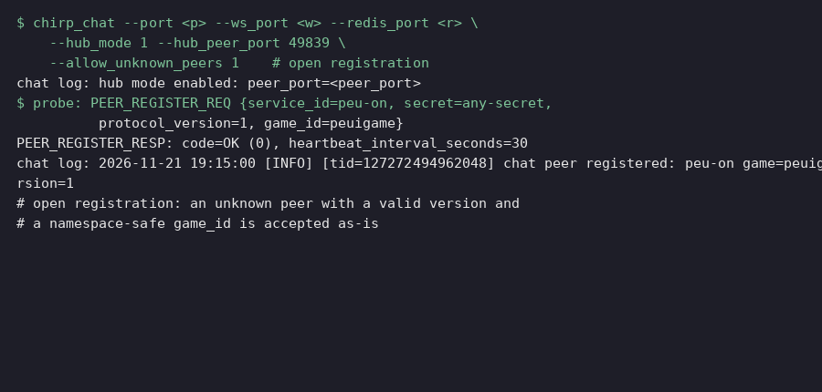 |

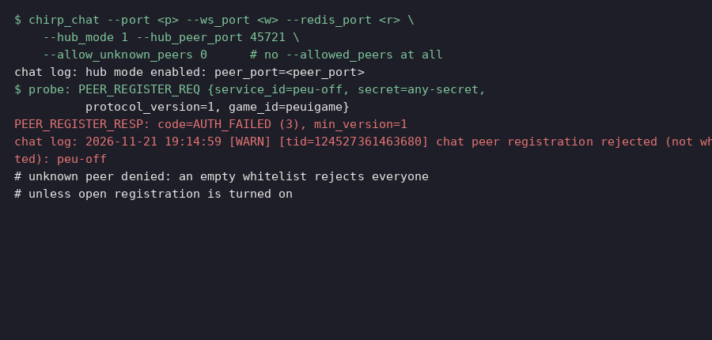

Evidence method: two `chirp_chat` instances, both `--hub_mode 1` on fresh
peer ports with their own probe redis and **no `--allowed_peers`** (so the
whitelist is empty); one with `--allow_unknown_peers 0`, one with `1`. The
probe sends the same `PEER_REGISTER_REQ` for an unknown `service_id`
(`peu-off`/`peu-on`, `protocol_version=1`, `game_id=peuigame`). Off answers
`code=AUTH_FAILED (3)` with `min_version=1` and the Warn log; on answers
`code=OK (0)` with a `heartbeat_interval_seconds` and the log
`chat peer registered: <id> game=peuigame version=1`.

## Complete switch inventory

Generated and source-verified by `scripts/build_config_switch_inventory.py` (it re-reads
every row's source file and fails loudly if a flag disappears or its default drifts, so the
table cannot silently go stale). Scope: **discrete** switches that change what the app does
once enabled — GUI switch controls plus CLI flags whose value is a discrete enum
(`on`/`off`, `0`/`1`, `logging|http`, `replace|reject|record`). Explicitly out of scope and
excluded from the table: numeric tuning knobs (rate limits, TTLs, caps, timeouts, retry
counts), connection endpoints (host/port), credentials (secret/token/password/key), and
compile-time or test-only switches.

<!-- switch-inventory:begin -->
| Switch | Service / plane | Default | Coverage |
|---|---|---|---|
| `desktop-notify` | desktop app | — | ✅ off/on + GIF |
| `friend-online-notify` | desktop app | — | ✅ off/on + GIF |
| `dm-restriction` | desktop app | — | ✅ off/on + GIF |
| `notify-enable` | web companion | — | ✅ off/on + GIF |
| `friend-online-notify-switch` | web companion | — | ✅ off/on + GIF |
| `dm-restriction-switch` | web companion | — | ✅ off/on + GIF |
| `game-presence-toggle` | web companion | — | ✅ off/on + GIF |
| `metrics_port` | chirp_chat and the other long-lived services | 0 | ✅ off/on + GIF |
| `allow_unknown_peers` | chirp_chat | 0 | ✅ off/on + GIF |
| `hub_mode` | chirp_chat | 0 | ✅ off/on + GIF |
| `enable_migration` | chirp_chat (enhanced) | 1 | ✅ off/on + GIF |
| `broker_consumer` | chirp_server_gateway | (空=关) | not covered: needs a scripted service rig — needs the broker stream plus two consumer instances |
| `kick_previous` | chirp_app_auth | 1 | ✅ off/on + GIF |
| `allow_scaffold_login` | chirp_app_auth | 0 | ✅ off/on + GIF |
| `word_filter_policy` | chirp_chat | replace | ✅ 3-state off/mid/on + GIF |
| `asr_disposition` | chirp_voice | flag | not covered: needs the ASR engine — the whole ASR chain needs the ASR engine and --asr_lexicon in place |
| `push_transport` | chirp_app_notification | logging | not covered: needs provider credentials — the dev stack does not run that service; real egress is also gated on FCM/APNs credentials |
| `push_verify_tls` | chirp_app_notification | on | not covered: needs provider credentials — same as above: needs one real outbound push |
| `apns-sandbox` | chirp_app_notification | (不传=生产端点) | not covered: needs provider credentials — ledger L25: missing the .p8 / Team ID / Key ID / Bundle ID |

<!-- switch-inventory:end -->

## Not covered yet

- `--push_transport logging|http` and the `--apns-*` / `--fcm-*` flags —
  proving delivery needs a dev stack that also runs `chirp_app_notification`
  with the gateway's `--notification_host/--notification_port/
  --notification_secret` wired to it (the desktop dev stack does not start that
  service at all), plus FCM/APNs credentials for a real egress. See the
  provider-egress paragraph in [deployment.md](deployment.md) for the runbook.
- Rate-limit / TTL knobs and compile-time or test-only switches — they change
  throughput or limits rather than an observable screen or endpoint, so an
  off/on image pair would not actually prove the effect.
