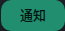
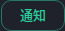
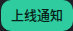
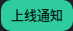
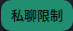

> 🌐 Language: [中文](../zh/guide/config-effects.md) | **English** (this page)

# Config switch effects

Before/after evidence for the switches that change what the app does when
toggled. Each switch shows the off/on pair of the control itself plus a GIF
alternating between the two states. Everything on this page is regenerated by
one script — do not hand-edit the images.

## Regenerate

```bash
# prerequisites: apps/desktop/dev/stack-up.sh stack running + vite dev server on :5180
node apps/desktop/dev/capture-switch-effects.mjs
```

Outputs land in `docs/screenshots/switches/`. The script asserts that each
toggle actually flips (contained ↔ outlined) and fails loudly otherwise.

## Desktop app switches (covered)

### Desktop notifications (`通知`)

Asks the OS/browser for notification permission on first enable; afterwards
messages that arrive off-screen fire a system notification.

| Off | On |
| --- | --- |
|  |  |



Capture note: headless Chromium hard-denies the Notification permission, so
the capture rig stubs it (same practice as the unit-test environment). The GIF
documents the control's UI state flip; in the real desktop shell the permission
ask goes through the Tauri notification plugin.

### Friend-online notifications (`上线通知`)

Toast when a friend comes online (social plane).

| Off | On |
| --- | --- |
|  |  |



### Direct-message restriction (`私聊限制`)

When on, only friends and same-group members can DM you (server-enforced).

| Off | On |
| --- | --- |
|  |  |


## Not covered yet

- `web_companion` toggles — same capture pipeline can be extended once its
  dev rig is scripted the same way.
- Server CLI flags (`--push_transport`, `--apns-*`, rate-limit knobs, …) —
  off→on evidence needs a scripted two-run server diff (logs/behavior capture);
  `asciinema` and `test-electron` are not installed on the current machine, so
  terminal-style recordings are not produced yet.
