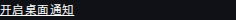
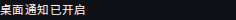

> 🌐 Language: [中文](../zh/guide/config-effects.md) | **English** (this page)

# Config switch effects

Before/after evidence for the switches that change what the app does when
toggled. Each switch shows the off/on pair of the control itself plus a GIF
alternating between the two states. Everything on this page is regenerated by
one script — do not hand-edit the images.

## Regenerate

```bash
# prerequisites: apps/desktop/dev/stack-up.sh stack online
node apps/desktop/dev/capture-switch-effects.mjs        # desktop app toggles
node apps/web_companion/scripts/capture-switch-effects.mjs   # web app toggles
python3 scripts/capture_cli_switch_effects.py          # server CLI flags
```

Outputs land in `docs/screenshots/switches/`. Every script asserts that the
switch actually changed state (desktop: button variant flips contained ↔
outlined; web: the switch input's `checked` property flips; CLI: the port goes
from refusing connections to answering `/health`) and fails loudly otherwise.

Note on the CLI frames: this machine has no `xterm` or `asciinema`, so there is
no live terminal recording. The frames are the two real runs' captured output
rendered in a terminal style and stitched with ffmpeg — every line in them is
text that actually came back (`curl`'s error string included).

## Desktop app switches (covered)

### Desktop notifications (`通知`)

Asks the OS/browser for notification permission on first enable; afterwards
messages that arrive off-screen fire a system notification.

| Off | On |
| --- | --- |
|  |  |


Capture note: headless Chromium hard-denies the Notification permission, so
the capture rig stubs it (same practice as the unit-test environment). The GIF
documents the control's UI state flip; in the real desktop shell the permission
ask goes through the Tauri notification plugin.

### Friend-online notifications (`上线通知`)

Toast when a friend comes online (social plane).

| Off | On |
| --- | --- |
|  |  |


### Direct-message restriction (`私聊限制`)

When on, only friends and same-group members can DM you (server-enforced).

| Off | On |
| --- | --- |
|  |  |


## Web companion switches (covered)

The web app runs against the same dev stack; its own capture pipeline starts a
vite server on 3001 and retargets the `/ws/*` proxy at the stack's ports (the
`vite.config.ts` values such as 7001 are product defaults, not dev-stack ports).

### Desktop notifications (`开启桌面通知`)

Not a switch control: clicking the left-rail link asks the browser for the
permission, after which the link is replaced by `桌面通知已开启`. Off/on is
that label change.

| Off | On |
| --- | --- |
|  |  |


### Friend-online notifications (`好友` dialog)

Toast when a friend comes online.

| Off | On |
| --- | --- |
|  |  |


### Direct-message restriction (`好友` dialog)

Only friends / same-group members can DM you.

| Off | On |
| --- | --- |
|  |  |


### Game presence (`在线设备` dialog)

Friends can see what you are playing; private messages also get delivered into
the game. Off/on flips this switch.

| Off | On |
| --- | --- |
|  |  |


## Server CLI flags (covered)

### `--metrics_port <port>` (`chirp_chat` and the other long-lived services)

Default `0` means no listener at all; with a port, `libs/common`'s
`MetricsHttpServer` comes up on it. Off = connections to that port are refused,
on = `GET /health` answers `OK` and `GET /metrics` answers `200`.

| Off | On |
| --- | --- |
|  |  |


**Real behavior worth knowing**: the `/metrics` body comes back **empty**. No
service in the repo calls `SetMetricsHandler` (only
`tests/unit/common_metrics_test.cc` does), so the counters that are collected
into `SimpleMetrics` (e.g. `CHIRP_GAUGE_INC("chirp_chat_sessions")` in
`services/shared/chat/src/enhanced_dispatch.cc`) are never exported. Collected,
not published.

## Not covered yet

- `--push_transport logging|http` and the `--apns-*` / `--fcm-*` flags —
  proving delivery needs a dev stack that also runs `chirp_app_notification`
  with the gateway's `--notification_host/--notification_port/
  --notification_secret` wired to it (the desktop dev stack does not start that
  service at all), plus FCM/APNs credentials for a real egress. See the
  provider-egress paragraph in [deployment.md](deployment.md) for the runbook.
- Rate-limit / TTL knobs and compile-time or test-only switches — they change
  throughput or limits rather than an observable screen or endpoint, so an
  off/on image pair would not actually prove the effect.
