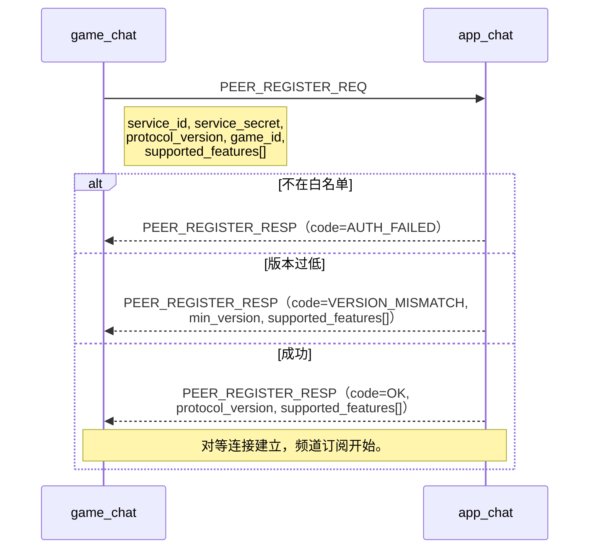
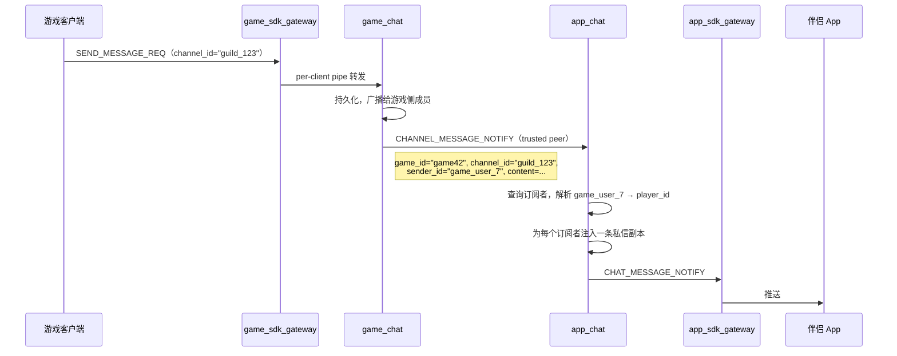
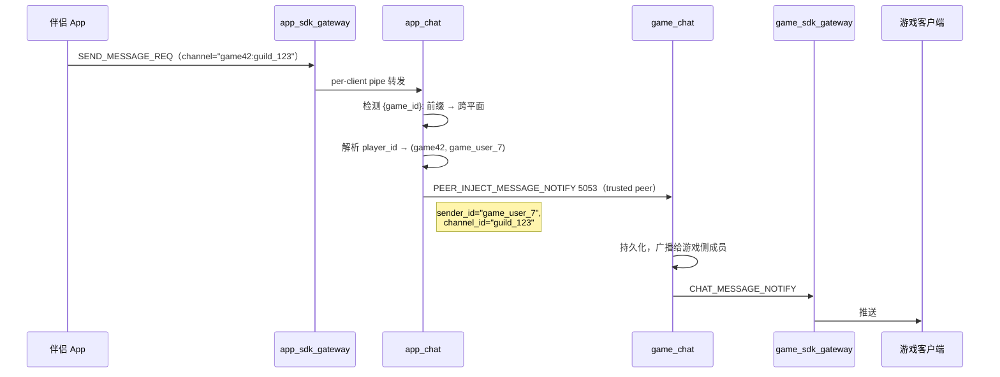
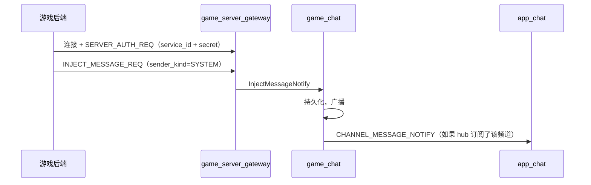

> 🌐 Language: **中文** (this page) | [English](../architecture.md)

# Chirp 整体架构

最后审查：2026-10-19

Chirp 是面向游戏的实时通信后端。游戏平面和 App 平面是两套独立系统，各自有独立的边缘和独立的 chat 服务。跨平面通信是 chat 的原生能力——两个 chirp_chat 实例直连，通过内置的注册协议、版本协商和访问控制完成接入。

## 概要

- 两个平面，两个 chat 实例。`game_chat` 服务游戏客户端；`app_chat` 服务伴侣 App。同一个二进制，不同部署。
- `app_chat` 是 hub。`game_chat` 实例通过内置的对等注册协议接入，支持白名单和版本协商。
- `game_server_gateway` 是轻量的游戏后端注入枢纽。
- 检索是独立服务 `chirp_search`（TCP 5007，SQLite FTS5）：两个网关经第二 ServiceBridge（`--search_host`）把 2248 查询转发给它（凭证复用 chat 的 service_id/secret），search 桥失败降级回 `SERVER_UNAVAILABLE` 不踢客户端；未配置 `--search_host` 时 2248 落回 chat 通配。
- 边缘（`game_sdk_gateway`、`app_sdk_gateway`）是无状态连接管理器。
- 游戏平面自足，不依赖 App 平面的任何组件。单独部署"只做游戏聊天"是一等公民。
- 两个平面的认证彼此隔离：游戏平面由游戏后端签发 token，game_chat 本地验证；App 平面由 `app_auth` 签发/验证平台用户令牌。

## 设计原则

1. 两个平面，不是一个共享核心。游戏平面面向游戏、高频、低延迟；App 平面面向玩家、低频、重聚合。
2. 同协议，同二进制。`game_chat` 和 `app_chat` 是同一个 `chirp_chat` 二进制。跨平面通信使用 chat 原生的 trusted-peer 协议，没有翻译层，也没有外部桥接进程。
3. Hub-spoke 接入模型。`app_chat` 是 hub，每个 `game_chat` 注册接入，hub 通过白名单和凭证验证控制谁能连接。
4. 边缘薄。只做连接管理、协议适配、认证转发、心跳，不持有业务状态。
5. 平面之间不互相依赖。游戏平面不依赖 App 平面的任何组件（包括认证）。跨平面接入的方向是游戏平面经注册协议连向 App 平面：`game_chat` 注册进 hub `app_chat`，反向不成立。
6. 可信平面用服务凭证，不可信边缘用用户令牌，不混用。

## 拓扑

```mermaid
flowchart TB
    subgraph game_plane["游戏平面（独立部署单元）"]
      GC1["游戏客户端 A"] -->|TCP/WS| GG1["game_sdk_gateway #1"]
      GC2["游戏客户端 B"] -->|TCP/WS| GG2["game_sdk_gateway #2"]
      GG1 -->|per-client pipe| GCHAT["game_chat"]
      GG2 -->|per-client pipe| GCHAT
      GB["游戏后端"] -->|出站连接，服务凭证| SG["game_server_gateway"]
      SG -->|注入| GCHAT
      GCHAT -->|事件| SG
      GG1 & GG2 -->|LOGIN_REQ| GCHAT
      Note right of GCHAT: 本地验证 token（--token_secret）<br/>不依赖外部认证服务
    end

    subgraph app_plane["App 平面（可选附加）"]
      APP1["伴侣 App"] -->|WS/TLS| AG1["app_sdk_gateway #1"]
      APP2["伴侣 App"] -->|WS/TLS| AG2["app_sdk_gateway #2"]
      AG1 -->|per-client pipe| ACHAT["app_chat（hub）"]
      AG2 -->|per-client pipe| ACHAT
      AG1 & AG2 -->|LOGIN_REQ| APPAUTH["app_auth"]
      AG1 & AG2 -->|会话 claim| R1[("Redis")]
      ACHAT -->|推送触发| NT["app_notification"]
      APPAUTH --> R1
    end

    GCHAT -->|"PEER_REGISTER_REQ + 白名单"| ACHAT
    GCHAT -->|"频道消息"| ACHAT
    ACHAT -->|"玩家回复"| GCHAT
```

图示说明：

- 游戏平面自足。`game_sdk_gateway + game_chat` 是完整的游戏聊天部署，游戏后端签发 token，game_chat 本地验证，不依赖 `app_auth` 或任何 App 平面组件。
- App 平面是可选附加，需要伴侣 App 时才部署；`app_auth` 只服务 App 平面。
- 跨平面是 chat 原生能力。两个 chirp_chat 实例直连，使用同一套 trusted-peer 协议，注册、版本协商、白名单都内建在 chat 服务中。

## 游戏平面

| 职责 | 归属 | 说明 |
| --- | --- | --- |
| 边缘 | `game_sdk_gateway` | TCP + WS 监听，登录/登出/心跳、踢出。无状态。 |
| Chat | `game_chat` | 部署为游戏平面的 `chirp_chat`。持有游戏内频道、历史、离线队列。本地验证 token。作为 spoke 注册到 `app_chat`。 |
| 认证 | game_chat 本地 | 游戏后端签发 HS256 JWT（`--token_secret`），game_chat 本地校验。不需要外部认证服务。 |
| 会话 claim | Redis | `chirp:sess:<user>\x1F<platform>` per 边缘实例。 |
| 后端注入 | `game_server_gateway` | 可信枢纽；游戏后端以 `service_id` + secret 出站连接。只负责消息注入 + 事件下发。可选。 |

部署形态：`game_sdk_gateway + game_chat` 即为完整部署。需要游戏后端注入时加 `game_server_gateway`。chat 本身需要扩展时，换成分布式 chat 构建。

## App 平面

| 职责 | 归属 | 说明 |
| --- | --- | --- |
| 边缘 | `app_sdk_gateway` | WS 优先，可选 TLS，移动网络调优心跳。无状态。 |
| Chat | `app_chat` | 部署为 hub 的 `chirp_chat`。接受 `game_chat` 注册，聚合跨游戏频道，投递给伴侣 App。持有身份绑定、频道订阅、未读计数。 |
| 认证 | `app_auth` | 签发/验证平台用户令牌（player_id）。只服务 App 平面，与游戏平面无关。 |
| 推送 | `app_notification` | 玩家离线时推送到手机（APNs/FCM）。独立服务，因为推送有厂商限制、合并、限流等特殊运行时特征。 |

部署形态：`app_sdk_gateway + app_chat + app_auth + app_notification`。任意数量 `app_sdk_gateway` 实例，一个 `app_chat`。

## 对等注册协议

`game_chat` 启动时，通过内置的对等注册握手接入 `app_chat`。注册、访问控制、版本协商都是 chat 的原生能力。协议级字段、错误码、CLI 与实现状态详见 [Chat Peer 注册协议](api/peer_protocol.md)。

### 握手



### 注册字段

| 字段 | 方向 | 含义 |
| --- | --- | --- |
| `service_id` | game → app | 游戏标识（如 `game_42`） |
| `service_secret` | game → app | 该游戏接入的共享密钥 |
| `protocol_version` | 双向 | 整数版本号；双方协商最高共同支持版本 |
| `game_id` | game → app | 游戏命名空间；该 peer 的所有频道在 hub 中自动加 `{game_id}:` 前缀 |
| `supported_features` | 双向 | 可选能力位掩码（已读回执转发、正在输入转发、在线状态同步等） |

### 白名单与访问控制

`app_chat` 维护允许接入的对等方白名单：

| 配置项 | 默认值 | 含义 |
| --- | --- | --- |
| `--allowed_peers` | （无） | 逗号分隔的 `service_id:secret` 对。空 = 拒绝所有。 |
| `--min_peer_version` | 1 | 接受的最低 `protocol_version`。 |
| `--allow_unknown_peers` | 0 | 是否接受不在白名单中的对等方（开放注册模式）。 |

规则：
- 不在 `--allowed_peers` 中（且 `--allow_unknown_peers` 关闭）的对等方被拒绝，返回 `AUTH_FAILED`。
- `protocol_version` 低于 `--min_peer_version` 的对等方被拒绝，返回 `VERSION_MISMATCH`；响应中携带 hub 的最低版本。
- 注册成功后，对等连接在连接生命周期内有效。断线重连需重新注册。
- 同一 `service_id` 的第二次注册挤掉第一次。

### 版本协商

双方在握手时交换 `protocol_version` 和 `supported_features`。协商版本为 `min(hub_version, spoke_version)`。交集之外的能力在该会话中禁用。

| 能力位 | 含义 |
| --- | --- |
| `RELAY_READ_RECEIPTS` | hub 转发已读回执变更给 spoke |
| `RELAY_TYPING` | hub 转发正在输入指示给 spoke |
| `RELAY_PRESENCE` | hub 转发在线/离线状态给 spoke |
| `RELAY_OFFLINE_MESSAGES` | spoke 在玩家登录时推送离线消息历史给 hub |

新增能力时，递增 `protocol_version` 并添加能力位。不理解该位的旧 peer 不使用它——无破坏性变更。

## 跨平面消息流

### game_chat → app_chat：频道消息桥接



`game_chat` 把每条频道消息发给已注册的 hub peer。hub（`app_chat`）负责扇出：

1. 查询哪些玩家订阅了 `(game_id, channel_id)`。
2. 解析发送者的 `game_user_id → player_id`。
3. 为每个订阅者注入一条私信副本到 app chat，频道自动加 `{game_id}:{channel_id}` 前缀。

游戏侧不知道订阅者、扇出或玩家身份。它只是把频道消息发给 hub。

### app_chat → game_chat：玩家回复



玩家向带 `{game_id}:` 前缀的频道发消息时，`app_chat`：

1. 检测跨平面前缀。
2. 解析 `player_id → game_user_id`。
3. 将消息注入到该 `game_id` 对应的已注册 `game_chat` peer。

游戏侧收到的是普通注入——它不知道消息来自 App 玩家。(2026-09-22 已落地:`PlayerDirectory::RelayGameReply` + `ChatPeerHub::service_id_for_game` + `IdentityRegistry::ResolveGameUser`,回码 OK/SERVER_UNAVAILABLE/INVALID_PARAM,详见 server_plane.md「跨平面回复」。)

### 游戏后端注入系统消息



## 身份与命名空间

两个身份空间，一个映射点：

- **游戏平面** 使用 `game_user_id`。游戏后端签发游戏作用域的短期用户令牌，game_chat 本地验证。游戏平面不知道 `player_id` 的存在。
- **App 平面** 使用 `player_id`。`app_auth` 签发平台用户令牌。
- **映射在 `app_chat` 内部。** 游戏后端在玩家通过游戏自己的登录服务器认证后，调 `app_chat` 的 `BIND_PLAYER_IDENTITY` RPC 断言 `player_id ↔ (game_id, game_user_id)`。映射存在 `app_chat` 内部（Redis 后端）。

频道命名空间：

- `game_chat` 内部，频道是裸的：`guild_123`、`world`、`team_42`。
- `app_chat` 内部，跨平面频道带前缀：`<game_id>:guild_123`。App 本地频道（玩家间私聊、App 侧群组）不带前缀。
- 前缀由 `app_chat` 在收到已注册 `game_chat` peer 的消息时自动添加（使用注册握手中的 `game_id`）。spoke 看不到前缀。

## 凭证模型

两种凭证，不可互换：

| 种类 | 标识 | 生命周期 | 使用位置 |
| --- | --- | --- | --- |
| 服务凭证（`service_id` + secret） | 后端组件 | 长期 | `game_server_gateway` peer、`game_chat → app_chat` 注册、gateway → chat trusted pipes、gateway → search 管道（复用 chat 的 service_id/secret） |
| 用户令牌（HS256 JWT） | 单个用户会话 | 短期 | 游戏客户端 → `game_sdk_gateway`（游戏后端签发，game_chat 本地验证）、App → `app_sdk_gateway`（`app_auth` 签发） |

规则：

- 服务凭证不进客户端二进制。
- 用户令牌不进可信平面。
- 两个平面的用户令牌彼此隔离：游戏平面的 token 由游戏后端签发，App 平面的 token 由 `app_auth` 签发，两者的 secret 互不相关。
- game_chat 用 `--token_secret` 本地验证游戏用户令牌，不依赖外部服务。
- `--auth_host` 可选，且只服务 App 边缘。`game_sdk_gateway`/`app_sdk_gateway` 的 `--auth_host` 仅在非空时创建 `AuthClient`（`services/game/sdk_gateway/src/main.cc`、`services/app/sdk_gateway/src/main.cc`）。未配置时 `HandleLogin` 走 scaffold：token 即 user_id，`BindAuthenticatedSession` 后经 ServiceBridge 转给 chat——游戏平面自足，无 `app_auth` 依赖。chat 侧与 `app_auth` 的关系同理：配了 `--token_secret` 就本地 HS256 验签，不回调任何认证服务；`app_auth` 的 scaffold 回退还额外要求 `--allow_scaffold_login 1`（默认关）。纯游戏平面端到端由 `test_services.sh --smoke-game` 覆盖（gateway 不配 `--auth_host` + chat 不配 `--token_secret` 的 scaffold 路径，以及生产同构的 `--token_secret` 本地验签路径由 `--smoke-jwt` 覆盖）。

## 故障与降级

| 组件故障 | 影响范围 |
| --- | --- |
| 一个 `game_sdk_gateway` 实例 | 其当前连接断开；客户端重连到其他实例。 |
| `game_chat` | 游戏平面消息停止。App 平面继续运行（跨游戏消息停止，但 App 本地消息正常）。 |
| `game_server_gateway` | 游戏后端无法注入消息。玩家聊天不受影响。 |
| 一个 `app_sdk_gateway` 实例 | 其当前连接断开；客户端重连到其他实例。 |
| `app_chat` | App 平面消息停止。游戏平面不受影响。`game_chat` peer 检测到连接断开，带退避重试注册。 |
| `app_auth` | App 平面新登录被阻断。已有会话不受影响（JWT 本地验证）。游戏平面不受影响。 |
| `app_notification` | 离线推送停止。在线消息不受影响。 |
| `chirp_search` | 2248 查询即时降级：网关回 `SERVER_UNAVAILABLE`，不踢客户端、不动连接，下一条查询自动重拨。聊天不受影响。 |
| Redis（游戏平面） | 会话 claim 降级为单实例（无跨实例踢出）。 |
| Redis（App 平面） | `app_chat` 的身份绑定/订阅/未读数据不可用。会话 claim 降级。 |

游戏平面的任何故障都不会影响 App 平面，反之亦然（`app_chat` 故障只影响跨平面消息，不影响游戏平面本地运行）。

## 水平扩展

- **边缘**（`game_sdk_gateway`、`app_sdk_gateway`）：无状态；在负载均衡器后扩展。跨实例踢出通过 Redis claim。
- **`app_auth`**：无状态；在负载均衡器后扩展。
- **`game_server_gateway`**：每个游戏后端集成一个。
- **Chat**：单写入者设计。需要扩展 chat 本身时，换成分布式 chat 构建。
- **`game_chat` 到 `app_chat` 连接**：每个 `game_chat` 实例维持一条到 `app_chat` 的持久连接。多个 `game_chat` 实例各自用 `service_id` 注册；hub 同时接受所有连接。

## 仓库分层

| 层 | 路径 | 角色 |
| --- | --- | --- |
| 协议 | `proto/*.proto` | 共享信封和 msg-id 块 |
| 公共库 | `libs/common` | 日志、JWT、base64、指标 |
| 网络库 | `libs/network` | ASIO TCP/WS 会话、帧协议、Redis 客户端、trusted-peer 辅助 |
| 共享服务 | `services/shared/chat/` | 聊天服务：同一 `chirp_chat` 二进制按启动参数部署为 `game_chat` / `app_chat` / 分布式形态 |
| 检索服务 | `services/search/` | 服务端消息搜索（`chirp_search`，SQLite FTS5，2248/2249） |
| 社交服务 | `services/social/` | 好友/在线状态/黑名单（`chirp_social`，8000/8001，Experimental） |
| 语音服务 | `services/voice/` | 语音房信令（`chirp_voice`，9000/9001，Experimental） |
| 组队服务 | `services/party/` | 组队快照面（`chirp_party`，7500/7501，Experimental） |
| 游戏平面 | `services/game/` | |
| | `services/game/sdk_gateway/` | 游戏客户端边缘（`game_sdk_gateway`） |
| | `services/game/server_gateway/` | 游戏后端注入枢纽（`game_server_gateway`，可选） |
| | `services/game/npc_dialog/` | NPC 关键词规则引擎（`chirp_npc_dialog`，无监听口，server plane 客户端） |
| App 平面 | `services/app/` | |
| | `services/app/sdk_gateway/` | App 客户端边缘（`app_sdk_gateway`） |
| | `services/app/auth/` | App 平面认证（`app_auth`） |
| | `services/app/notification/` | 后台推送（`app_notification`） |
| SDK | `sdks/*` | 客户端集成 |
| 应用/工具 | `apps/*`、`tools/*` | 演示、smoke 客户端、基准测试 |
| 交付 | `docker-compose.yml`、`deploy/`、`scripts/` | 编排与验证 |

## 抽象层

上表描述代码位置；以下八层描述运行时每个单元拥有什么。术语见[术语表](glossary.md)。

### L1 — 契约与编解码

| 方面 | 位置与生命周期 |
| --- | --- |
| 实现 | 源 schema 位于 `proto/*.proto`；`Packet` 是通用信封（`proto/gateway.proto:358`），`MsgID` 划分各平面（`proto/gateway.proto:11`）。 |
| 配置 schema | Protobuf 字段 schema 就是契约；线格式不由服务旗标配置。TS/C++/C#/Java/Go/Swift 生成物作为已提交构建输入。 |
| 专属协议文件 | `proto/gateway.proto`，以及 `auth`、`chat`、`social`、`voice`、`party`、`app_notification`、`game_server_gateway` 各域协议。 |
| 文案 | API 文案落在 [API 参考](api/overview.md)；本层没有 UI 字符串。 |
| 生命周期 | 生成先于服务构建；编码后的包只存活于一次线上读写。 |

### L2 — 进程原语

| 方面 | 位置与生命周期 |
| --- | --- |
| 实现 | 日志、JWT、指标、崩溃采集、必填参数和可选文件配置 `Config`（`libs/common/config.h:10`）。 |
| 配置 schema | `RequireArg` 定义必填启动输入（`libs/common/required_arg.h:28`）；指标旗标选择可选端点（`libs/common/include/common/metrics_http_server.h:17`）。 |
| 专属协议文件 | 无；本层只在进程内。 |
| 文案 | 日志与崩溃诊断从这里产生，供运维消费。 |
| 生命周期 | 崩溃采集先于解析；指标监听器随所属服务停止（`libs/common/crash_handler.h:33`）。 |

### L3 — 连接与分布式传输

| 方面 | 位置与生命周期 |
| --- | --- |
| 实现 | TCP/WebSocket 服务端、会话、帧、Redis 客户端/pub-sub、会话认领与可信 peer 辅助（`libs/network/tcp_server.h:14`、`libs/network/websocket_server.h:13`）。 |
| 配置 schema | 监听 host/port 与回调由构造函数注入；Redis host/port/TTL 是服务旗标，交给 `RedisSessionManager`（`libs/network/redis_session_manager.h:26`）。 |
| 专属协议文件 | 消费 `gateway.proto`；聊天 peer 注册新增 5050–5053 消息块。 |
| 文案 | 无终端用户文案；失败文本是运维日志。 |
| 生命周期 | 监听器先于 `io_context::run` 启动；Redis 认领向旧 owner 发布踢出并独立过期（`libs/network/redis_session_manager.h:26`）。 |

### L4 — 客户端接入与平台控制

| 方面 | 位置与生命周期 |
| --- | --- |
| 实现 | `game_sdk_gateway`、`app_sdk_gateway`、增强 auth 和推送通知。游戏边缘入口是 `services/game/sdk_gateway/src/main.cc:375`；通知入口是 `services/app/notification/src/main.cc:86`。 |
| 配置 schema | 边缘/auth/通知旗标配置监听器、认证后端、提供商密钥、TLS、设备持久化和密钥；通知持久化可选（`services/app/notification/src/device_store.h:36`）。 |
| 专属协议文件 | `auth.proto`、`app_notification.proto`、`gateway.proto`。 |
| 文案 | 服务端只有日志和协议错误码；客户端文案保留在各自 App 层。 |
| 生命周期 | 边缘绑定 TCP/WS、认证、绑定或认领本地会话，然后桥接或分发；App auth 必须有签名密钥才启动（`services/game/sdk_gateway/src/main.cc:375`）。 |

### L5 — Chat 业务核心

| 方面 | 位置与生命周期 |
| --- | --- |
| 实现 | enhanced/distributed chat 负责投递、历史、群组、治理、peer 注册与玩家目录（`services/shared/chat/src/main_enhanced.cc:1152`）。 |
| 配置 schema | `MessageStoreConfig` 集中 Redis、MySQL、迁移、投递、历史和 ACK 上限（`services/shared/chat/src/message_store_config.h:10`）；`PlayerDirectory::Options` 增加 Redis 注册表与扇出上限（`services/shared/chat/src/player_directory.h:52`）。 |
| 专属协议文件 | `chat.proto`，加 `game_server_gateway.proto` 和 `gateway.proto` 的 peer 注册块。 |
| 文案 | 功能行为落在[服务器平面](server_plane.md)与专题设计；错误用协议码表达。 |
| 生命周期 | 存储先于监听器初始化；迁移、投递、保留与过期 worker 运行在 chat `io_context`，关闭时按依赖反向停止（`services/shared/chat/src/main_enhanced.cc:1152`）。 |

### L6 — 可信服务集成

| 方面 | 位置与生命周期 |
| --- | --- |
| 实现 | `game_server_gateway` 接受已认证服务并桥接注入/事件（`services/game/server_gateway/src/main.cc:326`）；NPC 对话消费注入事件并回复。 |
| 配置 schema | Hub 旗标定义 `service_id` 密钥、心跳/超时、Redis Stream、group、consumer 和认领节奏（`services/game/server_gateway/src/stream_broker.h:75`）；NPC 规则用 TSV 加兜底回复（`services/game/npc_dialog/src/npc_engine.h:40`）。 |
| 专属协议文件 | 专属契约：`proto/game_server_gateway.proto`。 |
| 文案 | 服务平面行为见[服务器平面](server_plane.md)与 NPC 设计。 |
| 生命周期 | 服务 peer 先认证，接收服务端分配心跳；每个 `service_id` 只保留一条连接，旧连接被替换（`services/game/server_gateway/src/service_registry.h:28`）。 |

### L7 — 外围领域服务

| 方面 | 位置与生命周期 |
| --- | --- |
| 实现 | search、social、party、voice 暴露独立监听器与可选 Redis 持久化。入口分别是 `services/search/src/main.cc:32`、`services/social/src/main.cc:1370`、`services/party/src/main.cc:1323`、`services/voice/src/main.cc:1154`。 |
| 配置 schema | search 强依赖 MySQL 并选择 SQLite 路径；social/party 用可选 Redis；voice 用 token secret、TURN URI/secret 和心跳超时。状态形状见术语表中 `MessageSearchIndex`、`SocialState`、`PartyState`、`VoiceState`。 |
| 专属协议文件 | 专属 `social.proto`、`party.proto`、`voice.proto`；search 使用 chat 搜索消息。 |
| 文案 | 领域状态与降级见本文和 [API 参考](api/overview.md)。 |
| 生命周期 | 每个服务先恢复可选 Redis 状态再监听，随后启动 TCP/WS 和可选指标，关闭时先停监听器再 `io.stop()`（`services/social/src/main.cc:1370`）。 |

### L8 — 客户端集成面

| 方面 | 位置与生命周期 |
| --- | --- |
| 实现 | C++ 核心与引擎适配、TypeScript/Kotlin/C# 客户端、Go 服务客户端、companion web/desktop/iOS/Android/Harmony 服务图，以及 Unreal 游戏线程门面。代表构造点：`sdks/ts/src/chirp_client.ts:66`、`sdks/go/client.go:141`、`apps/desktop/src/api/services.ts:72`。 |
| 配置 schema | 共享客户端配置 URL、心跳、未收到 pong 上限、请求超时与重连退避；App 图解析 Vite URL、本地 host 输入、平台偏好或反代路径（`apps/web_companion/src/api/services.ts:111`）。 |
| 专属协议文件 | 消费 L1 绑定；服务端不为客户端新增私有线上字段。 |
| 文案 | UI 字符串随各客户端（例如 Android/Harmony 资源）；传输状态语义由 SDK API 共享。 |
| 生命周期 | 服务图连接、登录、启动订阅、让可选平面各自降级，退出时断开自有连接（`apps/desktop/src/App.tsx:46`）。 |

### 拆分理由

1. 契约与编解码单独成层，因为所有平面共用同一 `Packet`（`proto/gateway.proto:358`）和长度前缀线格式（`libs/network/protobuf_framing.h:12`）。
2. 进程关注点与 I/O 分开，因为崩溃采集、必填密钥、指标和可选文件配置各有独立构造点（`libs/common/crash_handler.h:33`、`libs/common/required_arg.h:28`、`libs/common/include/common/metrics_http_server.h:17`、`libs/common/config.h:10`）。
3. 传输与业务状态分开，因为 `TcpServer`、`WebSocketServer` 和 `Session` 只暴露回调，不含聊天语义（`libs/network/tcp_server.h:14`、`libs/network/websocket_server.h:13`、`libs/network/session.h:7`）。
4. 接入与领域状态分开，因为网关经 `ServiceBridge` 转发 2xxx 包，业务行为留在后端（`libs/network/service_bridge.h:54`）。
5. Chat 单独成核心，因为它的存储 schema 和投递 worker 不是通用传输关注点（`services/shared/chat/src/message_store_config.h:10`、`services/shared/chat/src/message_delivery_tracker.h:18`）。
6. 服务集成与客户端边缘分开，因为它认证 `service_id` peer、分配心跳并替换被顶 peer（`services/game/server_gateway/src/service_registry.h:28`）。
7. 外围领域分开，因为 social、party、voice、search 有专属监听器、协议族、存储选择和可选降级（`services/social/src/main.cc:1370`、`services/party/src/main.cc:1323`、`services/voice/src/main.cc:1154`、`services/search/src/main.cc:32`）。
8. 客户端集成单独成层，因为协议状态机共享，而传输、配置发现和持久设备身份随平台变化（`sdks/ts/src/chirp_client.ts:66`、`apps/web_companion/src/api/services.ts:111`、`apps/ios/Sources/ChirpAppCore/HostConfig.swift:10`）。

## 协议基线

所有边缘和可信 peer 使用相同的帧格式：

```
TCP 流:    [uint32_be payload_size][chirp.gateway.Packet protobuf bytes]
WebSocket: binary frame payload = [uint32_be payload_size][chirp.gateway.Packet protobuf bytes]
```

`chirp.gateway.Packet` 携带 `msg_id`、`sequence`、`body`、`request_id`（分布式关联 id；0 = 未提供，收发两侧按连接内单调值兜底，转发链路原样透传，见 [API 总览](api/overview.md)）。消息 ID 块：

| 块 | 平面 | 用途 |
| --- | --- | --- |
| 1xxx | 双方 | 认证 / 会话 / 心跳 |
| 2xxx | 双方 | 聊天/检索（客户端 ↔ chat/search 业务消息；2248/2249 归 search，其余归 chat） |
| 3xxx | 游戏 | 社交 |
| 4xxx | 游戏 | 语音 |
| 5xxx | 可信 | 服务平面（`game_server_gateway`、chat 对等注册） |
| 6xxx | App | 设备 / 通知 |
| 7xxx | 游戏 | 组队（party） |

### 对等注册新增 msg-id

| ID | 消息 | 方向 |
| --- | --- | --- |
| 5050 | `PEER_REGISTER_REQ` | spoke → hub（spoke 发起注册） |
| 5051 | `PEER_REGISTER_RESP` | hub → spoke（含 hub 分配的心跳周期 `heartbeat_interval_seconds`，spoke 静默约 2× 周期即被剔除） |
| 5052 | `CHANNEL_MESSAGE_NOTIFY` | spoke → hub（频道消息上行，hub 扇出） |
| 5053 | `PEER_INJECT_MESSAGE_NOTIFY` | hub → spoke（玩家回复注入；命名带 `PEER_` 前缀，与 server_gateway 链路的 5007 `INJECT_MESSAGE_NOTIFY` 区分） |

字段表、错误码表、能力位协商与 CLI 详见 [Chat Peer 注册协议](api/peer_protocol.md)。

## 架构承诺

- 游戏平面和 App 平面是独立部署单元。游戏平面可以独立运行，不依赖 App 平面的任何组件。
- 跨平面通信是 chat 的原生能力，不是外部桥接进程。
- Hub（`app_chat`）通过白名单和版本协商控制接入。
- 两个平面的认证彼此隔离：游戏平面由游戏后端负责，App 平面由 `app_auth` 负责。
- 玩家身份和游戏身份不混用。映射存在 `app_chat` 内部。
- 边缘不持有业务状态。Chat 不持有跨平面状态。
