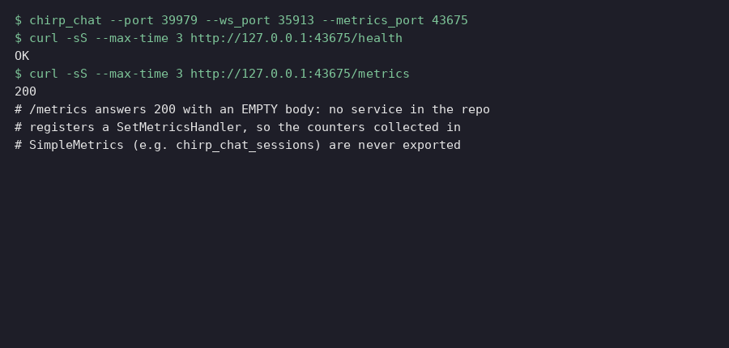

> 🌐 Language: **中文** (this page) | [English](../../guide/config-effects.md)

# 配置开关效果

切换后会改变应用行为的开关，逐个给出 off→on 证据：开关控件本身的前后对比 + 两态交替播放的
GIF。本页全部产物由脚本再生——不要手工修改图片。

## 再生成

```bash
# 前置：apps/desktop/dev/stack-up.sh 全栈在线
node apps/desktop/dev/capture-switch-effects.mjs         # 桌面端开关
node apps/web_companion/scripts/capture-switch-effects.mjs   # web 端开关
python3 scripts/capture_cli_switch_effects.py           # 服务端 CLI 旗标
```

产物落 `docs/screenshots/switches/`。三条脚本都断言开关真的变了状态（桌面端：按钮
variant 在 contained↔outlined 间翻转；web 端：开关 input 的 `checked` 属性翻转；
CLI：端口从拒绝连接变成应答 `/health`），没变就直接报错。

CLI 帧的口径说明：本机没有 `xterm` / `asciinema`，录不了真终端录屏。帧是把两次真实
运行的实测输出渲染成终端样式再用 ffmpeg 缝合——帧里每一行都是实际拿回来的文本
（`curl` 的报错串也是实测的）。

## 桌面端开关（已覆盖）

### 桌面通知（`通知`）

首次开启时向系统/浏览器请求通知权限；开启后，不在屏幕上的新消息发系统通知。

| 关 | 开 |
| --- | --- |
|  |  |


采集说明：无头 Chromium 会把 Notification 权限硬判 denied，采集桩与单测同款打了桩。
GIF 取证的是控件 UI 状态翻转；真实桌面壳里的权限申请走 Tauri 通知插件。

### 好友上线通知（`上线通知`）

好友上线时弹 toast（social 平面）。

| 关 | 开 |
| --- | --- |
|  |  |


### 私聊限制（`私聊限制`）

开启后仅好友/同群成员可私信我（服务端强制）。

| 关 | 开 |
| --- | --- |
|  |  |


## Web 端开关（已覆盖）

web 端跑同一套 dev 栈；它的采集管线自己起一个 vite server（3001），把 `/ws/*` 代理
重定向到该栈的端口（`vite.config.ts` 里写的 7001 之类是产品默认端口，不是 dev 栈端口）。

### 桌面通知（`开启桌面通知`）

不是开关控件：点左栏文案后向浏览器申请权限，成功即被替换成 `桌面通知已开启`。
off/on 就是这次文案变化。

| 关 | 开 |
| --- | --- |
|  |  |


### 好友上线通知（`好友` 弹窗）

好友上线时弹 toast。

| 关 | 开 |
| --- | --- |
|  |  |


### 私聊限制（`好友` 弹窗）

仅好友/同群成员可私信我。

| 关 | 开 |
| --- | --- |
|  |  |


### 游戏在线状态（`在线设备` 弹窗）

开启后好友可见你正在玩的游戏，好友私聊消息也同步投递进游戏内。

| 关 | 开 |
| --- | --- |
|  |  |


## 服务端 CLI 旗标（已覆盖）

### `--metrics_port <port>`（`chirp_chat` 等长驻服务）

缺省 `0`＝完全不监听；给了端口后 `libs/common` 的 `MetricsHttpServer` 在该端口起来。
关＝该端口拒绝连接，开＝`GET /health` 应答 `OK`、`GET /metrics` 应答 `200`。

| 关 | 开 |
| --- | --- |
|  |  |


**实测出的一个真行为**：`/metrics` 的正文是**空的**。仓内没有任何服务调用
`SetMetricsHandler`（只有 `tests/unit/common_metrics_test.cc` 调过），所以收集进
`SimpleMetrics` 的计数器（例如 `services/shared/chat/src/enhanced_dispatch.cc` 里的
`CHIRP_GAUGE_INC("chirp_chat_sessions")`）根本没被导出——收是收了，但没发出去。

## 尚未覆盖

- `--push_transport logging|http` 与 `--apns-*` / `--fcm-*`——证明真投递需要一个把
  `chirp_app_notification` 也接进栈的 dev 栈（gateway 侧还要配
  `--notification_host/--notification_port/--notification_secret`，桌面 dev 栈压根没起
  这个服务），外加 FCM/APNs 凭据才有真实出向。接线手册见
  [deployment.md](../../guide/deployment.md) 的出向推送段。
- 限流 / TTL 类旋钮，以及编译期或仅测试用的开关——它们改的是吞吐或上限，不是某个
  界面上或端点上能直接看见的东西，off/on 截图证不了效果。
