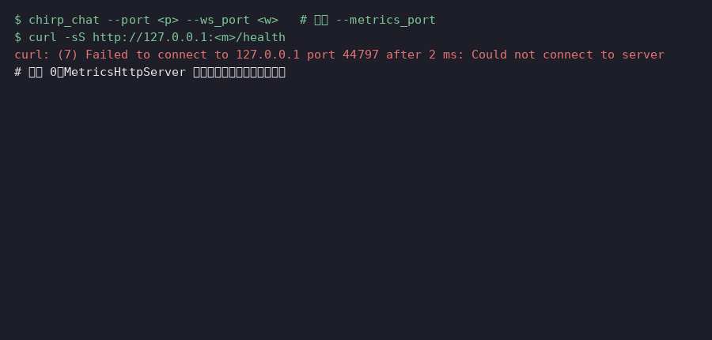
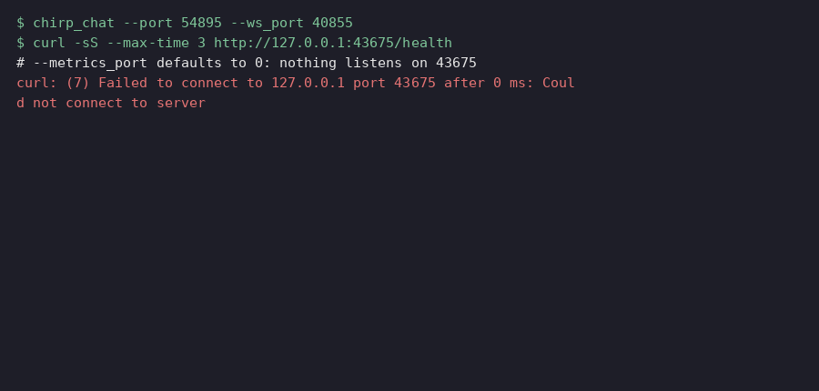
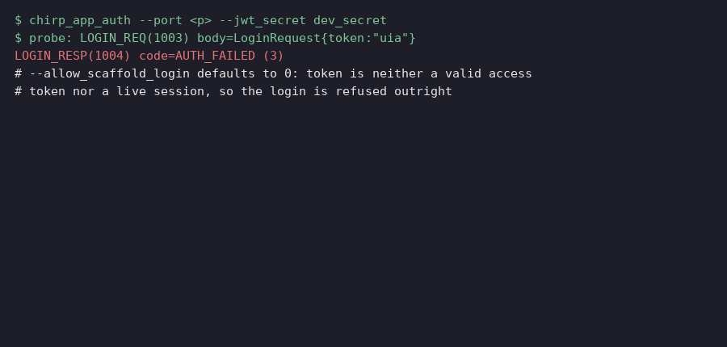
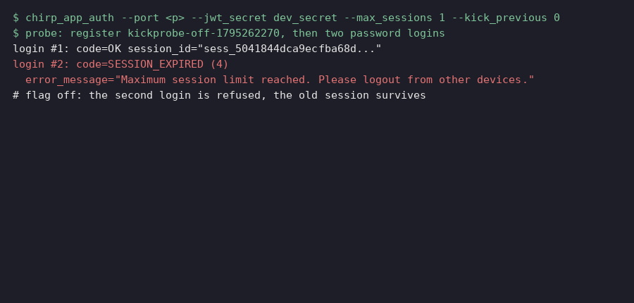
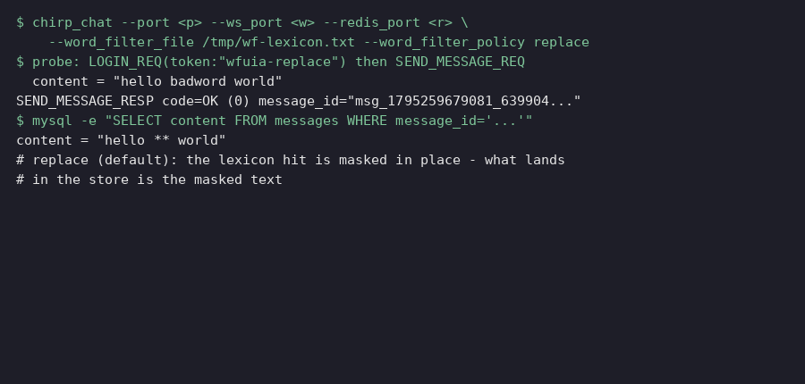
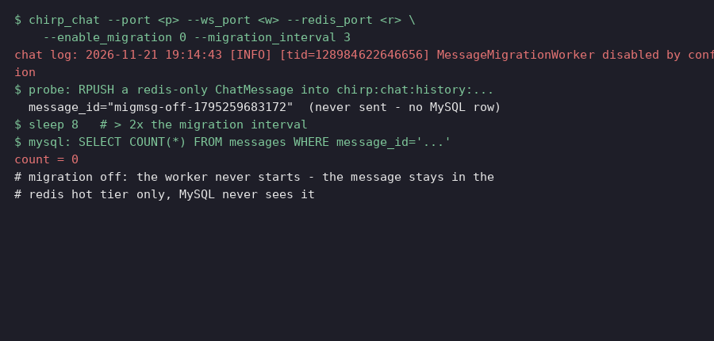
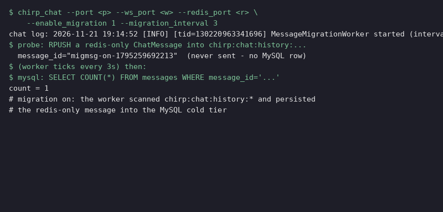

> 🌐 Language: **中文** (this page) | [English](../../guide/config-effects.md)

# 配置开关效果

切换后会改变应用行为的开关，逐个给出 off→on 证据：开关控件本身的前后对比 + 两态交替播放的
GIF。本页全部产物由脚本再生——不要手工修改图片。

## 再生成

```bash
# 前置：apps/desktop/dev/stack-up.sh 全栈在线
node apps/desktop/dev/capture-switch-effects.mjs         # 桌面端开关
node apps/web_companion/scripts/capture-switch-effects.mjs   # web 端开关
python3 scripts/capture_cli_switch_effects.py           # 服务端 CLI 旗标
python3 scripts/build_config_switch_inventory.py --write   # 刷新开关清单表
```

产物落 `docs/screenshots/switches/`。三条脚本都断言开关真的变了状态（桌面端：按钮
variant 在 contained↔outlined 间翻转；web 端：开关 input 的 `checked` 属性翻转；
CLI：端口从拒绝连接变成应答 `/health`，脚手架探针的 `LOGIN_RESP` code 从 `AUTH_FAILED`
翻成 `OK` 且回填 `user_id`，密码登录探针的第 2 次登录从 `SESSION_EXPIRED` 被拒翻成
`OK` 且 `kick_previous=true`），没变就直接报错。

CLI 帧的口径说明：本机没有 `xterm` / `asciinema`，录不了真终端录屏。帧是把两次真实
运行的实测输出渲染成终端样式再用 ffmpeg 缝合——帧里每一行都是实际拿回来的文本
（`curl` 的报错串也是实测的）。

## 桌面端开关（已覆盖）

### 桌面通知（`通知`）

首次开启时向系统/浏览器请求通知权限；开启后，不在屏幕上的新消息发系统通知。

| 关 | 开 |
| --- | --- |
|  |  |


采集说明：无头 Chromium 会把 Notification 权限硬判 denied，采集桩与单测同款打了桩。
GIF 取证的是控件 UI 状态翻转；真实桌面壳里的权限申请走 Tauri 通知插件。

### 好友上线通知（`上线通知`）

好友上线时弹 toast（social 平面）。

| 关 | 开 |
| --- | --- |
|  |  |


### 私聊限制（`私聊限制`）

开启后仅好友/同群成员可私信我（服务端强制）。

| 关 | 开 |
| --- | --- |
|  |  |


## Web 端开关（已覆盖）

web 端跑同一套 dev 栈；它的采集管线自己起一个 vite server（3001），把 `/ws/*` 代理
重定向到该栈的端口（`vite.config.ts` 里写的 7001 之类是产品默认端口，不是 dev 栈端口）。

### 桌面通知（`开启桌面通知`）

不是开关控件：点左栏文案后向浏览器申请权限，成功即被替换成 `桌面通知已开启`。
off/on 就是这次文案变化。

| 关 | 开 |
| --- | --- |
|  |  |


### 好友上线通知（`好友` 弹窗）

好友上线时弹 toast。

| 关 | 开 |
| --- | --- |
|  |  |


### 私聊限制（`好友` 弹窗）

仅好友/同群成员可私信我。

| 关 | 开 |
| --- | --- |
|  |  |


### 游戏在线状态（`在线设备` 弹窗）

开启后好友可见你正在玩的游戏，好友私聊消息也同步投递进游戏内。

| 关 | 开 |
| --- | --- |
|  |  |


## 服务端 CLI 旗标（已覆盖）

### `--metrics_port <port>`（`chirp_chat` 等长驻服务）

缺省 `0`＝完全不监听；给了端口后 `libs/common` 的 `MetricsHttpServer` 在该端口起来。
关＝该端口拒绝连接，开＝`GET /health` 应答 `OK`、`GET /metrics` 应答 `200`。

| 关 | 开 |
| --- | --- |
|  |  |



**实测出的一个真行为**：`/metrics` 的正文是**空的**。仓内没有任何服务调用
`SetMetricsHandler`（只有 `tests/unit/common_metrics_test.cc` 调过），所以收集进
`SimpleMetrics` 的计数器（例如 `services/shared/chat/src/enhanced_dispatch.cc` 里的
`CHIRP_GAUGE_INC("chirp_chat_sessions")`）根本没被导出——收是收了，但没发出去。

### `--allow_scaffold_login <0|1>`（`chirp_app_auth`）

缺省 `0`。给 `1` 后，`LOGIN_REQ` 里既不是有效 access token 也不是活跃 session 的
token 会回退成 *token 即 user_id*——桌面 dev 栈正是靠这个脚手架登录跑起来的。
`0`（缺省）则直接拒绝这种登录，不再把任意 token 当 user id 用。

| 关 | 开 |
| --- | --- |
|  |  |


取证手法：两个 `chirp_app_auth` 实例各占一个全新端口——一个缺省、一个带旗标——
用裸 TCP 发 `LOGIN_REQ`、body 为 `LoginRequest{token:"uia"}` 探测，帧格式与
`scripts/demo_account.py` 相同（`libs/network/protobuf_framing.h` 的 u32be 长度前缀）。
关＝应答 `code=AUTH_FAILED (3)` 且无 `session_id`/`user_id`；开＝应答 `code=OK (0)`、
`session_id="uia_sess"`、`user_id="uia"`。

### `--kick_previous <0|1>`（`chirp_app_auth`）

缺省 `1`。**只在密码登录路径被消费，且只在账号撞上会话上限（`--max_sessions`，
缺省 5）时才分叉**：给 `1` 则撤销该账号旧会话并让新登录成功，响应带
`kick_previous=true`；给 `0` 则这次登录被拒，回 `SESSION_EXPIRED`。

| 关 | 开 |
| --- | --- |
|  |  |



取证手法：在本机 `chirp` MySQL 库里注册一次性账号（不外借凭据），带
`--max_sessions 1`，让这个账号的第 2 次登录撞上限。关＝应答
`code=SESSION_EXPIRED (4)`、`error_message="Maximum session limit reached..."`
且不带 kick 标记；开＝应答 `code=OK (0)`、`session_id` 与第 1 次不同、
`kick_previous=true`。探针账号在跑完后从用户表/会话表/刷新令牌表删干净。

注意：老的 `LOGIN_REQ` 脚手架路径**无论该旗标如何**都固定应答 `kick_previous=true`
（`services/app/auth/src/main_enhanced.cc`），所以这个开关只改变密码登录的行为。

### `--word_filter_policy <replace|reject|record>`（`chirp_chat`）

缺省 `replace`。词源是 `WordFilterPolicyFromString`
（`services/shared/chat/src/word_filter.cc`），**只认这三个串**，写错任何其它值都
回落 `replace`。控制的是「含敏感词的消息怎么处置」：

- `replace`（缺省）：命中被原位掩码（默认替换串 `**`），掩码后的内容照常落库。
- `reject`：整条消息在进库前被拒，应答 `code=WORD_FILTERED (10)`，什么都不落。
- `record`：内容**原样**落库，命中只进服务端 Warn 日志（`word filter recorded a hit
  from <sender> (N term hit(s))`）留待审阅。

| replace | reject | record |
| --- | --- | --- |
|  |  |  |



取证手法：写一个只含 `badword` 的词表文件，三种策略各起一个带
`--word_filter_file <词表> --word_filter_policy <策略>` 的 `chirp_chat`（各自全新端口、
自起的探针 redis，不碰共享 dev 栈），脚手架登录（`--token_secret` 缺省空＝token 即
user id）后发同一条私信 `content="hello badword world"`，读 `SEND_MESSAGE_RESP` 的
code，再回读 `messages` 表落库内容：replace→`hello ** world`、reject→零行、
record→`hello badword world`（原样）。探针用户 `wfuia-*` 与自起 redis 在跑完后清干净。

### `--enable_migration <0|1>`（`chirp_chat` 增强版）

缺省 `1`。控制「redis 热层 → MySQL 冷层」后台迁移 worker：给 `1` 则
`MessageMigrationWorker` 启动，每 `--migration_interval` 秒（缺省 30）扫一遍
`chirp:chat:history:*` 与 `chirp:chat:offline:*`，逐条解析后 INSERT 进
`messages` 表；给 `0` 则 worker 根本不启动（启动日志
`MessageMigrationWorker disabled by configuration`），只存在 redis 热层的东西就
留在那里。

| 关 | 开 |
| --- | --- |
|  |  |


取证手法：不需要带数据的旧库——worker 的输入态就是「一条只存在于 redis 热层的
ChatMessage」，探针直接手工种一条。两种变体各起独立 redis + 独立 `chirp_chat`
（`--migration_interval 3` 让 worker 快走），探针用 `redis-cli -x RPUSH` 把一条
序列化的 `ChatMessage`（字段布局与 store 写入的一致，键含
`PrivateChannelId` 的 `a|b` 排序拼接）推进 `chirp:chat:history:<channel>`——
这条消息从没走过 `SendMessage`，除了迁移 worker 没有任何路径能把它落库。
关：等过两个 interval 后该 message_id 在 `messages` 表仍 0 行，日志是 worker
未启动；开：一个 interval 内行数变 1，日志是 worker 已启动。探针用户 `miguia-*`
与两个自起 redis 在跑完后清干净。

### `--hub_mode <0|1>`（`chirp_chat`）

缺省 `0`。给 `1` 则 chirp_chat 在 `--hub_peer_port`（缺省 8200）开出
game-chat peer 接入器，日志 `hub mode enabled: peer_port=<port>`；缺省 `0`
则根本没有这个监听器，chat 只在主端口服务客户端协议。这是 hub+spoke 拓扑里
的 hub 半边。

| 关 | 开 |
| --- | --- |
|  |  |


取证手法：不需要真 spoke——探针自己说 peer 注册协议。两个 `chirp_chat`（各自独立
探针 redis）：一个不带 `--hub_mode`，一个带
`--hub_mode 1 --hub_peer_port <端口> --allowed_peers peuhub:peusecret`。探针连到
peer 端口发 `PEER_REGISTER_REQ`（`gateway.proto`，msg 5050，与客户端同款的
u32be+Packet 帧），`service_id=peuhub, service_secret=peusecret,
protocol_version=1, game_id=peuigame`。关：连接被拒（该端口从未绑定），日志里也
没有 `hub mode enabled`；开：应答 `code=OK (0)` 带 `heartbeat_interval_seconds`，
日志 `chat peer registered: peuhub game=peuigame version=1`
（`libs/network/chat_peer_hub.cc`）。注册只存内存，跑完没有残留要清。

### `--allow_unknown_peers <0|1>`（`chirp_chat`）

缺省 `0`。**只在 `--hub_mode 1` 时被消费**。管的是 peer 注册闸门：缺省 `0` 时，
`service_id` 不在 `--allowed_peers` 里的 peer 被拒（`code=AUTH_FAILED (3)`、连接
关闭、Warn 日志 `chat peer registration rejected (not whitelisted): <id>`）；给 `1`
则同一个 peer 走开放注册被放行（`code=OK (0)`）。

| 关 | 开 |
| --- | --- |
|  |  |


取证手法：两个 `chirp_chat`，都 `--hub_mode 1`、各占全新 peer 端口、各起独立探针
redis，**都不给 `--allowed_peers`**（白名单为空）；一个 `--allow_unknown_peers 0`、
一个 `1`。探针用同一个未知 `service_id`（`peu-off`/`peu-on`、`protocol_version=1`、
`game_id=peuigame`）发同样的 `PEER_REGISTER_REQ`。关：应答 `code=AUTH_FAILED (3)`
带 `min_version=1` 与那条 Warn 日志；开：应答 `code=OK (0)` 带
`heartbeat_interval_seconds`，日志 `chat peer registered: <id> game=peuigame
version=1`。

## 开关清单

由 `scripts/build_config_switch_inventory.py` 生成并回源码核对（每一行都会重读其源码文件，
旗标消失或缺省值漂移就报错退出，所以这张表不会悄悄过期）。口径：**离散**开关——开启后会改变
应用行为的 GUI 开关控件，加上取值是离散枚举（`on`/`off`、`0`/`1`、`logging|http`、
`replace|reject|record`）的服务端 CLI 旗标。明确排除在表外：数值调优旋钮（限流、TTL、上限、超时、
重试次数）、连接端点（host/port）、凭据类（secret/token/password/key）、编译期与仅测试用的开关。

<!-- switch-inventory:begin -->
| 开关 | 所在服务/面 | 缺省 | 覆盖情况 |
|---|---|---|---|
| `desktop-notify` | 桌面端 | — | ✅ 有 off/on 图+GIF |
| `friend-online-notify` | 桌面端 | — | ✅ 有 off/on 图+GIF |
| `dm-restriction` | 桌面端 | — | ✅ 有 off/on 图+GIF |
| `notify-enable` | web 端 | — | ✅ 有 off/on 图+GIF |
| `friend-online-notify-switch` | web 端 | — | ✅ 有 off/on 图+GIF |
| `dm-restriction-switch` | web 端 | — | ✅ 有 off/on 图+GIF |
| `game-presence-toggle` | web 端 | — | ✅ 有 off/on 图+GIF |
| `metrics_port` | chirp_chat 等 10 个长驻服务 | 0 | ✅ 有 off/on 图+GIF |
| `allow_unknown_peers` | chirp_chat | 0 | ✅ 有 off/on 图+GIF |
| `hub_mode` | chirp_chat | 0 | ✅ 有 off/on 图+GIF |
| `enable_migration` | chirp_chat（增强版） | 1 | ✅ 有 off/on 图+GIF |
| `broker_consumer` | chirp_server_gateway | (空=关) | 未覆盖：要自建服务实例/双实例对照（需要 broker 流 + 双消费实例） |
| `kick_previous` | chirp_app_auth | 1 | ✅ 有 off/on 图+GIF |
| `allow_scaffold_login` | chirp_app_auth | 0 | ✅ 有 off/on 图+GIF |
| `word_filter_policy` | chirp_chat | replace | ✅ 有 3 态图+GIF（replace/reject/record） |
| `asr_disposition` | chirp_voice | flag | 未覆盖：要 ASR 引擎（整条 ASR 链要 ASR 引擎与 --asr_lexicon 才在位） |
| `push_transport` | chirp_app_notification | logging | 未覆盖：要 FCM/APNs 凭据（dev 栈没起这个服务；真投递又卡在 FCM/APNs 凭据） |
| `push_verify_tls` | chirp_app_notification | on | 未覆盖：要 FCM/APNs 凭据（同上，要有一次真实推送出向） |
| `apns-sandbox` | chirp_app_notification | (不传=生产端点) | 未覆盖：要 FCM/APNs 凭据（台账 L25：缺 .p8 / Team ID / Key ID / Bundle ID） |

<!-- switch-inventory:end -->
## 尚未覆盖

- `--push_transport logging|http` 与 `--apns-*` / `--fcm-*`——证明真投递需要一个把
  `chirp_app_notification` 也接进栈的 dev 栈（gateway 侧还要配
  `--notification_host/--notification_port/--notification_secret`，桌面 dev 栈压根没起
  这个服务），外加 FCM/APNs 凭据才有真实出向。接线手册见
  [deployment.md](../../guide/deployment.md) 的出向推送段。
- 限流 / TTL 类旋钮，以及编译期或仅测试用的开关——它们改的是吞吐或上限，不是某个
  界面上或端点上能直接看见的东西，off/on 截图证不了效果。
